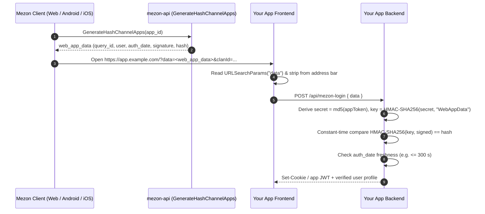

import Tabs from "@theme/Tabs";
import TabItem from "@theme/TabItem";

# Verifying launch data

When a member clicks **Launch App** in Mezon (Web, Android, or iOS), Mezon calls `GenerateHashChannelApps` to sign the member's identity with your app's **Token** and opens your URL with `?data=...`. Your backend must verify the HMAC-SHA256 signature before creating a session.

:::danger Never verify `data` in the browser
Verification requires your app's secret **Token**. Keep the token strictly on your server; never ship it in frontend JavaScript or mobile bundles.
:::

## Authentication sequence



## Structure of `data`

After decoding the `data` query parameter once (as `URLSearchParams.get("data")` does), you receive five ordered parameters (`api_channel_app.go`):

```text
query_id=AbCdEfGhIjKlMnOpQrStUvWx&user=%7B%22id%22%3A1234567890123456789%2C...%7D&auth_date=1795083705&signature=ZGM5...%3D%3D&hash=e30db1ab...
```

| Parameter | Description |
|---|---|
| `query_id` | Random 24-character alphanumeric identifier generated per launch. |
| `user` | URL-encoded JSON object containing the launching member's profile. |
| `auth_date` | Unix timestamp (seconds) when `mezon-api` signed the payload. |
| `signature` | Secondary Base64 signature over `auth_date` derived with `"WebAppSignature"`. Covered inside `hash`; you do not need to verify it separately. |
| `hash` | 64 lowercase hexadecimal characters: the HMAC-SHA256 signature over the exact substring preceding `&hash=`. |

Example decoded `user` JSON:

```json
{
  "id": 1234567890123456789,
  "username": "mai.nguyen",
  "display_name": "Mai Nguyen",
  "avatar_url": "https://example.com/avatar.png"
}
```

:::warning 64-bit Snowflake ID precision in JavaScript
`user.id` is serialized as a 64-bit JSON number (up to 19 digits). Standard JavaScript `JSON.parse()` silently rounds integers above `Number.MAX_SAFE_INTEGER` (`2^53 - 1`), corrupting user IDs. Always extract `id` as a string (or parse with a BigInt-safe JSON parser), as shown in the Node.js validator below.
:::

## Exact HMAC verification algorithm

`mezon-api` computes `hash` in three deterministic steps:

1. `secret` = `md5(appToken)` formatted as **32 lowercase hexadecimal characters** (UTF-8 encoded string, **not** raw 16 bytes).
2. `key` = `HMAC-SHA256(key = secret, message = "WebAppData")` (raw 32-byte digest).
3. `expected_hash` = `HMAC-SHA256(key = key, message = signed)` formatted as **64 lowercase hexadecimal characters**, where `signed` is the exact substring of `data` before the final `&hash=`.

Then perform two mandatory checks:

- **Constant-time comparison** between `expected_hash` and `hash`.
- **Freshness check** on `auth_date`: Mezon does not expire `data` server-side. Reject payloads older than your chosen window (for example, `300` seconds) and consider rejecting negative skew too far in the future.

:::caution Do not re-encode, sort, or double-decode `data`
Hash the exact `signed` substring as received after a single URL query decode. Re-sorting query parameters or running `decodeURIComponent` a second time breaks the HMAC check.
:::

## Backend validators

<Tabs groupId="backend-lang">
<TabItem value="node" label="Node.js" default>

```js
const crypto = require("node:crypto");

function checkMezonData(data, appToken, maxAgeSeconds = 300) {
  const at = data.lastIndexOf("&hash=");
  if (at < 0) return null;

  const signed = data.slice(0, at);
  const hash = Buffer.from(data.slice(at + "&hash=".length), "utf8");

  const secret = crypto.createHash("md5").update(appToken).digest("hex");
  const key = crypto.createHmac("sha256", secret).update("WebAppData").digest();
  const expected = Buffer.from(
    crypto.createHmac("sha256", key).update(signed).digest("hex"),
    "utf8",
  );

  if (hash.length !== expected.length || !crypto.timingSafeEqual(hash, expected)) {
    return null;
  }

  const params = new URLSearchParams(signed);
  const authDate = Number(params.get("auth_date"));
  const age = Date.now() / 1000 - authDate;
  if (!Number.isFinite(authDate) || age > maxAgeSeconds || age < -60) {
    return null;
  }

  const userJson = params.get("user") ?? "";
  const user = JSON.parse(userJson);
  // Preserve 64-bit Snowflake ID without IEEE-754 float rounding
  user.id = /"id":\s*(\d+)/.exec(userJson)?.[1] ?? String(user.id);
  return user;
}

module.exports = { checkMezonData };
```

</TabItem>
<TabItem value="python" label="Python">

```python
import hashlib
import hmac
import json
import time
from urllib.parse import parse_qs


def check_mezon_data(data: str, app_token: str, max_age_seconds: int = 300) -> dict | None:
    signed, sep, received_hash = data.rpartition("&hash=")
    if not sep:
        return None

    secret = hashlib.md5(app_token.encode("utf-8")).hexdigest()
    key = hmac.new(secret.encode("utf-8"), b"WebAppData", hashlib.sha256).digest()
    expected = hmac.new(key, signed.encode("utf-8"), hashlib.sha256).hexdigest()

    if not hmac.compare_digest(expected, received_hash):
        return None

    params = parse_qs(signed, keep_blank_values=True)
    auth_date = int(params["auth_date"][0])
    age = time.time() - auth_date
    if age > max_age_seconds or age < -60:
        return None

    user = json.loads(params["user"][0])
    # Python ints have arbitrary precision; convert to str if serializing to JSON/JS
    user["id"] = str(user["id"])
    return user
```

</TabItem>
<TabItem value="go" label="Go">

```go
package main

import (
	"crypto/hmac"
	"crypto/md5"
	"crypto/sha256"
	"encoding/hex"
	"encoding/json"
	"errors"
	"net/url"
	"strconv"
	"strings"
	"time"
)

type MezonUser struct {
	ID          int64  `json:"id"`
	Username    string `json:"username"`
	DisplayName string `json:"display_name"`
	AvatarURL   string `json:"avatar_url"`
}

func CheckMezonData(data, appToken string, maxAge time.Duration) (*MezonUser, error) {
	at := strings.LastIndex(data, "&hash=")
	if at < 0 {
		return nil, errors.New("missing hash")
	}
	signed, received := data[:at], data[at+len("&hash="):]

	sum := md5.Sum([]byte(appToken))
	secret := hex.EncodeToString(sum[:])

	keyMac := hmac.New(sha256.New, []byte(secret))
	keyMac.Write([]byte("WebAppData"))

	dataMac := hmac.New(sha256.New, keyMac.Sum(nil))
	dataMac.Write([]byte(signed))
	expected := hex.EncodeToString(dataMac.Sum(nil))

	if !hmac.Equal([]byte(expected), []byte(received)) {
		return nil, errors.New("invalid hash")
	}

	params, err := url.ParseQuery(signed)
	if err != nil {
		return nil, err
	}
	authDate, err := strconv.ParseInt(params.Get("auth_date"), 10, 64)
	if err != nil {
		return nil, errors.New("invalid auth_date")
	}
	age := time.Since(time.Unix(authDate, 0))
	if age > maxAge || age < -time.Minute {
		return nil, errors.New("launch data expired")
	}

	var user MezonUser
	if err := json.Unmarshal([]byte(params.Get("user")), &user); err != nil {
		return nil, err
	}
	return &user, nil
}
```

</TabItem>
<TabItem value="csharp" label="C#">

```csharp
using System.Security.Cryptography;
using System.Text;
using System.Text.Json;
using System.Web;

public sealed record MezonUser(long Id, string Username, string DisplayName, string AvatarUrl);

public static class MezonLaunchDataVerifier
{
    public static MezonUser? Verify(string data, string appToken, TimeSpan maxAge)
    {
        var at = data.LastIndexOf("&hash=", StringComparison.Ordinal);
        if (at < 0) return null;

        var signed = data[..at];
        var received = data[(at + "&hash=".Length)..];

        var secret = Convert.ToHexString(MD5.HashData(Encoding.UTF8.GetBytes(appToken))).ToLowerInvariant();
        var key = HMACSHA256.HashData(Encoding.UTF8.GetBytes(secret), Encoding.UTF8.GetBytes("WebAppData"));
        var expected = Convert.ToHexString(HMACSHA256.HashData(key, Encoding.UTF8.GetBytes(signed))).ToLowerInvariant();

        var expectedBytes = Encoding.ASCII.GetBytes(expected);
        var receivedBytes = Encoding.ASCII.GetBytes(received);
        if (expectedBytes.Length != receivedBytes.Length ||
            !CryptographicOperations.FixedTimeEquals(expectedBytes, receivedBytes))
        {
            return null;
        }

        var query = HttpUtility.ParseQueryString(signed);
        if (!long.TryParse(query["auth_date"], out var authUnix)) return null;
        var age = DateTimeOffset.UtcNow - DateTimeOffset.FromUnixTimeSeconds(authUnix);
        if (age > maxAge || age < TimeSpan.FromMinutes(-1)) return null;

        using var doc = JsonDocument.Parse(query["user"] ?? "{}");
        var root = doc.RootElement;
        return new MezonUser(
            root.GetProperty("id").GetInt64(),
            root.TryGetProperty("username", out var u) ? u.GetString() ?? "" : "",
            root.TryGetProperty("display_name", out var d) ? d.GetString() ?? "" : "",
            root.TryGetProperty("avatar_url", out var a) ? a.GetString() ?? "" : "");
    }
}
```

</TabItem>
</Tabs>

## Forwarding `data` from the frontend

Read `data` once with `URLSearchParams`, strip it from the URL with `history.replaceState` so it does not leak via `Referer` headers or browser history, and POST it to your backend:

```html
<script>
  const data = new URLSearchParams(location.search).get("data");
  if (data) {
    history.replaceState(null, "", location.pathname);
    fetch("/api/mezon-login", {
      method: "POST",
      headers: { "Content-Type": "application/json" },
      body: JSON.stringify({ data }),
    })
      .then((res) => (res.ok ? res.json() : Promise.reject(res.status)))
      .then(({ user }) => {
        document.body.textContent = `Hello ${user.display_name || user.username}`;
      })
      .catch(() => {
        document.body.textContent = "Launch this app from Mezon to sign in.";
      });
  }
</script>
```

## Common verification pitfalls

| Symptom | Root cause & fix |
|---|---|
| `data` is `null` | The member selected the app channel inline instead of clicking **Launch App**. |
| `hash` never matches | The app token was reset or copied incorrectly, **or** `data` was double-decoded (for example calling `decodeURIComponent()` on a value already returned by `URLSearchParams.get("data")`), **or** you used raw 16-byte MD5 instead of the 32-char lowercase hex string for `secret`. |
| Last digits of `user.id` change to `00` in JS | `JSON.parse()` rounded the 64-bit Snowflake ID. Extract `id` as a string from the raw JSON text. |

## Related

- [Channel apps overview](./overview.md)
- [Express tutorial](./tutorial-express.md)
- [Error codes and troubleshooting](../../reference/error-codes-and-troubleshooting.md)
