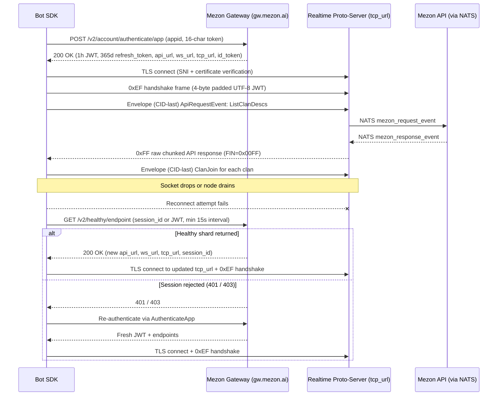

# Architecture & transport

Mezon separates **authentication and routing** from **realtime messaging** and **application RPCs**. Understanding this split explains how SDKs stay fast under high fan-out and recover transparently when backend nodes rotate.

## Service topology

| Service | Default Endpoint / Role | Protocol |
| --- | --- | --- |
| **Mezon Gateway** (`mezon-gw`) | `https://gw.mezon.ai:443` — authenticates bots/apps and returns shard endpoints (`api_url`, `ws_url`, `tcp_url`) | HTTPS REST / gRPC-gateway |
| **Realtime Proto-Server** (`mezon-proto-server`) | Persistent stateful socket server handling realtime `Envelope` events and hot-path API-over-socket calls | TLS Abridged TCP (`0xEF`) or WebSocket |
| **Mezon API** (`mezon-api`) | Core PostgreSQL-backed business RPC service reached via NATS from `mezon-proto-server` (and HTTPS) | NATS / gRPC / HTTP |
| **Voice SFU & Streaming** (`mezon-sfu`, `mezon-streaming-server`) | WebRTC voice/meeting rooms and WHIP/LL-HLS stream channels, authorized via short-lived grants | WebRTC / WHIP / LL-HLS |
| **Mezon Dong Network** (`dong.mezon.ai`) | `https://dong.mezon.ai/mmn-api/` and `https://dong.mezon.ai/zk-api/` for ZK-proven token transfers | HTTP / gRPC |

## Gateway bootstrap & failover lifecycle

Both `mezon-sdk` (Node.js) and `Mezon.Net.Sdk` (.NET) follow the same three-phase connection lifecycle:

1. **Bootstrap via Gateway** <ApiBadge method="POST" path="/v2/account/authenticate/app" /> — Exchange `(botId, token)` for a session containing a 1-hour access JWT, a 365-day refresh token, `api_url`, `ws_url`, `tcp_url`, and (for non-shadow bots) `id_token`.
2. **Open TLS Abridged TCP socket** <ApiBadge method="TCP" path="0xEF TLS Abridged" /> — Connect directly to `tcp_url` over TLS with SNI verification, send the `0xEF` JWT handshake frame, and join clan chats (`joinClanChat`).
3. **Failover via Gateway health lookup** <ApiBadge method="GET" path="/v2/healthy/endpoint" /> — When a socket reconnect fails, query `getHealthyEndpoint` (throttled to at most once every 15 seconds in `mezon-sdk`). If the gateway returns updated `tcp_url`/`api_url` endpoints, the SDK rotates the socket automatically; if it returns `401` or `403`, the SDK forces full re-authentication.

## TLS Abridged TCP wire protocol

Production bot SDKs connect to `mezon-proto-server` over **TLS Abridged TCP** rather than browser WebSockets to eliminate HTTP upgrade overhead and per-frame masking costs.

### 1. Handshake frame (`0xEF`)

Immediately after TLS `secureConnect`, the client transmits one authentication frame:

- **Lead byte**: `0xEF`.
- **Payload**: UTF-8 bytes of the session JWT, zero-padded to a 4-byte boundary (`lengthDiv4 = paddedLen / 4`).
- **Length header**:
  - If `lengthDiv4 < 0x7F` (127 words = 508 bytes): `[0xEF, lengthDiv4]` (2-byte header).
  - Otherwise: `[0xEF, 0x7F, len_lo, len_mid, len_hi]` (5-byte header with 24-bit little-endian `lengthDiv4`).

### 2. Outbound frames (CID-last encoding)

Every outbound protobuf `Envelope` uses **CID-last encoding**: the correlation ID (`cid`, protobuf field `1`, wrapping `1..65535`) is encoded at the end of the protobuf message (`0x08` + varint `cid`) so `mezon-proto-server` can scan or strip it without reallocating the payload.

- The serialized protobuf bytes are zero-padded to a 4-byte word boundary (`max 1 MiB` per realtime frame; `8 MiB` outbound write queue cap in `mezon-sdk`).
- **Header**: 1 byte `lengthDiv4` if `< 0x7F`, or `0x7F` followed by 3-byte little-endian `lengthDiv4`.
- **Ping**: Compact 3-byte control frame `[0x00, cid_hi, cid_lo]` (big-endian `u16` CID).

### 3. Inbound frame demultiplexing

The first byte of each server-to-client frame selects its decoder:

| Lead byte | Frame type | Layout & limits |
| --- | --- | --- |
| `0x00` | **TCP Pong** | 3 bytes total: `[0x00, cid_hi, cid_lo]` matching the client ping CID |
| `0xFF` | **Raw chunked API response** | 11-byte header: `0xFF` + `cid` (`u16 BE`) + `code` (`u32 BE`, high 16 bits = status code, low 16 bits `0x00FF` = `FIN`) + `payloadLength` (`u32 BE`), followed by protobuf response bytes (reassembled across chunks up to `16 MiB`) |
| `0x01`–`0x7E` | **Short abridged `Envelope`** | Payload length = `firstByte * 4` bytes (trailing zero padding stripped via protobuf wire walk) |
| `0x7F` | **Extended abridged `Envelope`** | 3-byte little-endian `lengthDiv4` (`payloadLength = lengthDiv4 * 4`, max `1 MiB`) |
| `0x82` | **Unmasked WebSocket binary frame** | Legacy/tunnelled RFC 6455 binary frame carrying an `Envelope` or raw `ChannelMessage` |

Server-initiated push events always carry `cid = 0`.

## Two request paths on one socket

Once authenticated, a bot multiplexes two logical request classes over the same TLS TCP connection:

1. **Realtime `Envelope` messages** — Direct protobuf `Envelope` oneof payloads (for example `channel_message_send`, `ephemeral_message_send`, `channel_join`, `clan_join`, `message_reaction`). Low latency, fire-and-ack.
2. **API-over-socket RPCs** — Wrapped inside `Envelope.api_request_event { api_index, api_name, body }`. `mezon-proto-server` enforces `is_bot_allowed_api(api_index)`, serves hot-path RPCs (such as `GetStreamPlayback`) directly, and forwards all other allowed RPCs to `mezon-api` over NATS (`mezon_request_event` / `mezon_response_event`).

:::note Append-only `api_index`
The numeric `api_index` table is append-only and shared across `mezon-proto-server`, `mezon-api`, `mezon-sdk`, and `Mezon.Net`. Always keep your SDK up to date so newly added RPCs resolve to the correct index.
:::

## Related

- [Authentication & sessions](./authentication-and-sessions.md) — token lifetimes, JWT claims, and shadow bots.
- [Permissions & bot API access](./permissions-and-api-access.md) — exact RPC allowlists enforced on the socket and API layers.
- [Error codes & troubleshooting](../reference/error-codes-and-troubleshooting.md) — diagnosing disconnects, desyncs, and timeouts.
