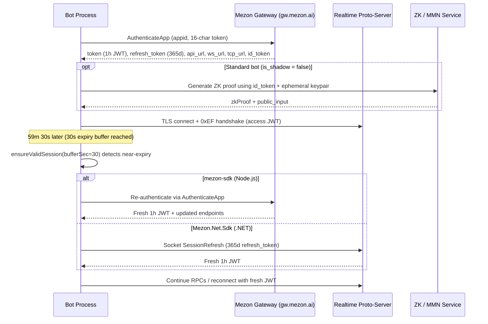

# Authentication & sessions

Mezon uses short-lived **HS256 session JWTs** backed by long-lived **refresh tokens** for every bot session. The SDKs automate token renewal, but understanding the exact claims and lifetimes is essential for debugging `401`/`403` errors and designing secure deployments.

## Credential types

| Credential | Format | Where issued | Where used |
| --- | --- | --- | --- |
| **Bot / App ID** | 64-bit Snowflake integer (string in JS, `long` in .NET) | Developer Portal → General Information | `AuthenticateApp` request (`account.appid`) |
| **Bot / App Token** | 16-character secret (`LEN_TOKEN_APP = 16`), shown once | Developer Portal → General Information | `AuthenticateApp` (`account.token`) & Channel App HMAC verification |
| **Access JWT (`token`)** | HS256 JWT, **1-hour TTL** (`3600s`) | Returned by `gw.mezon.ai` `AuthenticateApp` | `0xEF` socket handshake & `Authorization: Bearer` header |
| **Refresh Token (`refresh_token`)** | HS256 JWT, **365-day TTL** (`31536000s`) | Returned by `gw.mezon.ai` `AuthenticateApp` | Session refresh without re-sending static secrets (`.NET` `SessionRefresh`) |
| **ID Token (`id_token`)** | Signed identity JWT (omitted for shadow bots) | Returned by `gw.mezon.ai` `AuthenticateApp` | ZK proof generation (`zk-api`) for Mezon Dong (MMN) transfers |

## Token exchange & automatic renewal

Calling `client.login()` (`mezon-sdk`) or `client.LoginAsync()` (`Mezon.Net.Sdk`) sends <ApiBadge method="POST" path="/v2/account/authenticate/app" /> to `https://gw.mezon.ai:443`.



### How each SDK handles expiry

- **`mezon-sdk` (`2.8.68`)**: Before API calls and during socket reconnects, `ensureValidSession(bufferSec = 30)` checks whether the JWT expires within 30 seconds. If so, it deduplicates concurrent callers via a single `reAuthPromise`, calls `SessionManager.reAuthenticate()` against `gw.mezon.ai`, updates `clan.sessionToken` on all cached clans, and applies any updated endpoints.
- **`Mezon.Net.Sdk` (`1.11.0`)**: Passes `autoRefreshSession: true` during `LoginAsBotInternalAsync`, automatically renewing the access JWT via socket `SessionRefresh` using the 365-day refresh token. Calling `client.GetAuthTokenAsync()` or `client.GetSessionIdAsync()` always yields a fresh credential.

## Session JWT claims (`SessionTokenClaims`)

`mezon-gw` signs every bot access token with the following JSON claims:

```json
{
  "tid": "550e8400-e29b-41d4-a716-446655440000",
  "uid": 1234567890123456789,
  "usn": "my-bot",
  "vrs": {
    "appname": "my-bot",
    "shadow": "false",
    "creator": "9876543210987654321"
  },
  "exp": 1795749600
}
```

Both `mezon-proto-server` (`handshake.c`) and `mezon-api` (`server/api.go`) classify a connection as a **bot** whenever `vrs` contains **both** `appname` and `shadow`:

- **`isBot = has("appname") && has("shadow")`** → Subject to the [Bot API allowlist](./permissions-and-api-access.md#bot-api-allowlist).
- **`isExternal = vrs["appname"] == "external"`** (issued by `AuthenticateIdToken` for `mezon-light-sdk`) → Subject to the [5-RPC External allowlist](./permissions-and-api-access.md#external-token-allowlist-mezon-light-sdk).

## Shadow bots {#shadow-bots}

When a bot is created with the **Shadow Bot** toggle enabled (`is_shadow: true`), `mezon-gw/server/api_authenticate.go` changes session issuance in three concrete ways:

1. **Identity inheritance**: The session's `uid` and `usn` are set to the **creator's** `user_id` and `username` instead of the bot's own Snowflake ID, while `vrs["shadow"]` is set to `"true"`.
2. **No `id_token` (no MMN/ZK)**: `AuthenticateApp` skips `GenIdToken`, returning an empty `id_token`. Consequently, shadow bots cannot initialize ZK proofs or send Mezon Dong transactions.
3. **DM-only write boundary**: `mezon-api` explicitly rejects non-DM writes from shadow bot sessions (`isBot && isShadow == "true" && mode != StreamModeDM` returns `PermissionDenied`). A shadow bot can receive events for its creator's account and send Direct Messages (`STREAM_MODE_DM`), but cannot post or react in clan channels, threads, or groups.

:::tip When to use Shadow Mode
Leave **Shadow Bot** off for all regular clan bots. Only enable it when building a personal automation or assistant strictly tied to your own creator account that observes incoming activity and communicates back over Direct Messages.
:::

## Operational security checklist

- **Never hardcode credentials**: Pass `MEZON_BOT_ID` and `MEZON_BOT_TOKEN` via environment variables or a secret vault.
- **Never log session tokens**: Do not print `session.token`, `session.refresh_token`, `session.id_token`, `session_id`, meet JWTs, or stream WHIP/HLS grant URLs to stdout or telemetry.
- **Rotate compromised tokens immediately**: Clicking **Reset Token** in the Developer Portal invalidates future `AuthenticateApp` calls with the old 16-character secret.

## Related

- [Create a bot](../getting-started/create-a-bot.md) — issuing and rotating your 16-character token.
- [Permissions & bot API access](./permissions-and-api-access.md) — what bot, shadow, and external tokens may call.
- [Mezon Dong & MMN overview](../payments-and-mmn/overview.md) — how `id_token` powers ZK-proven bot transfers.
