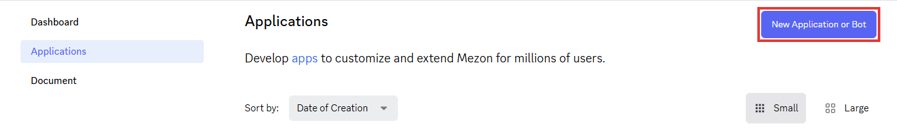
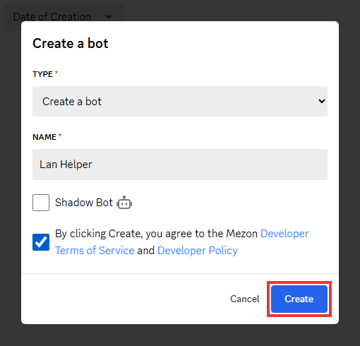
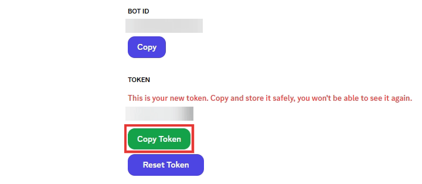
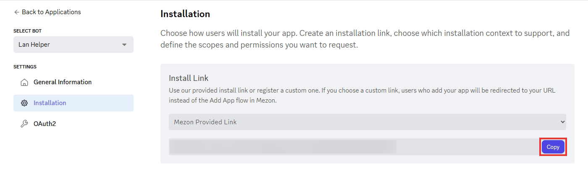
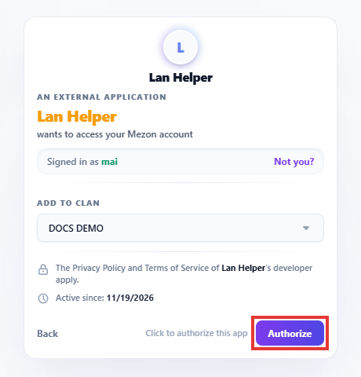

# Create a bot

Register a bot account in the Mezon Developer Portal, save its **Bot ID** and **Token**, and authorize it into a clan. Use a desktop browser and sign in with your Mezon account.

## 1. Create the bot account

1. Open the [Mezon Developer Portal](https://mezon.ai/developers/applications) and log in with your Mezon account.
2. Click **New Application or Bot**.

   

3. Under **TYPE**, select **Create a bot**.
4. Under **NAME**, enter a display name for your bot.
5. Check the box to accept the Mezon Developer Terms of Service and Developer Policy. **Create** stays disabled until you accept.
6. Click **Create**.

   

The bot's **General Information** page opens automatically.

:::info Shadow Bot switch
The creation form includes an optional **Shadow Bot** toggle (`is_shadow: true`). Leave it **off** for standard bots. When enabled, `AuthenticateApp` binds the session to the creator's `user_id` and `username`, omits `id_token` (disabling MMN/ZK token transfers), and restricts sending to Direct Messages (`STREAM_MODE_DM`) only — channel, thread, and group sends return `PermissionDenied`. See [Shadow bots](../core-concepts/authentication-and-sessions.md#shadow-bots) for full details.
:::

## 2. Save the Bot ID and token

Your bot authenticates to `gw.mezon.ai` with two credentials from **General Information**:

- **Bot ID**: The bot's 64-bit Snowflake user ID (pass as a `string` in JavaScript/TypeScript, or `long` in C#).
- **Token**: A 16-character secret string (`LEN_TOKEN_APP = 16`).

1. Click **Copy Token**.
2. Save both values in a secret manager or local environment variables (such as `MEZON_BOT_ID` and `MEZON_BOT_TOKEN`).

   

:::warning Token shown once
The Developer Portal shows a token **only once**, right after creation. If you lose it, click **Reset Token** to generate a new 16-character secret and update your deployment. Rotating a token invalidates future authentications with the old secret.
:::

## 3. Add the bot to a clan

A bot receives events and can send messages only in clans where it has been installed. Installing a bot requires the **Manage Clan** permission in the target clan.

1. Open the **Installation** tab of your bot.
2. Under **Install Link**, click **Copy**.

   

3. Open the install link in your browser.
4. Under **Add to clan**, select the clan where you want to install the bot.
5. Click **Authorize**.

   

A **Success!** page confirms installation. You can share the same **Install Link** with other clan administrators who want to install your bot.

:::tip Private channels
After installing a bot in a clan, it automatically sees public clan channels. To let the bot read or reply in a **private channel**, add the bot to that channel's member list in Mezon.
:::

## Next steps

- [JavaScript/TypeScript bot quickstart](../bot-sdks/javascript/quickstart.md) (`mezon-sdk` 2.8.68 on Node.js)
- [.NET bot quickstart](../bot-sdks/dotnet/quickstart.md) (`Mezon.Net.Sdk` 1.11.0 on .NET)
- [Permissions & bot API access](../core-concepts/permissions-and-api-access.md) — understand the exact server allowlist for bots
