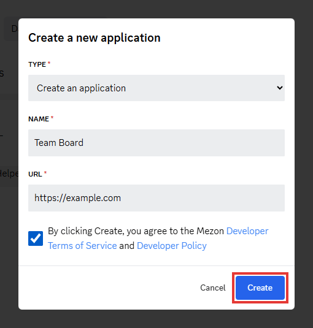
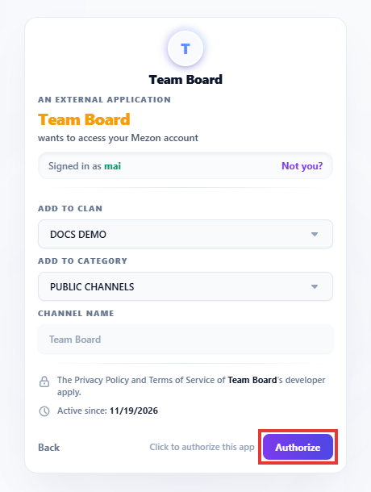
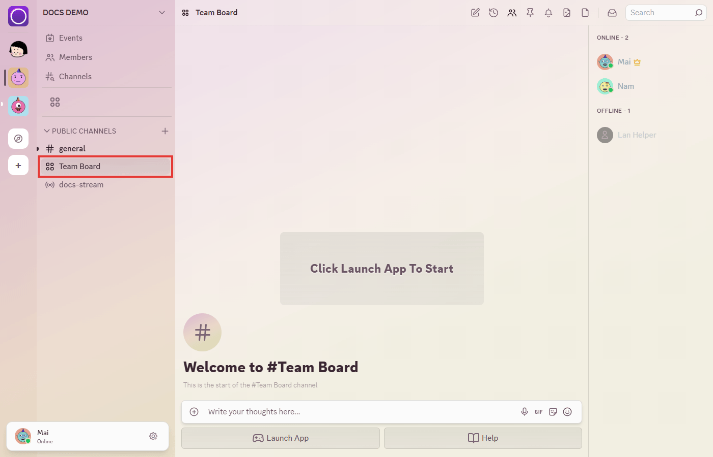

# Create a channel app

A **channel app** is a standard web application hosted on your own HTTPS origin and launched directly from a channel inside a Mezon clan. When a member opens the channel app, Mezon passes signed user and clan launch data in the URL query string (`?data=`) so your backend can authenticate the user without a separate login prompt.

Use a desktop browser and sign in with your Mezon account.

## 1. Register the application

1. Open the [Mezon Developer Portal](https://mezon.ai/developers/applications) and log in with your Mezon account.
2. Click **New Application or Bot**.
3. Under **TYPE**, select **Create an application**.
4. Under **NAME**, enter the application's name.
5. Under **URL**, enter the HTTPS URL of your web application (for example, `https://app.example.com`).
6. Check the box to accept the Mezon Developer Terms of Service and Developer Policy.
7. Click **Create**.

   

The app's **General Information** page opens, showing the **App ID** and **Token**.

:::warning Keep the App Token on your backend
Click **Copy Token** and store the 16-character secret strictly on your backend server. The portal shows it **only once**. Your server uses this token to verify the HMAC signature on incoming launch data — never expose it to browser code. See [Verifying launch data](../channel-apps-and-widgets/channel-apps/verifying-launch-data.mdx).
:::

## 2. Install the channel app in a clan

Installing a channel app creates an App Channel (`CHANNEL_TYPE_APP = 8`) in the target clan. You need the **Manage Channels** permission in that clan.

1. Open the **Installation** tab of your application.
2. Under **Install Link**, click **Copy**.
3. Open the link in your browser.
4. Under **Add to clan**, choose the target clan.
5. Under **Add to category**, choose the category where the app channel will live.
6. Under **Channel Name**, enter a channel name or leave it blank to use the application's name. Names keep letters, digits, spaces, `-`, and `_`, up to 32 characters.
7. Click **Authorize**.

   

The application now appears as a dedicated channel in the clan's sidebar:

## Next steps

- [Channel apps overview](../channel-apps-and-widgets/channel-apps/overview.md) — understand the launch lifecycle and available query data.
- [Verifying launch data](../channel-apps-and-widgets/channel-apps/verifying-launch-data.mdx) — validate the HMAC signature safely on your server.
- [Express tutorial](../channel-apps-and-widgets/channel-apps/tutorial-express.md) — build a working channel app end to end.
