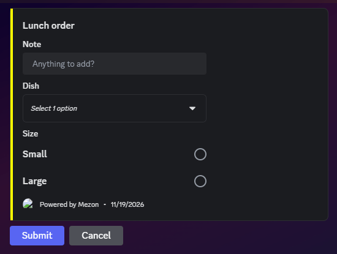

import Tabs from "@theme/Tabs";
import TabItem from "@theme/TabItem";

# Interactive messages

Mezon bots can attach clickable buttons, text inputs, dropdown selects, radio groups, date pickers, and animated cards directly to channel or direct messages. When a member submits a card or clicks a button, Mezon dispatches a realtime interaction event to the bot's notification stream.

:::danger Security boundary: `MessageButtonClicked.user_id` is client-supplied
`mezon-api` forwards `MessageButtonClicked` events verbatim to the bot without overwriting `user_id` from the authenticated session (`api_interactive_message.go`). Any logged-in client can forge `event.user_id` on a button click.

- **Do NOT** rely on `MessageButtonClicked.user_id` alone to authorize privileged actions (role grants, token transfers, admin commands, or private data access).
- By contrast, `DropdownBoxSelected.user_id` **is** overwritten by the server from the authenticated session user.
- In `Mezon.Net.Sdk`, `InteractionRouter` models this explicitly via `InteractionActorTrust.ClientSupplied` (buttons) versus `InteractionActorTrust.ServerAuthenticated` (selects).
:::

## Sending buttons

Buttons belong inside action rows under `components`. Each action row is an object wrapping an array of button components (`components: [{ components: row }]`).

<Tabs groupId="sdk-lang">
<TabItem value="ts" label="TypeScript (mezon-sdk)" default>

```ts
import { ButtonBuilder, EButtonMessageStyle } from "mezon-sdk";

const channel = await client.channels.fetch("CHANNEL_ID");

const row = new ButtonBuilder()
  .addButton("approve", "Approve", EButtonMessageStyle.SUCCESS)
  .addButton("reject", "Reject", EButtonMessageStyle.DANGER)
  .build();

await channel.send({
  t: "Approve the leave request?",
  components: [{ components: row }],
});
```

</TabItem>
<TabItem value="csharp" label="C# (Mezon.Net.Sdk)">

```csharp
using Mezon.Net.Client;
using Mezon.Net.Sdk.Builders;

var channel = await client.GetChannelAsync(channelId);

var row = new ButtonBuilder()
    .AddButton("approve", "Approve", (int)MessageButtonStyle.Success)
    .AddButton("reject", "Reject", (int)MessageButtonStyle.Danger)
    .BuildComponents();

var content = new MessageContentBuilder()
    .SetText("Approve the leave request?")
    .AddActionRow(row)
    .Build();

await channel.SendMessageAsync(content);
```

</TabItem>
</Tabs>

### Button styles

| Style | Numeric value | `mezon-sdk` enum | `Mezon.Net.Sdk` enum |
|---|---|---|---|
| Primary | `1` | `EButtonMessageStyle.PRIMARY` | `MessageButtonStyle.Primary` |
| Secondary | `2` | `EButtonMessageStyle.SECONDARY` | `MessageButtonStyle.Secondary` |
| Success | `3` | `EButtonMessageStyle.SUCCESS` | `MessageButtonStyle.Success` |
| Danger | `4` | `EButtonMessageStyle.DANGER` | `MessageButtonStyle.Danger` |
| Link | `5` | `EButtonMessageStyle.LINK` | `MessageButtonStyle.Link` |

:::warning Action row nesting
`components` must be an array of action rows (`[{ components: [...] }]`). Passing the flat array returned by `ButtonBuilder.build()` directly as `components: row` renders no buttons in Mezon clients.
:::

## Handling clicks and routing interactions

<Tabs groupId="sdk-lang">
<TabItem value="ts" label="TypeScript (mezon-sdk)" default>

```ts
client.onMessageButtonClicked(async (event) => {
  const channel = await client.channels.fetch(event.channel_id);

  if (event.button_id === "approve") {
    await channel.send({ t: "Request marked as approved." });
  } else if (event.button_id === "reject") {
    await channel.send({ t: "Request marked as rejected." });
  }
});
```

</TabItem>
<TabItem value="csharp" label="C# (Mezon.Net.Sdk)">

`Mezon.Net.Sdk` provides `InteractionRouter` with exact or prefix (`*`) custom ID matching, one-shot handlers, expiration, and explicit actor-trust enforcement:

```csharp
using Mezon.Net.Sdk.Interactions;

var router = new InteractionRouter();

router
    .OnButton("approve", async ctx =>
    {
        await ctx.Channel.SendTextAsync("Request marked as approved.");
    })
    .OneShot()
    .ExpiresAfter(TimeSpan.FromMinutes(15));

router
    .OnSelect("role_*", async ctx =>
    {
        var select = (SelectInteraction)ctx.Interaction;
        await ctx.Channel.SendTextAsync($"Selected: {string.Join(", ", select.Values)}");
    })
    .RequireServerAuthenticatedActor();

client.UseInteractions(router);
```

:::note `RequireServerAuthenticatedActor()` on button routes
Because button clicks carry `InteractionActorTrust.ClientSupplied`, adding `.RequireServerAuthenticatedActor()` to an `OnButton(...)` route causes every click to return `InteractionExecutionResult.Unauthorized`. Similarly, `.WithOwner(userId)` on a button route filters accidental clicks only—it is not a cryptographic security boundary.
:::

</TabItem>
</Tabs>

### Event payload fields

| Event | Fields | `user_id` trust |
|---|---|---|
| `MessageButtonClicked` | `message_id`, `channel_id`, `button_id`, `sender_id` (the bot), `user_id`, `extra_data` (JSON string or plain text) | **Client-supplied** (untrusted) |
| `DropdownBoxSelected` | `message_id`, `channel_id`, `selectbox_id`, `sender_id`, `user_id`, `values` (`string[]`) | **Server-authenticated** |

## Interactive form cards

Use `InteractiveBuilder` (in `mezon-sdk`) or `MessageEmbedBuilder` / `InteractiveBuilder` (in `Mezon.Net.Sdk`) to compose rich cards containing read-only fields, text inputs, dropdown selects, radio choices, and date pickers, paired with submit/cancel buttons in `components`.

<Tabs groupId="sdk-lang">
<TabItem value="ts" label="TypeScript (mezon-sdk)" default>

```ts
import { ButtonBuilder, EButtonMessageStyle, InteractiveBuilder } from "mezon-sdk";

const channel = await client.channels.fetch("CHANNEL_ID");

const embed = new InteractiveBuilder("Lunch order")
  .setDescription("Choose your lunch for Friday.")
  .addInputField("note", "Note", "Anything to add?")
  .addSelectField("dish", "Dish", [
    { label: "Pho", value: "pho" },
    { label: "Rice", value: "rice" },
  ])
  .addRadioField("size", "Size", [
    { label: "Small", value: "s" },
    { label: "Large", value: "l" },
  ])
  .build();

const actions = new ButtonBuilder()
  .addButton("order_submit", "Submit", EButtonMessageStyle.PRIMARY)
  .addButton("order_cancel", "Cancel", EButtonMessageStyle.SECONDARY)
  .build();

await channel.send({
  embed: [embed],
  components: [{ components: actions }],
});
```

</TabItem>
<TabItem value="csharp" label="C# (Mezon.Net.Sdk)">

```csharp
using Mezon.Net.Client;
using Mezon.Net.Sdk.Builders;

var embed = new MessageEmbedBuilder()
    .SetTitle("Lunch order")
    .SetDescription("Choose your lunch for Friday.")
    .AddInputField(
        "Note",
        string.Empty,
        new InputMessageComponent("note", placeholder: "Anything to add?"))
    .AddInputField(
        "Dish",
        string.Empty,
        new SelectMessageComponent("dish", new[]
        {
            new MessageSelectOption("Pho", "pho"),
            new MessageSelectOption("Rice", "rice"),
        }))
    .AddInputField(
        "Size",
        string.Empty,
        new RadioMessageComponent("size", new[]
        {
            new MessageRadioOption("Small", "s"),
            new MessageRadioOption("Large", "l"),
        }))
    .Build();

var actions = new ButtonBuilder()
    .AddButton("order_submit", "Submit", (int)MessageButtonStyle.Primary)
    .AddButton("order_cancel", "Cancel", (int)MessageButtonStyle.Secondary)
    .BuildComponents();

var content = new MessageContentBuilder()
    .AddEmbed(embed)
    .AddActionRow(actions)
    .Build();

await channel.SendMessageAsync(content);
```

</TabItem>
</Tabs>



### `InteractiveBuilder` reference (`mezon-sdk`)

| Method | Adds |
|---|---|
| `new InteractiveBuilder(title?)` | Card with an optional title, random accent color, current timestamp, and default footer. |
| `setAuthor(name, icon_url?, url?)` | Author header line. |
| `setDescription(text)` | Main body text. |
| `setThumbnail(url)` | Small thumbnail image. |
| `setImage(url, width?, height?)` | Full-width embed image. |
| `addField(name, value, inline?)` | Read-only name/value field. |
| `addInputField(id, name, placeholder?, options?, description?)` | Text input (`options`: `{ type?, textarea?, defaultValue? }`). |
| `addSelectField(id, name, options, valueSelected?, description?)` | Dropdown list (`options`: `[{ label, value }]`). |
| `addRadioField(id, name, options, description?, max_options?)` | Single- or multi-choice radio group. Give each option a unique `name` and set `max_options` to enable multi-select. |
| `addDatePickerField(id, name, description?)` | Date picker control. |
| `addAnimation(id, config, name?, description?)` | Sprite-sheet animation component. |
| `build()` | Finalizes the embed object for the `embed` array. |

### Multi-select radio example (`mezon-sdk`)

```ts
import { InteractiveBuilder } from "mezon-sdk";

const card = new InteractiveBuilder("Office schedule")
  .addRadioField(
    "days",
    "Office days",
    [
      { label: "Monday", value: "mon", name: "mon" },
      { label: "Wednesday", value: "wed", name: "wed" },
      { label: "Friday", value: "fri", name: "fri" },
    ],
    "Pick up to two days",
    2,
  )
  .build();
```

## Parsing form submissions (`extra_data`)

When a member clicks a submit button below a form card, `event.extra_data` contains a JSON-encoded map keyed by each touched field's `id`:

```json
{ "note": "No onions", "dish": "pho", "size": "l" }
```

- Inputs, selects, single-choice radios, and date pickers serialize as strings.
- Multi-choice radios serialize as `string[]`.
- Untouched fields are omitted; if no field was touched, `extra_data` is empty.
- Always validate and sanitize values server-side.

```ts
client.onMessageButtonClicked(async (event) => {
  if (event.button_id !== "order_submit") return;

  let values: Record<string, string | string[]> = {};
  if (event.extra_data) {
    try {
      values = JSON.parse(event.extra_data);
    } catch {
      return;
    }
  }

  const channel = await client.channels.fetch(event.channel_id);
  await channel.send({
    t: `Order received: ${values.dish ?? "no dish"}, size ${values.size ?? "?"}`,
  });
});
```

:::tip Select interactions in the web client
Whenever a member changes a dropdown option in a form card, the web client immediately emits a `MessageButtonClicked` event where `button_id` equals the select's `id` and `extra_data` is the chosen `value` as **plain text** (not JSON). Guard your submit handler on the submit button's `button_id` and wrap `JSON.parse` in `try/catch`. Note that the current web client does not emit `DropdownBoxSelected` for form-card selects.
:::

## Known limits

- In `mezon-sdk`, `addInputField` accepts a `disabled` option in its type definition, but the builder does not serialize it.
- `EMessageComponentType.GRID` (`7`) has no builder helper in `mezon-sdk` and is not rendered by the web client (`Mezon.Net.Sdk` exposes `ButtonBuilder.AddGrid` for wire completeness).
- For voting workflows where Mezon tracks counts and voter rosters server-side, use [Polls](./polls.mdx).

## Related

- [Polls](./polls.mdx)
- [Quick menu](./quick-menu.mdx)
- [Commands and interactions (.NET)](../bot-sdks/dotnet/commands-and-interactions.md)
- [Message format and entities](../core-concepts/message-format-and-entities.md)
