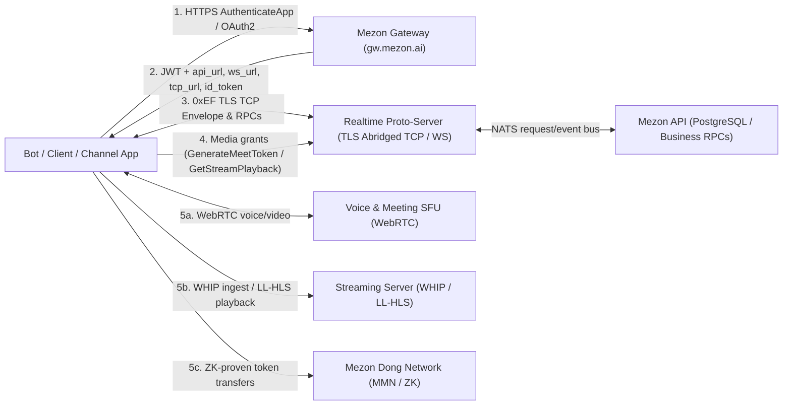

# Mezon developer documentation

Mezon is an extensible messaging, voice, streaming, and payments platform. Every bot, channel app, and OAuth2 client starts in the [Mezon Developer Portal](https://mezon.ai/developers/applications), where you register an application ID and issue credentials.

## Choose your integration path

<FeatureGrid columns={2}>
  <FeatureCard
    title="Getting started"
    description="Understand the Developer Portal, create a bot or channel app, and choose the right SDK from the ecosystem matrix."
    to="/developer/getting-started/portal-overview"
    badge="Start here"
  />
  <FeatureCard
    title="Core concepts"
    description="Gateway bootstrap, TLS abridged TCP framing, session JWT lifecycles, bot API allowlists, and message JSON payloads."
    to="/developer/core-concepts/architecture-and-transport"
    badge="Architecture"
  />
  <FeatureCard
    title="JavaScript & TypeScript SDK"
    description="Node.js bot SDK (mezon-sdk 2.8.68) with typed events, local SQLite cache, interactive builders, and MMN transfers."
    to="/developer/bot-sdks/javascript/overview"
    badge="v2.8.68"
  />
  <FeatureCard
    title=".NET (C#) SDK"
    description="Multi-targeted .NET bot SDK (Mezon.Net.Sdk 1.11.0) with DI, commands, interaction routing, and Redis/SQLite caching."
    to="/developer/bot-sdks/dotnet/overview"
    badge="v1.11.0"
  />
  <FeatureCard
    title="Interactive features"
    description="Build rich embeds, buttons, forms, selects, polls, and clan quick menu commands."
    to="/developer/interactive-features/interactive-messages"
    badge="UX"
  />
  <FeatureCard
    title="Channel apps & widgets"
    description="Embed web apps inside clan channels with signed launch data, or add Mezon chat to your site."
    to="/developer/channel-apps-and-widgets/channel-apps/overview"
    badge="Web"
  />
  <FeatureCard
    title="Voice SFU & stream channels"
    description="Join real-time voice rooms with 6 language SFU SDKs, or publish live video over WHIP to stream channels."
    to="/developer/media-voice-and-streaming/overview"
    badge="Media"
  />
  <FeatureCard
    title="Webhooks, OAuth2 & payments"
    description="Post messages with one HTTP request, sign users in with Mezon OAuth2, or transfer Mezon Dong via MMN."
    to="/developer/webhooks/overview"
    badge="Integrations"
  />
</FeatureGrid>

## Platform architecture

All bots and clients authenticate once against the Mezon Gateway (`gw.mezon.ai`), which assigns regional/shard endpoints for realtime sockets and HTTP APIs. From there, bots stay connected over persistent TLS abridged TCP sockets to `mezon-proto-server` while media, payments, and AI agent events flow through dedicated services.

## Integration surfaces at a glance

| Integration type | Best for | Runtime & transport | Starting point |
| --- | --- | --- | --- |
| **Bots** | Commands, interactive cards, moderation, polls, streaming grants, token transfers | Persistent Node.js (`mezon-sdk`) or .NET (`Mezon.Net.Sdk`) over TLS TCP | [Create a bot](./getting-started/create-a-bot.md) |
| **Channel apps** | Full web applications launched inside a clan channel with signed user context | Any web stack verifying HMAC launch data (`?data=`) | [Create a channel app](./getting-started/create-a-channel-app.md) |
| **Webhooks** | One-way notifications from CI/CD, monitoring, or backend jobs | Single HTTPS `POST` — no bot account or SDK required | [Webhooks overview](./webhooks/overview.mdx) |
| **OAuth2** | "Sign in with Mezon" on external websites | Standard Authorization Code flow + ID tokens | [OAuth2 flow](./oauth2/authorization-code-flow.mdx) |
| **Light SDK & Chat Widget** | Embedded chat experiences for external web apps | Browser JS (`mezon-light-sdk`, `mezon-chat-widget`) | [Light SDK](./channel-apps-and-widgets/light-sdk.md) |
| **Voice SFU & Streaming** | Voice bots, meeting recorders, live stream publishers | WebRTC SFU SDKs (6 languages) + WHIP / LL-HLS | [Media overview](./media-voice-and-streaming/overview.md) |
| **AI & MCP** | Voice/room AI session events and LLM tool integration | Agent SSE (`connectMezonAgentSSE`) and MCP | [AI agent events](./ai-and-mcp/ai-agent-events.md) |

## Quick links

- [SDK ecosystem matrix](./getting-started/sdk-ecosystem-matrix.md) — compare supported versions, runtimes, and stability tiers.
- [Permissions & bot API access](./core-concepts/permissions-and-api-access.md) — exact server allowlists for bot and external tokens.
- [Events reference](./reference/events-reference.md) — complete catalog of realtime and SSE events.
- [Error codes & troubleshooting](./reference/error-codes-and-troubleshooting.md) — common HTTP, socket, and SDK failures.
- [Changelog](./reference/changelog.md) — notable platform and SDK changes.
