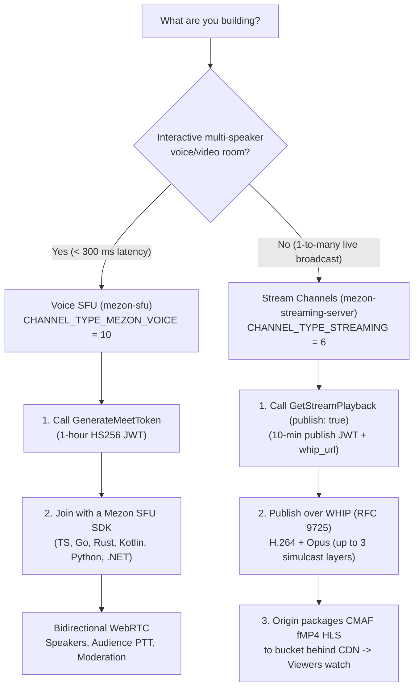

# Media, voice & streaming overview

Mezon operates two purpose-built media systems depending on whether your use case requires **sub-second interactive conversations** or **one-to-many live broadcasts**:

## Side-by-side comparison

| Dimension | Voice SFU (`mezon-sfu`) | Stream channels (`mezon-streaming-server`) |
|---|---|---|
| Channel type | `CHANNEL_TYPE_MEZON_VOICE` (`10`) | `CHANNEL_TYPE_STREAMING` (`6`) |
| Topology | Many-to-many (multiple speakers & audience) | **1 publisher** per channel, unlimited CDN viewers |
| Typical glass-to-glass latency | Sub-second (realtime WebRTC) | ~6 seconds or more (plain CMAF HLS from CDN; optional sub-second WHEP) |
| Token / grant RPC | `GenerateMeetToken` (bot-allowed, 1 h HS256 JWT) | `GetStreamPlayback` (API 213, bot-allowed; 10 min publish JWT / 6 h view JWT) |
| Publish protocol | Custom `mezon-sfu` WebSocket + server-offered WebRTC | Standard **WHIP** (RFC 9725 `POST /whip/<channel>`) |
| Playback protocol | WebRTC (`mezon-sfu` dynamic / fixed-slot / decoupled pools) | **HLS** (CMAF fMP4 H.264 + Opus via CDN); WHEP WebRTC on streaming nodes |
| Codecs | Opus audio, VP8 / H.264 / VP9 video (SDK-dependent) | Opus 48 kHz audio + H.264 Constrained Baseline (`42e01f`, no B-frames) or VP8 |
| Official SDKs | 6 pre-1.0 SFU SDKs (TypeScript, Go, Rust, Kotlin, Python, .NET) | Standard WHIP (OBS, ffmpeg, Pion, libwebrtc, browser) + bot grant APIs |

## Where to go next

- **Voice bots, recorders, and custom meeting clients:** Start with [SFU concepts & tokens](./voice-sfu/concepts-and-tokens.md), compare runtimes in [SFU SDKs overview](./voice-sfu/sdks-overview.md), and jump into [SFU quickstarts](./voice-sfu/quickstarts.mdx).
- **Live broadcasts, OBS / ffmpeg / bot video publishing:** Start with [Publishing with WHIP](./stream-channels/publishing-with-whip.mdx) and [Playback & realtime events](./stream-channels/playback-and-events.md).
