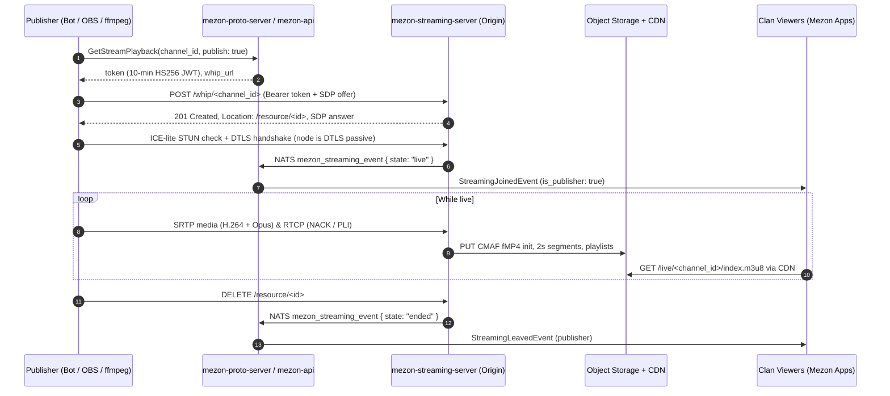

import Tabs from "@theme/Tabs";
import TabItem from "@theme/TabItem";

# Publishing to stream channels with WHIP

Mezon stream channels (`CHANNEL_TYPE_STREAMING = 6`) ingest live broadcasts via **WHIP** ([RFC 9725](https://www.rfc-editor.org/rfc/rfc9725)) on `mezon-streaming-server`. Bots request a short-lived publish grant using `GetStreamPlayback` (API index `213`), then publish media with any compliant WebRTC/WHIP stack (OBS Studio, `ffmpeg`, Pion, libwebrtc, or a browser).

## End-to-end broadcast sequence



## 1. Request a publish grant (`GetStreamPlayback`)

<ApiBadge method="RPC" path="GetStreamPlayback (API 213)" /> <BotAccessBadge allowed={true} />

The bot must be a member of the stream channel's clan. Calling `GetStreamPlayback` on a non-stream channel returns `400`; calling without clan membership returns `403`.

<Tabs groupId="sdk-lang">
<TabItem value="ts" label="TypeScript (mezon-sdk)" default>

```ts
const grant = await client.getStreamPlayback({
  channel_id: "STREAM_CHANNEL_ID",
  publish: true,
});

if (!grant?.token || !grant.whip_url) {
  throw new Error("Missing publish grant");
}
// Never log grant.token!
console.log("Publish grant expires at:", grant.expires_at);
```

</TabItem>
<TabItem value="csharp" label="C# (Mezon.Net.Sdk)">

```csharp
using Mezon.Net.Core;
using Mezon.Net.Models;

try
{
    var grant = await client.GetStreamPlaybackAsync(
        new GetStreamPlaybackParams(streamChannelId, publish: true));
    // Pass grant.WhipUrl and grant.Token to your WHIP publisher; never log grant.Token.
    Console.WriteLine($"Publish grant valid until {grant.ExpiresAt}");
}
catch (MezonApiException ex)
{
    Console.Error.WriteLine($"Grant refused: {ex.RawCode} {ex.Message}");
}
```

</TabItem>
</Tabs>

### Grant fields & token lifetime

| Field | Description |
|---|---|
| `token` | HS256 JWT (`sub`, `channel`, `role: "publish"`, `exp`) valid for **10 minutes**. Checked only when starting a WHIP session—an active stream continues after `exp`. |
| `whip_url` | Origin WHIP endpoint: `<origin_url>/whip/<channel_id>`. |
| `hls_url` | Viewer playback playlist URL (`<hls_base_url>/live/<channel_id>/index.m3u8`). |
| `expires_at` | Expiry timestamp in Unix seconds. |

## 2. Establish & tear down a WHIP session

```ts
async function startPublishing(channelId: string): Promise<string> {
  const grant = await client.getStreamPlayback({ channel_id: channelId, publish: true });
  if (!grant?.token || !grant.whip_url) throw new Error("No publish grant");

  const sdpOffer = await createWebRtcOffer(); // From your WebRTC library

  const res = await fetch(grant.whip_url, {
    method: "POST",
    headers: {
      "Content-Type": "application/sdp",
      Authorization: `Bearer ${grant.token}`,
    },
    body: sdpOffer,
  });

  if (res.status !== 201) {
    throw new Error(`WHIP rejected: ${res.status} ${await res.text()}`);
  }

  await applyWebRtcAnswer(await res.text());

  const location = res.headers.get("Location");
  if (!location) throw new Error("Missing WHIP Location header");
  // Capability URL: /resource/<slot>.<gen>.<32 hex> — treat as secret
  return new URL(location, grant.whip_url).toString();
}

async function stopPublishing(resourceUrl: string): Promise<void> {
  await fetch(resourceUrl, { method: "DELETE" });
}
```

### Publishing with `ffmpeg`

Because `mezon-streaming-server` is always the DTLS server (`a=setup:passive`), pass `-whip_flags dtls_active` and a fixed 2-second keyframe interval (matching `capacity.keyframe_ms = 2000`):

```bash
ffmpeg -re -i input.mp4 \
  -c:v libx264 -profile:v baseline -level 3.1 -bf 0 -g 60 -keyint_min 60 -sc_threshold 0 \
  -c:a libopus -ar 48000 -ac 2 \
  -f whip -whip_flags dtls_active \
  -authorization "$WHIP_BEARER_TOKEN" \
  "$WHIP_URL"
```

## 3. Protocol, SDP & media requirements (`spec.md` §2, §5, §8)

### HTTP & ICE/DTLS transport

- **No trickle ICE:** `PATCH` returns `404`. The server is **ICE-lite** and returns a single IPv4 UDP host candidate + `a=end-of-candidates`.
- **DTLS role:** Client MUST offer `a=setup:actpass` or `a=setup:active` (`a=setup:passive` is rejected with `400`).
- **HTTP limits:** Maximum **64 KiB** headers + body (`413`), explicit `Content-Length` required (no chunked transfer encoding), 5-second request/response timeout.
- **One publisher per channel:** A second publisher with a **different `sub`** receives **`409 Conflict`**. Re-POSTing from the **same `sub`** immediately replaces your previous live session without triggering `409` or disconnecting viewers.
- **Keepalive / inactivity timeout:** If nothing (STUN, DTLS, RTP, RTCP) arrives for **15 seconds** (`capacity.timeout_ms`), the node closes the session and emits `ended`.

### Media codecs & feedback

| Track | Exact requirements |
|---|---|
| **Video (H.264 default)** | `H264/90000` with `packetization-mode=1`, Constrained Baseline (`profile-level-id=42e01f`), **in-band SPS/PPS** before every IDR (`sprop-parameter-sets` is ignored), **no B-frames**. (Nodes configured for VP8 require `VP8/90000`.) |
| **Audio** | `opus/48000`, mono or stereo. |
| **Sections & simulcast** | Max **4 media sections** per offer (first usable audio + first usable video accepted). Up to **3 simulcast layers** via `a=rid:<id> send`, `a=simulcast:send ...`, and `sdes:rtp-stream-id`. |
| **Loss recovery (NACK)** | NACK **without RTX** — retransmit lost video packets on the **original SSRC and sequence number** within **150 ms**. Audio is not NACKed. |
| **Keyframes & bitrate** | Respond to **PLI** (sent every **2 s**; fixed 2 s GOP if encoder ignores PLI). Node sends REMB every 1 s (`4 Mbit/s` single layer, `6 Mbit/s` summed simulcast). |

## 4. WHIP HTTP status codes

| Status | Cause | Client action |
|---|---|---|
| `201` | Session created; `Location` holds `/resource/<id>`, body holds SDP answer | Apply SDP answer and start ICE/DTLS/SRTP |
| `400` | Bad channel name, malformed SDP, missing ICE/SHA-256 fingerprint, or `setup:passive` | Fix offer/request; do not retry unchanged |
| `401` | Missing, malformed, invalid, or expired Bearer JWT | Call `GetStreamPlayback` for a fresh 10-minute token |
| `403` | Wrong channel, `role: "view"` token, or sent to an edge node | Request a `publish` grant and send to `whip_url` |
| `406` | Offer lacks any codec the node accepts | Offer H.264 (`packetization-mode=1`) and/or Opus 48 kHz |
| `409` | Another user (`sub`) is already publishing in this channel | Notify user; wait until the active stream ends |
| `413` | Request exceeds 64 KiB | Reduce SDP size |
| `500` | Internal DTLS context failure | Retry with backoff |
| `503` | No free channel/session slot, momentarily busy, or node draining (`Retry-After: 5`) | Retry with backoff after `Retry-After` |

## Related

- [Playback & realtime stream events](./playback-and-events.md)
- [Media overview](../overview.md)
- [WHIP (RFC 9725)](https://www.rfc-editor.org/rfc/rfc9725)
