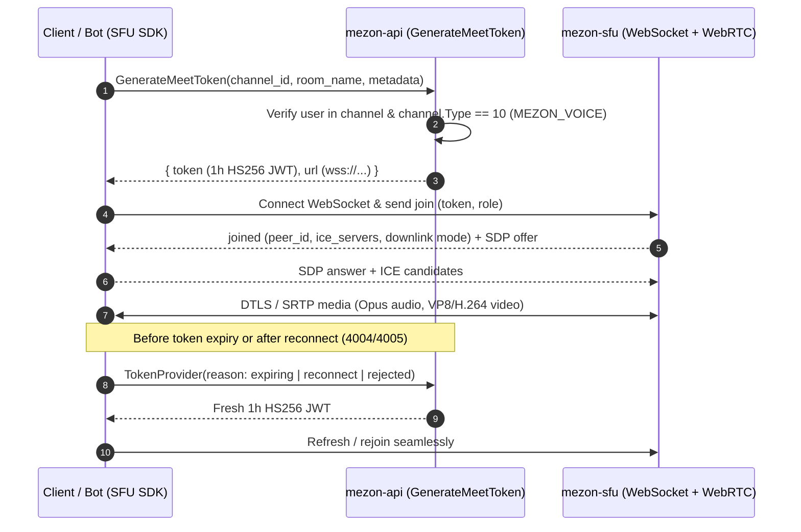

# Voice SFU concepts & tokens

Mezon voice channels (`CHANNEL_TYPE_MEZON_VOICE = 10`) run on **`mezon-sfu`**, a high-performance C WebRTC Selective Forwarding Unit. Before connecting any SFU SDK, your bot or client obtains a short-lived HS256 meet token from `mezon-api`.

## Connection and token refresh sequence



## Obtaining a meet token (`GenerateMeetToken`)

`GenerateMeetToken` is allowed for both user sessions and bot sessions (`api_voice.go`, `core_voice.go`).

- **Channel type check:** Only `CHANNEL_TYPE_MEZON_VOICE` (`10`) is accepted. Requesting a meet token for a text, streaming, or legacy voice channel returns `InvalidArgument`.
- **Membership check:** The caller must be a member of the channel (`PermissionDenied` otherwise).
- **JWT claims & lifetime:** Signed with HS256 using the shared meet secret, valid for **1 hour** (`exp = now + 1h`), carrying `iss` (user ID string), `room` (channel ID), `identity` (user ID), `exp`, and optional `metadata`.
- **Token hygiene:** Pass tokens in memory or environment variables—never in query strings, command-line arguments, or logs.

### Requesting a meet token from a bot

```ts
// TypeScript (mezon-sdk)
const meet = await client.generateMeetToken({
  channel_id: "VOICE_CHANNEL_ID",
  room_name: "VOICE_CHANNEL_ID",
  metadata: JSON.stringify({ displayName: "Voice Bot" }),
});
// Pass meet.url and meet.token into your SFU SDK's Room.connect(...)
```

```csharp
// C# (Mezon.Net.Sdk)
var meet = await client.GenerateMeetTokenAsync(
    new GenerateMeetTokenParams(channelId, roomName: channelId.ToString(), metadata: "{}"));
```

## Participant roles: Speaker vs. Audience (PTT)

| Role | Default media capability | Speaking behavior |
|---|---|---|
| **Speaker** (`speaker`) | Full audio and camera (plus screen share in browser TS SDK) | Sessions start **muted** on the server. Call `setMicrophoneEnabled(true)` before sending audio. |
| **Audience** (`audience`) | Listens to room media without taking a permanent speaker slot | Speaks temporarily while holding **push-to-talk**: call `setPushToTalk(true)` to transmit and `setPushToTalk(false)` to release. |

:::tip RFC 6464 audio levels & voice activity detection
In fixed-slot downlink rooms, `mezon-sfu` selects active speakers using the **RFC 6464 client-to-mixer audio level** RTP header extension (`0` loudest … `127` silence). When publishing raw Opus RTP frames (Go, Rust, .NET), supply audio levels (e.g. `WriteSampleWithLevel` / `write_opus(..., Some(level))`); otherwise the SFU treats the publisher as continuously speaking whenever packets arrive.
:::

## Downlink modes

`mezon-sfu` rooms operate in one of three server-configured downlink layouts:

1. **Dynamic mode:** The SFU renegotiates tracks dynamically as speakers publish or unpublish.
2. **Fixed-slot mode:** The server allocates a fixed number of audio/video slots and dynamically maps the loudest active speakers into those slots without full renegotiation. Remote tracks emit unsubscribe + subscribe events whenever slot ownership changes.
3. **Decoupled media pools (`media_pool_mode: "decoupled"`, `media_pool_version: 1`):** Separates audio, camera, and screen slots into independent pools (`max_audio_slots`, `max_camera_slots`, `max_screen_slots`). Currently implemented in **`Mezon.Net.Sdk.Sfu`**.

## `TokenProvider` & reconnection lifecycle

Always pass a **`TokenProvider` callback** (instead of a static token string) for any long-running bot or client. Every SFU SDK invokes your provider with a structured request reason and the previous token:

| Refresh reason | When the SDK triggers it |
|---|---|
| `initial` | First `connect()` attempt. |
| `reconnect` | Recovering from a dropped WebSocket, ICE failure, or server restart. |
| `expiring` | Proactively renewing the JWT before the 1-hour expiry elapses. |
| `rejected` | After the SFU rejected the previous token (`4004` / `4005`). A static token cannot recover from `4005` and terminates with `auth_failed`. |

### Reconnectable vs. terminal close codes

- **Automatic reconnect with jittered backoff:** `1001`, `1006`, `1011`, `4001`, `4002`, `4007`–`4010`, `4013`, `4014` (plus `room_creation_failed`). Each reconnect creates a new peer ID and automatically replays microphone, camera, screen share, push-to-talk, video-receiving preference, and metadata.
- **Terminal disconnect (stops retrying):**
  - `1000` (normal server close)
  - `4003` (server misconfigured)
  - `4006` (kicked by moderator)
  - `4011` (alone timeout)
  - `4012` (`duplicate_session` — **one user ID can hold only one active SFU session at a time**; joining any room with the same user ID disconnects the older session)
  - Full room or `invalid_room` (`join_failed`)

## Related

- [SFU SDKs overview](./sdks-overview.md)
- [SFU quickstarts (all 6 languages)](./quickstarts.mdx)
- [Media overview](../overview.md)
