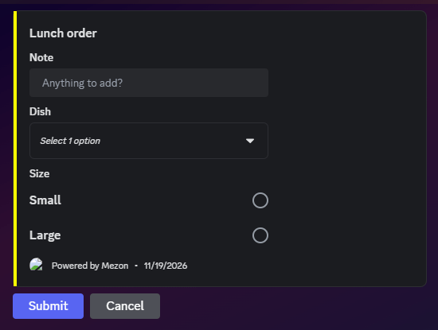

# Interactive messages

A bot can send messages with buttons, and cards with input fields, selects, choices and date pickers. When a member clicks a button, the bot receives the click and the values the member entered.

This page uses `mezon-sdk` 2.8.66. It describes how the Mezon web app (version 2.1.5) shows these messages and what it sends back; the desktop and phone apps were not checked.

## Buttons

Build buttons with `ButtonBuilder` and send them in `components`, inside an action row: `components: [{ components: buttons }]`.

```ts
import { ButtonBuilder, EButtonMessageStyle } from "mezon-sdk";

const channel = await client.channels.fetch("CHANNEL_ID");
const row = new ButtonBuilder()
  .addButton("approve", "Approve", EButtonMessageStyle.SUCCESS)
  .addButton("reject", "Reject", EButtonMessageStyle.DANGER)
  .build();

await channel.send({
  t: "Approve the leave request?",
  components: [{ components: row }],
});
```

`addButton(id, label, style)` takes:

- `id`: your name for the button. It comes back as `button_id` when someone clicks.
- `label`: the text on the button.
- `style`: `EButtonMessageStyle.PRIMARY` (1), `SECONDARY` (2), `SUCCESS` (3), `DANGER` (4) or `LINK` (5). The style sets the colour.

:::warning
`components` is a list of rows. Passing the array from `build()` directly, as `components: row`, shows no buttons in the web app.
:::

## Handle clicks

```ts
client.onMessageButtonClicked(async (event) => {
  const channel = await client.channels.fetch(event.channel_id);
  if (event.button_id === "approve") {
    await channel.send({ t: "Approved." });
  } else if (event.button_id === "reject") {
    await channel.send({ t: "Rejected." });
  }
});
```

The event has these fields:

| Field | Meaning |
|---|---|
| `button_id` | The `id` of the button (or select) that was used. |
| `user_id` | The member who clicked. |
| `message_id`, `channel_id` | The message and its channel. |
| `sender_id` | The sender of the message, that is, the bot. |
| `extra_data` | The values the member entered in the card, as a JSON string. See [Read the form values](#read-the-form-values). |

## Forms

`InteractiveBuilder` builds a card (an embed) with a title, text, images and form fields. Send it in `embed`, with its buttons in `components`:

```ts
import { ButtonBuilder, EButtonMessageStyle, InteractiveBuilder } from "mezon-sdk";

const channel = await client.channels.fetch("CHANNEL_ID");
const embed = new InteractiveBuilder("Lunch order")
  .setDescription("Choose your lunch for Friday.")
  .addInputField("note", "Note", "Anything to add?")
  .addSelectField("dish", "Dish", [
    { label: "Pho", value: "pho" },
    { label: "Rice", value: "rice" },
  ])
  .addRadioField("size", "Size", [
    { label: "Small", value: "s" },
    { label: "Large", value: "l" },
  ])
  .build();

const actions = new ButtonBuilder()
  .addButton("order_submit", "Submit", EButtonMessageStyle.PRIMARY)
  .addButton("order_cancel", "Cancel", EButtonMessageStyle.SECONDARY)
  .build();

await channel.send({ embed: [embed], components: [{ components: actions }] });
```



Every card gets a random colour, the current time and the footer "Powered by Mezon".

### Builder methods

| Method | Adds |
|---|---|
| `new InteractiveBuilder(title?)` | A card with an optional title. |
| `setAuthor(name, icon_url?, url?)` | An author line at the top. |
| `setDescription(text)` | The main text. |
| `setThumbnail(url)` | A small image. |
| `setImage(url, width?, height?)` | A large image. |
| `addField(name, value, inline?)` | A read-only name and value. |
| `addInputField(id, name, placeholder?, options?, description?)` | A text box. `options`: `{ type?, textarea?, defaultValue? }`, where `type` is an HTML input type such as `"email"` and `textarea: true` gives several lines. |
| `addSelectField(id, name, options, valueSelected?, description?)` | A drop-down list. `options`: `[{ label, value }]`; `valueSelected` is the option chosen at the start. |
| `addRadioField(id, name, options, description?, max_options?)` | Choices. `options`: `[{ label, value, name?, description?, style?, disabled? }]`. |
| `addDatePickerField(id, name, description?)` | A date picker. |
| `addAnimation(id, config, name?, description?)` | An animation made of images. |
| `build()` | Returns the card, to put in `embed`. |

To let members pick several choices in `addRadioField`, give every option a different `name` and set `max_options` to the most they may pick. With the same `name` (or none), members pick one.

```ts
import { InteractiveBuilder } from "mezon-sdk";

new InteractiveBuilder("Profile")
  .addRadioField(
    "days",
    "Office days",
    [
      { label: "Monday", value: "mon", name: "mon" },
      { label: "Wednesday", value: "wed", name: "wed" },
      { label: "Friday", value: "fri", name: "fri" },
    ],
    "Pick up to two",
    2,
  )
  .build();
```

## Read the form values

When a member clicks a button under a card, `extra_data` holds what the member entered, as a JSON object keyed by the field `id`s:

```json
{ "note": "No onions", "dish": "pho", "size": "l" }
```

- Text boxes, selects, single choices and dates give a string.
- Multiple choices give an array of strings.
- Fields the member did not touch are missing. If the member touched no field, `extra_data` is empty.

```ts
client.onMessageButtonClicked(async (event) => {
  if (event.button_id !== "order_submit") return;

  const values: Record<string, string | string[]> = event.extra_data
    ? JSON.parse(event.extra_data)
    : {};
  const channel = await client.channels.fetch(event.channel_id);
  await channel.send({ t: `Order received: ${values.dish ?? "no dish"}, size ${values.size ?? "?"}` });
});
```

Check the values on the bot's side: members can send anything.

### Selects send a click too

Each time a member picks an option in a select, the web app also sends a click event right away: `button_id` is the select's `id` and `extra_data` is the chosen `value` (plain text, not JSON). If your bot reads only the submit button, ignore these events.

The SDK also has `onDropdownBoxSelected`, but the web app does not send that event.

## Limits

- `addInputField` accepts a `disabled` option, but the builder does not pass it on.
- `EMessageComponentType.GRID` (7) has no builder method, and the web app does not show it.
- Use [polls](../mezon-sdk/integration-bot-sdk/usage-and-examples.md#create-a-poll) for simple votes: Mezon counts the votes for you.

## Related

- [Usage and examples](../mezon-sdk/integration-bot-sdk/usage-and-examples.md)
- [API reference](../mezon-sdk/integration-bot-sdk/api-references.md)
