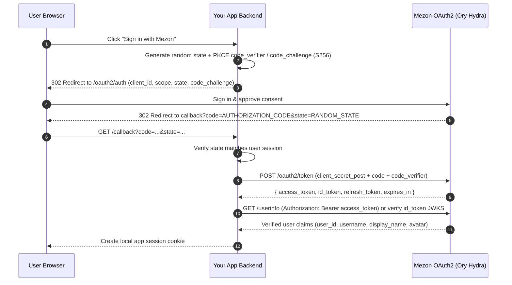

import Tabs from "@theme/Tabs";
import TabItem from "@theme/TabItem";

# OAuth2 authorization code flow

Mezon operates a standards-compliant OAuth 2.0 and OpenID Connect (OIDC) identity provider powered by **Ory Hydra** at `https://oauth2.mezon.ai`. External websites and backends use the Authorization Code flow to authenticate users with their Mezon account and receive verified identity claims (`user_id`, `username`, `display_name`, `avatar`, `email`).

## Flow overview



## 1. Configure your OAuth2 application

1. Open the [Mezon developer portal](https://mezon.ai/developers/applications) and select your app (or [create one](../getting-started/create-a-channel-app.md)).
2. Open the **OAuth2** tab.
3. Under **Redirects**, add your exact callback URL (e.g. `https://your-app.example.com/callback`). It must begin with `http://` or `https://`.
4. Under **OAuth2 URL Generator → Scopes**, enable the scopes you need (`openid`, and optionally `offline`) and save.
5. Copy your **Client ID** and click **Reset secret** to generate your **Client Secret** (requires at least one redirect URI saved first).

:::danger Keep your client secret server-side
Apps created in the Mezon developer portal are configured as confidential clients using `client_secret_post`. Never embed `YOUR_CLIENT_SECRET` in browser JavaScript, single-page apps, or mobile binaries.
:::

## Discovery and endpoints

All URLs are published in the OIDC discovery document at `https://oauth2.mezon.ai/.well-known/openid-configuration`:

| Endpoint | Method & URL |
|---|---|
| Discovery | <ApiBadge method="GET" path="https://oauth2.mezon.ai/.well-known/openid-configuration" /> |
| Authorization | <ApiBadge method="GET" path="https://oauth2.mezon.ai/oauth2/auth" /> |
| Token | <ApiBadge method="POST" path="https://oauth2.mezon.ai/oauth2/token" /> |
| UserInfo | <ApiBadge method="GET" path="https://oauth2.mezon.ai/userinfo" /> |
| Revocation | <ApiBadge method="POST" path="https://oauth2.mezon.ai/oauth2/revoke" /> |
| End Session / Logout | <ApiBadge method="GET" path="https://oauth2.mezon.ai/oauth2/sessions/logout" /> |
| JWKS (RS256 public keys) | <ApiBadge method="GET" path="https://oauth2.mezon.ai/.well-known/jwks.json" /> |

## Scopes

| Scope | Grants |
|---|---|
| `openid` | Issues a signed RS256 `id_token` and unlocks Mezon user claims on `/userinfo`. |
| `offline` | Issues a `refresh_token` so your backend can renew expired access tokens without prompting the user again. |

Request only scopes that are enabled in your app's developer portal settings.

## 2. Redirect the user to `/oauth2/auth`

Generate a cryptographically random `state` (at least 32 bytes hex/base64url) to prevent CSRF and a PKCE `code_verifier` + `S256` `code_challenge` (RFC 7636) to prevent authorization-code interception. Store `state` and `code_verifier` in the user's server-side session, then redirect the browser to:

```text
https://oauth2.mezon.ai/oauth2/auth?client_id=YOUR_CLIENT_ID&redirect_uri=https%3A%2F%2Fyour-app.example.com%2Fcallback&response_type=code&scope=openid%20offline&state=RANDOM_STATE&code_challenge=PKCE_S256_CHALLENGE&code_challenge_method=S256
```

| Parameter | Required | Description |
|---|---|---|
| `client_id` | Yes | Your application's Client ID. |
| `redirect_uri` | Yes | URL-encoded callback URL; must match a registered redirect URI byte for byte. |
| `response_type` | Yes | Must be `code`. |
| `scope` | Yes | Space-separated (`%20`) list of enabled scopes, e.g. `openid offline`. |
| `state` | Recommended (required for security) | Opaque CSRF token verified on callback. |
| `code_challenge` | Recommended (PKCE) | `BASE64URL(SHA256(ASCII(code_verifier)))`. |
| `code_challenge_method` | With PKCE | `S256`. |

## 3. Handle the callback & exchange the code

After sign-in, Mezon redirects back to your callback URL:

```text
https://your-app.example.com/callback?code=AUTHORIZATION_CODE&scope=openid+offline&state=RANDOM_STATE
```

Verify that `state` matches the value stored in the user's session, then `POST` to `/oauth2/token` encoded as **`application/x-www-form-urlencoded`** (JSON bodies are rejected) using `client_secret_post`:

<Tabs groupId="backend-lang">
<TabItem value="node" label="Node.js" default>

```js
async function exchangeCode({ code, codeVerifier }) {
  const body = new URLSearchParams({
    grant_type: "authorization_code",
    code,
    redirect_uri: "https://your-app.example.com/callback",
    client_id: process.env.MEZON_CLIENT_ID,
    client_secret: process.env.MEZON_CLIENT_SECRET,
    code_verifier: codeVerifier,
  });

  const res = await fetch("https://oauth2.mezon.ai/oauth2/token", {
    method: "POST",
    headers: { "Content-Type": "application/x-www-form-urlencoded" },
    body,
  });
  if (!res.ok) throw new Error(`Token exchange failed: ${res.status} ${await res.text()}`);
  return res.json();
}
```

</TabItem>
<TabItem value="python" label="Python">

```python
import os
import requests

TOKEN_URL = "https://oauth2.mezon.ai/oauth2/token"
REDIRECT_URI = "https://your-app.example.com/callback"


def exchange_code(code: str, code_verifier: str) -> dict:
    res = requests.post(
        TOKEN_URL,
        data={
            "grant_type": "authorization_code",
            "code": code,
            "redirect_uri": REDIRECT_URI,
            "client_id": os.environ["MEZON_CLIENT_ID"],
            "client_secret": os.environ["MEZON_CLIENT_SECRET"],
            "code_verifier": code_verifier,
        },
        timeout=10,
    )
    res.raise_for_status()
    return res.json()
```

</TabItem>
<TabItem value="go" label="Go">

```go
package main

import (
	"encoding/json"
	"net/http"
	"net/url"
	"os"
)

func exchangeCode(code, codeVerifier string) (map[string]any, error) {
	form := url.Values{
		"grant_type":    {"authorization_code"},
		"code":          {code},
		"redirect_uri":  {"https://your-app.example.com/callback"},
		"client_id":     {os.Getenv("MEZON_CLIENT_ID")},
		"client_secret": {os.Getenv("MEZON_CLIENT_SECRET")},
		"code_verifier": {codeVerifier},
	}
	resp, err := http.PostForm("https://oauth2.mezon.ai/oauth2/token", form)
	if err != nil {
		return nil, err
	}
	defer resp.Body.Close()
	var tokens map[string]any
	err = json.NewDecoder(resp.Body).Decode(&tokens)
	return tokens, err
}
```

</TabItem>
<TabItem value="csharp" label="C#">

```csharp
using System.Net.Http.Json;

using var http = new HttpClient();
var form = new FormUrlEncodedContent(new Dictionary<string, string>
{
    ["grant_type"] = "authorization_code",
    ["code"] = authorizationCode,
    ["redirect_uri"] = "https://your-app.example.com/callback",
    ["client_id"] = Environment.GetEnvironmentVariable("MEZON_CLIENT_ID")!,
    ["client_secret"] = Environment.GetEnvironmentVariable("MEZON_CLIENT_SECRET")!,
    ["code_verifier"] = codeVerifier,
});

var response = await http.PostAsync("https://oauth2.mezon.ai/oauth2/token", form);
response.EnsureSuccessStatusCode();
var tokens = await response.Content.ReadFromJsonAsync<Dictionary<string, object>>();
```

</TabItem>
<TabItem value="bash" label="curl">

```bash
curl -X POST https://oauth2.mezon.ai/oauth2/token \
  -H "Content-Type: application/x-www-form-urlencoded" \
  --data-urlencode "grant_type=authorization_code" \
  --data-urlencode "code=AUTHORIZATION_CODE" \
  --data-urlencode "redirect_uri=https://your-app.example.com/callback" \
  --data-urlencode "client_id=YOUR_CLIENT_ID" \
  --data-urlencode "client_secret=YOUR_CLIENT_SECRET" \
  --data-urlencode "code_verifier=PKCE_CODE_VERIFIER"
```

</TabItem>
</Tabs>

### Token response

```json
{
  "access_token": "ACCESS_TOKEN",
  "expires_in": 3600,
  "id_token": "ID_TOKEN",
  "refresh_token": "REFRESH_TOKEN",
  "scope": "openid offline",
  "token_type": "bearer"
}
```

`id_token` is included when `openid` was granted; `refresh_token` is included when `offline` was granted.

## 4. Refresh and revoke tokens

Refresh an expired `access_token` using `refresh_token`:

```bash
curl -X POST https://oauth2.mezon.ai/oauth2/token \
  -H "Content-Type: application/x-www-form-urlencoded" \
  --data-urlencode "grant_type=refresh_token" \
  --data-urlencode "refresh_token=REFRESH_TOKEN" \
  --data-urlencode "client_id=YOUR_CLIENT_ID" \
  --data-urlencode "client_secret=YOUR_CLIENT_SECRET"
```

Revoke a token on user sign-out:

```bash
curl -X POST https://oauth2.mezon.ai/oauth2/revoke \
  -H "Content-Type: application/x-www-form-urlencoded" \
  --data-urlencode "token=REFRESH_TOKEN" \
  --data-urlencode "client_id=YOUR_CLIENT_ID" \
  --data-urlencode "client_secret=YOUR_CLIENT_SECRET"
```

## Next steps

Read [Claims and ID tokens](./claims-and-id-tokens.md) to verify RS256 ID tokens, map `user_id` safely, and bridge OAuth2 logins into `mezon-light-sdk`.

## Related

- [Claims and ID tokens](./claims-and-id-tokens.md)
- [Mezon Light SDK](../channel-apps-and-widgets/light-sdk.md)
- [Mezon Chat Widget](../channel-apps-and-widgets/chat-widget.md)
- [OAuth 2.0 (RFC 6749)](https://www.rfc-editor.org/rfc/rfc6749) · [PKCE (RFC 7636)](https://www.rfc-editor.org/rfc/rfc7636)
