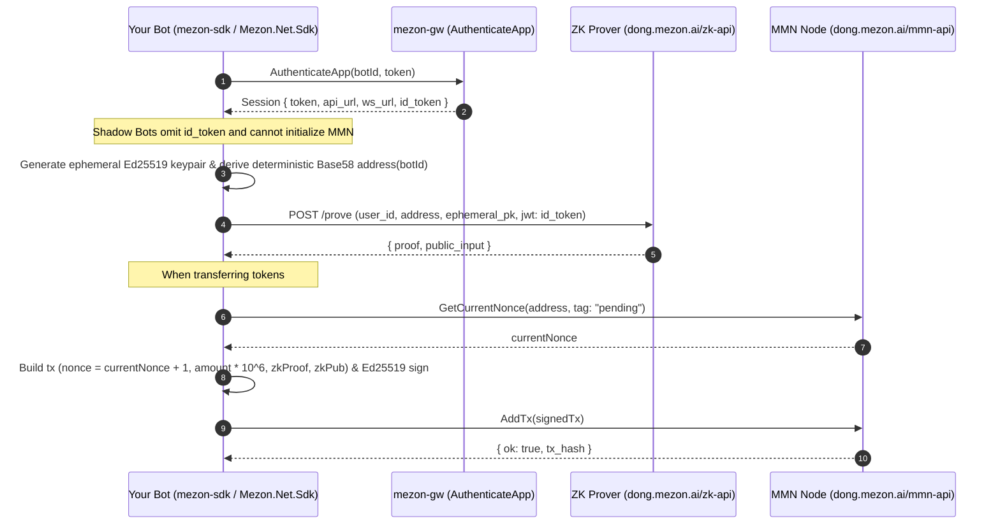

# Payments & MMN overview

**Mezon Dong (₫)** is Mezon's native digital token running on **MMN (Mezon Mainnet)**. Both human users and standard bots can hold deterministic MMN addresses derived from their Mezon snowflake ID, query balances and transaction history via the public explorer at [`https://dong.mezon.ai`](https://dong.mezon.ai), and submit signed token transfers.

## Cryptographic transfer architecture

MMN uses **zkLogin-style authentication** combining an ephemeral **Ed25519** keypair with a **Zero-Knowledge (ZK) proof** tied to the bot's Mezon `id_token`:

## Public endpoints & units

| Resource | Default URL / value | Purpose |
|---|---|---|
| Public explorer | `https://dong.mezon.ai` | Browse accounts, balances, and transaction hashes |
| MMN JSON-RPC API | `https://dong.mezon.ai/mmn-api/` | Account lookup, pending nonces, and `AddTx` submission |
| ZK Prover API | `https://dong.mezon.ai/zk-api/` | Generates ZK proofs binding `id_token` to an ephemeral Ed25519 public key |
| Token precision | **6 decimals** (`1 ₫ = 1,000,000` base units) | `mmn-client-js` scales via `scaleAmountToDecimals()`; `Mezon.Net.Sdk` expects scaled `BigInteger` base units |

## Shadow Bot limitation

:::warning Shadow Bots cannot send MMN tokens
In `mezon-gw` (`api_authenticate.go`), `AuthenticateApp` explicitly skips minting `id_token` when `isShadow == true`. Because the ZK Prover requires a valid `id_token` JWT to authorize your ephemeral Ed25519 keypair, **Shadow Bots cannot initialize MMN or call `sendToken` / `SendTransferAsync`**. Use a standard bot application if your bot needs to send Mezon Dong.
:::

## Nonce concurrency

Every transfer increments the sender account's **pending nonce** (`pendingNonce + 1`). Submitting two transactions in parallel without waiting for the first nonce reservation causes a nonce collision and rejects one transfer:

- `Mezon.Net.Sdk` (`1.11.0`) automatically serializes transfers with an internal `SemaphoreSlim` (`_mmnTransferGate`).
- In `mezon-sdk` (`2.8.68`), serialize concurrent `client.sendToken(...)` calls in a queue on your application side so pending nonces never collide.

## Related

- [Bot token transfers](./bot-token-transfers.mdx)
- [Standalone MMN SDKs](./mmn-sdks.md)
- [Authentication and sessions](../core-concepts/authentication-and-sessions.md)
