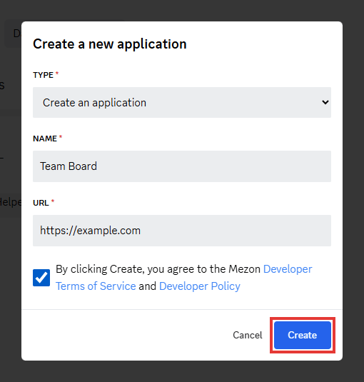
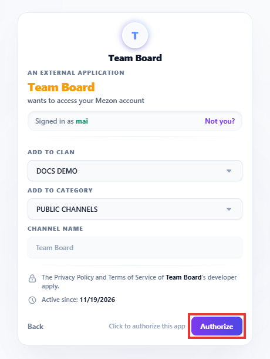
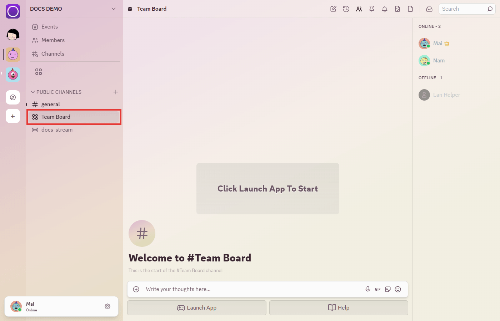

# Create a channel app

A channel app is your website, opened from a channel of a clan. Register it in the Mezon developer portal, then install it in a clan. Use a computer browser; you need a Mezon account.

## Create the app

1. Open the [Mezon developer portal](https://mezon.ai/developers/applications) and log in with your Mezon account.
2. Click **New Application or Bot**.
3. Under **TYPE**, select **Create an application**.
4. Under **NAME**, type the app's name.
5. Under **URL**, type the address of your website, for example `https://app.example.com`.
6. Tick the box to accept the Mezon Developer Terms of Service and Developer Policy.
7. Click **Create**.

   

The app's **General Information** page opens. It shows the app's id and its **Token**, as for a bot.

:::warning
Click **Copy Token** and keep the token on your server. The portal shows it only once. Your server needs it to check who opened the app: see [Check who opened your app](../mezon-sdk/channel-app-sdk/channel-app-auth-flow.mdx).
:::

## Install the app in a clan

Installing the app adds a channel for it to the clan. You need the **Manage Channels** permission in that clan.

1. Open the **Installation** tab of your app.
2. Under **Install Link**, click **Copy**.
3. Open the link in your browser.
4. Under **Add to clan**, choose the clan.
5. Under **Add to category**, choose the category for the app's channel.
6. Under **Channel Name**, type a name for the channel, or leave it empty to use the app's name. The name keeps letters, digits, spaces, `-` and `_`, up to 32 characters.
7. Click **Authorize**.

   

The app appears as a channel in the clan's channel list.

## Next steps

- [Channel apps overview](../mezon-sdk/channel-app-sdk/overview.md): how members open your app and what it receives.
- [Check who opened your app](../mezon-sdk/channel-app-sdk/channel-app-auth-flow.mdx)
