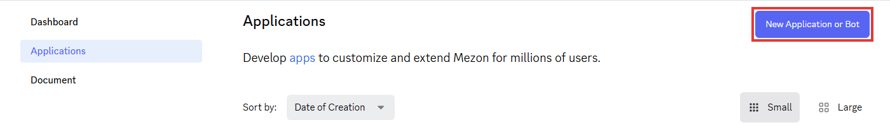
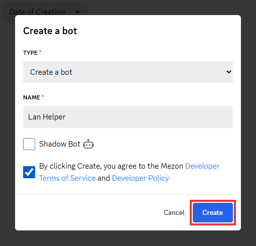
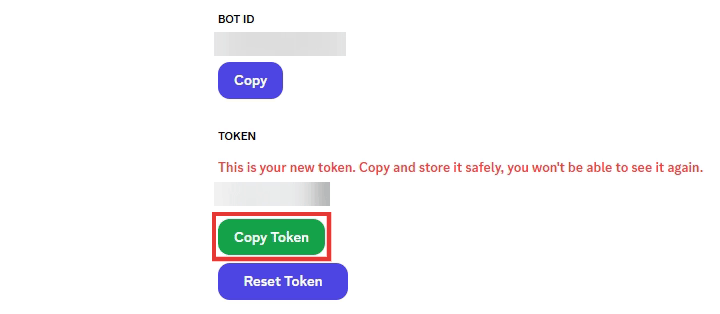
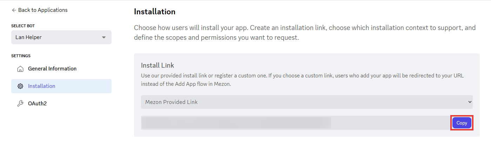
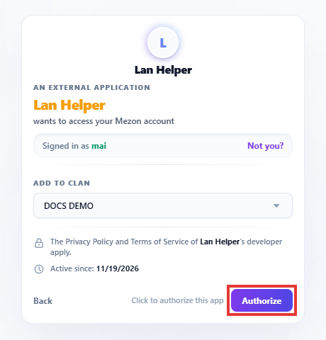

# Create a bot

Create the bot's account in the Mezon developer portal, keep its Bot ID and token, then add it to a clan. Use a computer browser; you need a Mezon account.

## Create the bot

1. Open the [Mezon developer portal](https://mezon.ai/developers/applications) and log in with your Mezon account.
2. Click **New Application or Bot**.

   

3. Under **TYPE**, select **Create a bot**.
4. Under **NAME**, type the bot's name.
5. Tick the box to accept the Mezon Developer Terms of Service and Developer Policy. **Create** stays disabled until you do.
6. Click **Create**.

   

The bot's **General Information** page opens.

:::note Shadow Bot
The create form also has a **Shadow Bot** switch. In shadow mode, the bot can receive all messages sent to the creator, but it cannot send messages. Leave it off for a normal bot.
:::

## Keep the Bot ID and token

Your program logs in with two values from the **General Information** page:

- **Bot ID**: the bot's user id.
- **Token**: the bot's secret.

1. Click **Copy Token**.
2. Store the token in a safe place, for example a secret manager or an environment variable on your server.

   

:::warning
The portal shows a token only once, when it is created. If you lose it, click **Reset Token** to get a new one, and update your program. Never put the token in source code or in a chat message.
:::

## Add the bot to a clan

A bot works only in the clans it was added to. To add it, you need the **Manage Clan** permission in that clan.

1. Open the **Installation** tab of your bot.
2. Under **Install Link**, click **Copy**.

   

3. Open the link in your browser.
4. Under **Add to clan**, choose the clan.
5. Click **Authorize**.

   

A **Success!** page confirms that the bot was added to the clan. Share the install link with clan owners who want your bot.

## Next steps

- [Write your first bot in JavaScript or TypeScript](../mezon-sdk/integration-bot-sdk/getting-started.md)
- [Write your first bot in .NET](../mezon-sdk/dotnet-sdk.md)
- [What bots are allowed to do](../mezon-sdk/bot-api-access.md)
