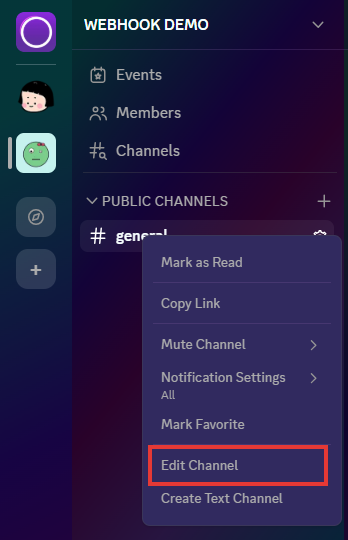
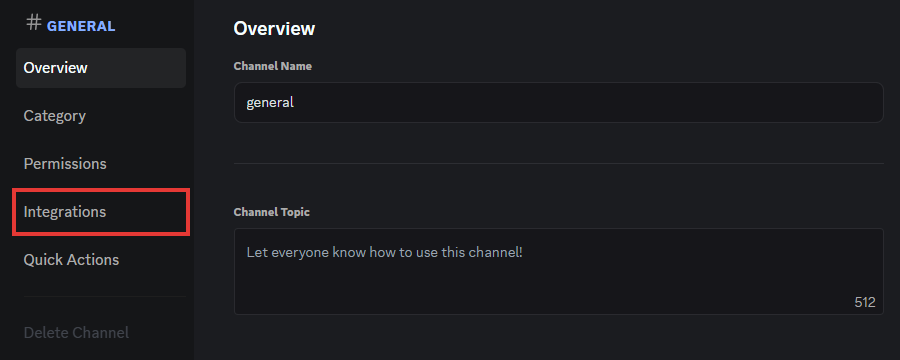
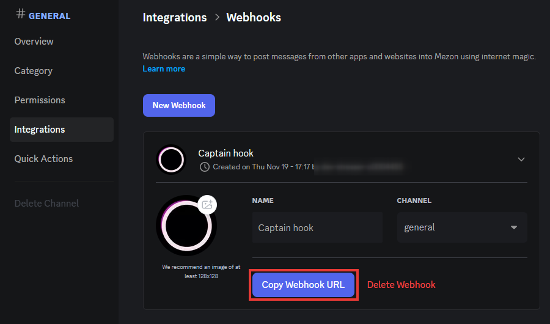

import Tabs from "@theme/Tabs";
import TabItem from "@theme/TabItem";

# Channel webhook

A channel webhook posts messages to one channel. The messages show the webhook's name and avatar, which you can change.

## Create a channel webhook

You need the **Manage Channels** permission in the clan. These steps use the Mezon web app on a computer.

1. In the channel list, right-click the channel.
2. Click **Edit Channel**.

   

3. Open the **Integrations** tab.

   

4. Click **Create Webhook**. If the channel already has webhooks, click **View Webhook** instead.
5. Click **New Webhook**. Mezon creates a webhook with a random name and avatar.
6. Click the webhook to open it, then click **Copy Webhook URL**.

   

Store the URL as a secret. In the open webhook you can also change its name, avatar and channel. If the URL leaks, click **Delete Webhook** and create a new one.

## Send a message

Send a `POST` request to the webhook URL with the header `Content-Type: application/json`. The URL has this form:

```text
https://webhook.mezon.ai/webhooks/CHANNEL_ID/TOKEN
```

Use the URL exactly as you copied it.

### Body

```json
{
  "type": "hook",
  "message": {
    "t": "Build passed: https://example.com/builds/42 @Hoa",
    "mk": [
      { "type": "b", "s": 0, "e": 12 },
      { "type": "lk", "s": 14, "e": 43 }
    ],
    "mentions": [{ "user_id": "USER_ID", "s": 44, "e": 48 }]
  }
}
```

| Field | Type | Required | Meaning |
|---|---|---|---|
| `type` | string | Yes | Any value, for example `"hook"`. The key must be present. |
| `message.t` | string | Yes | The text of the message. |
| `message.mk` | array | No | Formatting ranges in `t`: `{ "type", "s", "e" }`. `type` is for example `"b"` (bold) or `"lk"` (link). |
| `message.mentions` | array | No | Members to mention: `{ "user_id" or "username", "s", "e" }`. |
| `message.images` | array | No | Images to show: `{ "url", "fn", "ft", "w", "h", "sz" }`. |

`s` and `e` are the start and end positions of a range in `t`, counted in UTF-16 characters (as JavaScript counts them), with `e` not included. In the example, `"b"` covers `Build passed` (0 to 12) and the mention covers `@Hoa` (44 to 48).

#### Mentions

Give each mention a `user_id` (the member's id, as a string) or a `username`. Mentioned members get a mention notification. Mezon keeps only mentions of members who can see the channel: other names stay plain text and notify no one. `@here` does not work in webhook messages either.

#### Images

| Field | Meaning |
|---|---|
| `url` | The full public URL of the image, for example `https://example.com/chart.png`. A URL without a scheme and host, such as `/chart.png`, makes the request fail. |
| `fn` | The file name. |
| `ft` | The file type, for example `image/png`. |
| `w`, `h` | Width and height in pixels. |
| `sz` | Size in bytes. |

### Examples

Set `WEBHOOK_URL` to your webhook URL before you run them.

<Tabs groupId="code">
<TabItem value="bash" label="curl" default>

```bash
curl -X POST "$WEBHOOK_URL" \
  -H "Content-Type: application/json" \
  -d '{"type":"hook","message":{"t":"Build passed: https://example.com/builds/42 @Hoa","mk":[{"type":"b","s":0,"e":12},{"type":"lk","s":14,"e":43}],"mentions":[{"user_id":"USER_ID","s":44,"e":48}]}}'
```

</TabItem>
<TabItem value="js" label="JavaScript">

```js
const payload = {
  type: "hook",
  message: {
    t: "Build passed: https://example.com/builds/42 @Hoa",
    mk: [
      { type: "b", s: 0, e: 12 },
      { type: "lk", s: 14, e: 43 },
    ],
    mentions: [{ user_id: "USER_ID", s: 44, e: 48 }],
  },
};

fetch(process.env.WEBHOOK_URL, {
  method: "POST",
  headers: { "Content-Type": "application/json" },
  body: JSON.stringify(payload),
}).then(async (response) => console.log(response.status, await response.text()));
```

</TabItem>
<TabItem value="python" label="Python">

```python
import json
import os
import urllib.request

payload = {
    "type": "hook",
    "message": {
        "t": "Build passed: https://example.com/builds/42 @Hoa",
        "mk": [
            {"type": "b", "s": 0, "e": 12},
            {"type": "lk", "s": 14, "e": 43},
        ],
        "mentions": [{"user_id": "USER_ID", "s": 44, "e": 48}],
    },
}

request = urllib.request.Request(
    os.environ["WEBHOOK_URL"],
    data=json.dumps(payload).encode(),
    headers={"Content-Type": "application/json"},
    method="POST",
)
with urllib.request.urlopen(request) as response:
    print(response.status, response.read().decode())
```

</TabItem>
<TabItem value="go" label="Go">

```go
package main

import (
	"bytes"
	"encoding/json"
	"fmt"
	"io"
	"net/http"
	"os"
)

func main() {
	payload := map[string]any{
		"type": "hook",
		"message": map[string]any{
			"t": "Build passed: https://example.com/builds/42 @Hoa",
			"mk": []map[string]any{
				{"type": "b", "s": 0, "e": 12},
				{"type": "lk", "s": 14, "e": 43},
			},
			"mentions": []map[string]any{{"user_id": "USER_ID", "s": 44, "e": 48}},
		},
	}
	body, _ := json.Marshal(payload)

	response, err := http.Post(os.Getenv("WEBHOOK_URL"), "application/json", bytes.NewReader(body))
	if err != nil {
		fmt.Println(err)
		return
	}
	defer response.Body.Close()
	text, _ := io.ReadAll(response.Body)
	fmt.Println(response.StatusCode, string(text))
}
```

</TabItem>
<TabItem value="csharp" label="C#">

```csharp
using System.Net.Http.Json;

var payload = new
{
    type = "hook",
    message = new
    {
        t = "Build passed: https://example.com/builds/42 @Hoa",
        mk = new[]
        {
            new { type = "b", s = 0, e = 12 },
            new { type = "lk", s = 14, e = 43 },
        },
        mentions = new[] { new { user_id = "USER_ID", s = 44, e = 48 } },
    },
};

using var http = new HttpClient();
var response = await http.PostAsJsonAsync(Environment.GetEnvironmentVariable("WEBHOOK_URL"), payload);
Console.WriteLine($"{(int)response.StatusCode} {await response.Content.ReadAsStringAsync()}");
```

</TabItem>
</Tabs>

The message appears in the channel:


## Responses and limits

Mezon answers `200` as soon as it has accepted the request, and posts the message right after. Problems found after that, such as a deleted channel, are not reported back.

| Status | Body | Cause |
|---|---|---|
| `200` | (empty) | Accepted. |
| `400` | `Invalid JSON` | The body is not JSON. |
| `400` | `Invalid token` | The token is wrong, or it belongs to another channel than the one in the URL. |
| `400` | `Invalid attachment URL` | An image `url` is not a full URL. |

- A body without a `type` key is accepted with `200`, but its `message` is not posted.
- If the message content (`t` and `mk`, as JSON) is longer than 4,000 bytes, Mezon posts "The original message was too long" instead. Letters with accents, such as Vietnamese letters, take 2 or 3 bytes each.
- Hashtags (`hg`) are not supported: channel names in `t` stay plain text.
- The sender is always the webhook's name and avatar.

## Related

- [Webhooks overview](./overview.mdx)
- [Clan webhook](./clan-webhook.mdx)
