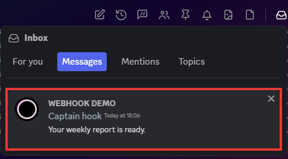

import Tabs from "@theme/Tabs";
import TabItem from "@theme/TabItem";

# Clan webhook

A clan webhook delivers a persistent notification directly into one clan member's **Inbox → Messages** tab, displaying the clan name alongside the webhook's name and avatar. You choose the recipient dynamically in the final URL path segment.

<ApiBadge method="POST" path="https://webhook.mezon.ai/clanwebhooks/YOUR_WEBHOOK_TOKEN/USERNAME_OR_USER_ID" />

## Permissions

| Action | Required clan permission (`api_clan_webhook.go`) |
|---|---|
| Create a clan webhook (`GenerateClanWebhook`) | **Manage Channel** |
| Update, reset token, or delete (`UpdateClanWebhookById`, `DeleteClanWebhookById`) | **Manage Clan** |

## Create a clan webhook

1. Click the clan name at the top of the channel sidebar and select **Clan Settings**.

   

2. Open **Integrations** and click **Create Clan Webhook** (or **View Clan Webhook** if clan webhooks already exist).

   

3. Click **New Clan Webhook**, expand the entry, and click **Copy Webhook URL**.

   

Keep the URL secret. If it ever leaks, click **Reset Token** (requires **Manage Clan**) to invalidate the old token immediately.

## Send a message

Append the target member's **username** or **user ID** (snowflake) to the copied URL and send an `HTTP POST` with `Content-Type: application/json`:

```text
https://webhook.mezon.ai/clanwebhooks/YOUR_WEBHOOK_TOKEN/USERNAME_OR_USER_ID
```

The recipient must be a current member of the clan (`CheckUserInClan`).

### Request body

```json
{
  "content": "{\"t\":\"Your weekly report is ready.\",\"mk\":[{\"type\":\"b\",\"s\":0,\"e\":18}]}",
  "attachments": [
    { "url": "https://example.com/report.png", "filetype": "image/png" }
  ]
}
```

| Field | Type | Required | Description |
|---|---|---|---|
| `content` | string | Yes | **A JSON-encoded string** (not a JSON object) representing `{ "t": "...", "mk": [...] }`. Serialize it with `JSON.stringify` / `json.dumps` / `json.Marshal` / `JsonSerializer.Serialize`. |
| `attachments` | array | No | Array of `{ "url", "filetype" }`. Every `url` is validated (`ValidateURL` requires full scheme + host). Mezon embeds the **first** attachment (`AttachmentLink` / `AttachmentType`) and sets `HasMoreAttachment = true` when more than one attachment is supplied (`api_clan_webhook.go`). |

### Examples

Set `CLAN_WEBHOOK_URL="https://webhook.mezon.ai/clanwebhooks/YOUR_WEBHOOK_TOKEN/USERNAME_OR_USER_ID"` in your environment.

<Tabs groupId="code">
<TabItem value="bash" label="curl" default>

```bash
curl -X POST "$CLAN_WEBHOOK_URL" \
  -H "Content-Type: application/json" \
  -d '{"content":"{\"t\":\"Your weekly report is ready.\"}","attachments":[{"url":"https://example.com/report.png","filetype":"image/png"}]}'
```

</TabItem>
<TabItem value="js" label="JavaScript">

```js
const body = {
  content: JSON.stringify({ t: "Your weekly report is ready." }),
  attachments: [{ url: "https://example.com/report.png", filetype: "image/png" }],
};

const res = await fetch(process.env.CLAN_WEBHOOK_URL, {
  method: "POST",
  headers: { "Content-Type": "application/json" },
  body: JSON.stringify(body),
});
console.log(res.status, await res.text());
```

</TabItem>
<TabItem value="python" label="Python">

```python
import json
import os
import urllib.request

body = {
    "content": json.dumps({"t": "Your weekly report is ready."}),
    "attachments": [{"url": "https://example.com/report.png", "filetype": "image/png"}],
}

req = urllib.request.Request(
    os.environ["CLAN_WEBHOOK_URL"],
    data=json.dumps(body).encode("utf-8"),
    headers={"Content-Type": "application/json"},
    method="POST",
)
with urllib.request.urlopen(req) as res:
    print(res.status, res.read().decode())
```

</TabItem>
<TabItem value="go" label="Go">

```go
package main

import (
	"bytes"
	"encoding/json"
	"fmt"
	"io"
	"net/http"
	"os"
)

func main() {
	inner, _ := json.Marshal(map[string]any{"t": "Your weekly report is ready."})
	body, _ := json.Marshal(map[string]any{
		"content": string(inner),
		"attachments": []map[string]string{
			{"url": "https://example.com/report.png", "filetype": "image/png"},
		},
	})

	resp, err := http.Post(os.Getenv("CLAN_WEBHOOK_URL"), "application/json", bytes.NewReader(body))
	if err != nil {
		panic(err)
	}
	defer resp.Body.Close()
	text, _ := io.ReadAll(resp.Body)
	fmt.Println(resp.StatusCode, string(text))
}
```

</TabItem>
<TabItem value="csharp" label="C#">

```csharp
using System.Net.Http.Json;
using System.Text.Json;

var body = new
{
    content = JsonSerializer.Serialize(new { t = "Your weekly report is ready." }),
    attachments = new[] { new { url = "https://example.com/report.png", filetype = "image/png" } },
};

using var http = new HttpClient();
var response = await http.PostAsJsonAsync(Environment.GetEnvironmentVariable("CLAN_WEBHOOK_URL"), body);
Console.WriteLine($"{(int)response.StatusCode} {await response.Content.ReadAsStringAsync()}");
```

</TabItem>
</Tabs>

The recipient sees the notification under **Inbox → Messages**:



## Error responses

| HTTP status | Response body | Cause |
|---|---|---|
| `200` | *(empty)* | Notification queued and badge updated. |
| `400` | `Invalid JSON` | Body is not valid JSON. |
| `400` | `invalid token` | Token is invalid, deleted, or was reset. |
| `400` | `User not in clan` | Target user ID / username does not belong to the clan. |
| `400` | `Invalid attachment URL` | An attachment `url` lacks a valid scheme and host. |
| `404` | `Not Found` | URL is missing the trailing `/{username_or_user_id}` path segment. |

## Related

- [Webhooks overview](./overview.mdx)
- [Channel webhook](./channel-webhook.mdx)
