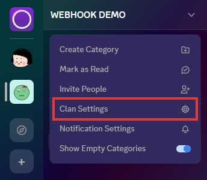
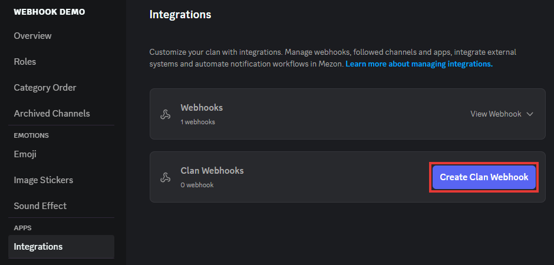
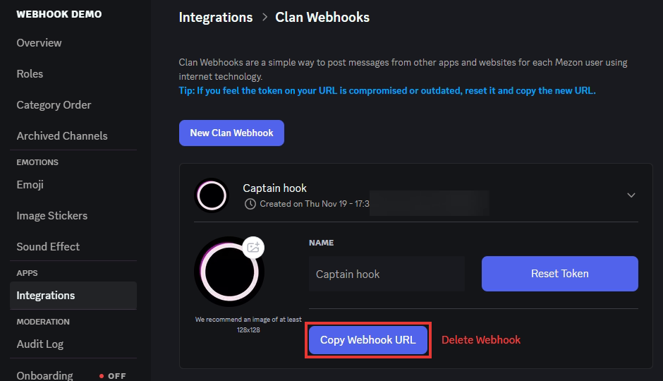

import Tabs from "@theme/Tabs";
import TabItem from "@theme/TabItem";

# Clan webhook

A clan webhook sends a message to one member of the clan. You choose the member in the URL. The message arrives in the member's **Inbox**, on the **Messages** tab, with the clan's name and the webhook's name and avatar.

## Create a clan webhook

You need the **Manage Channels** permission to create a clan webhook, and **Manage Clan** to edit or delete one. These steps use the Mezon web app on a computer.

1. Click the clan name at the top of the channel list.
2. Click **Clan Settings**.

   

3. Click **Integrations** in the settings menu.
4. Next to **Clan Webhooks**, click **Create Clan Webhook**. If the clan already has clan webhooks, click **View Clan Webhook** instead.

   

5. Click **New Clan Webhook**. Mezon creates a webhook with a random name and avatar.
6. Click the webhook to open it, then click **Copy Webhook URL**.

   

Store the URL as a secret. If it leaks, click **Reset Token**: the old URL stops working.

## Send a message

Add the member to the end of the copied URL, then send a `POST` with the header `Content-Type: application/json`:

```text
https://webhook.mezon.ai/clanwebhooks/TOKEN/USERNAME_OR_USER_ID
```

The last part is the member's username or user id. The member must be in the clan.

### Body

```json
{
  "content": "{\"t\":\"Your weekly report is ready.\"}",
  "attachments": [{ "url": "https://example.com/report.png", "filetype": "image/png" }]
}
```

| Field | Type | Required | Meaning |
|---|---|---|---|
| `content` | string | Yes | The message, as a JSON string: `{"t": "text", "mk": [...]}`. `t` is the text; `mk` adds formatting, as in a [channel webhook](./channel-webhook.mdx#body). |
| `attachments` | array | No | Files to show: `{ "url", "filetype" }`. Mezon shows only the first one. |

`content` is a string that contains JSON, not a JSON object. Build it with `JSON.stringify` (or your language's equivalent), as in the examples.

Each attachment `url` must be a full URL, with a scheme and a host.

### Examples

Set `CLAN_WEBHOOK_URL` to your clan webhook URL, with the member's username or user id at the end.

<Tabs groupId="code">
<TabItem value="bash" label="curl" default>

```bash
curl -X POST "$CLAN_WEBHOOK_URL" \
  -H "Content-Type: application/json" \
  -d '{"content":"{\"t\":\"Your weekly report is ready.\"}"}'
```

</TabItem>
<TabItem value="js" label="JavaScript">

```js
const body = {
  content: JSON.stringify({ t: "Your weekly report is ready." }),
  attachments: [{ url: "https://example.com/report.png", filetype: "image/png" }],
};

fetch(process.env.CLAN_WEBHOOK_URL, {
  method: "POST",
  headers: { "Content-Type": "application/json" },
  body: JSON.stringify(body),
}).then(async (response) => console.log(response.status, await response.text()));
```

</TabItem>
<TabItem value="python" label="Python">

```python
import json
import os
import urllib.request

body = {
    "content": json.dumps({"t": "Your weekly report is ready."}),
    "attachments": [{"url": "https://example.com/report.png", "filetype": "image/png"}],
}

request = urllib.request.Request(
    os.environ["CLAN_WEBHOOK_URL"],
    data=json.dumps(body).encode(),
    headers={"Content-Type": "application/json"},
    method="POST",
)
with urllib.request.urlopen(request) as response:
    print(response.status, response.read().decode())
```

</TabItem>
</Tabs>

The member sees the message in **Inbox** → **Messages**:


## Responses

| Status | Body | Cause |
|---|---|---|
| `200` | (empty) | The message was sent. |
| `400` | `Invalid JSON` | The body is not JSON. |
| `400` | `invalid token` | The token in the URL is wrong or was reset. |
| `400` | `User not in clan` | The member is not in the clan, or the username does not exist. |
| `400` | `Invalid attachment URL` | An attachment `url` is not a full URL. |
| `404` | `Not Found` | The URL has no username or user id at the end. |

## Related

- [Webhooks overview](./overview.mdx)
- [Channel webhook](./channel-webhook.mdx)
