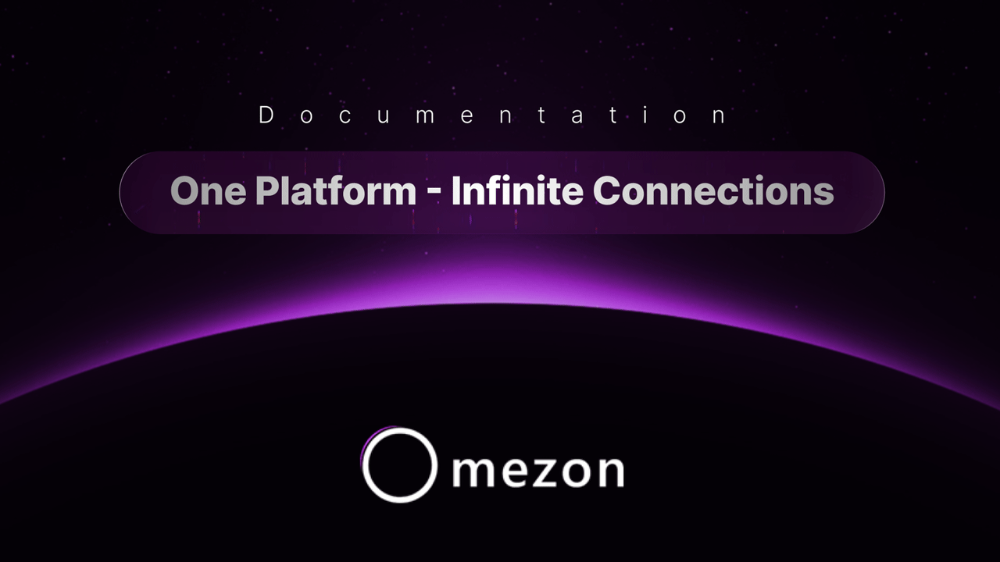

# Welcome to Mezon

**Mezon** is the live, work and play platform. Chat with one person or a group, talk in voice channels, and work together in communities called clans. Mezon runs on Android phones, iPhones, Windows, macOS and Linux computers, and in a web browser.

## New to Mezon? Start here

1. [**Quick start**](./quick-start.mdx): install Mezon, log in, join your team's clan, chat, talk and invite people.
2. [**Features at a glance**](./features-at-a-glance.mdx): everything you can do in Mezon, and on which devices.

## Guides

### Account and personalization

Download Mezon, log in, find your way around the screen, and change your profile and settings.

See [Account and personalization](./account-and-personalization/index.mdx).

### Friends and messages

Add friends, send direct messages, start group chats, and call one person by voice or video.

See [Friends and messaging](./friends-and-messaging/index.mdx).

### Clans

A clan is a space for a team, a class or a community. It has text channels for messages, voice channels for talking, and stream channels for watching live streams. Clan owners add channels, give roles, invite people and plan events.

See [What is a clan](./clan/what-is-clan.mdx).

### Bots and apps

Add bots and apps to your clan to do more, for example run commands or open a web app in a channel. You can also add an AI agent to a voice call.

See [Bots and apps](./bots-and-apps/index.mdx).

### Mezon Dong

Mezon Dong is the currency inside Mezon. Send it to other people and see your transaction history.

See [Mezon Dong](./mezon-dong/index.mdx).

### Questions and websites

Find quick answers and the list of official Mezon websites.

See [Resources](./resources/index.mdx).

## For developers

Build bots and apps for Mezon with the Mezon SDK, webhooks and APIs.

See the [developer docs](../developer/intro.mdx).
