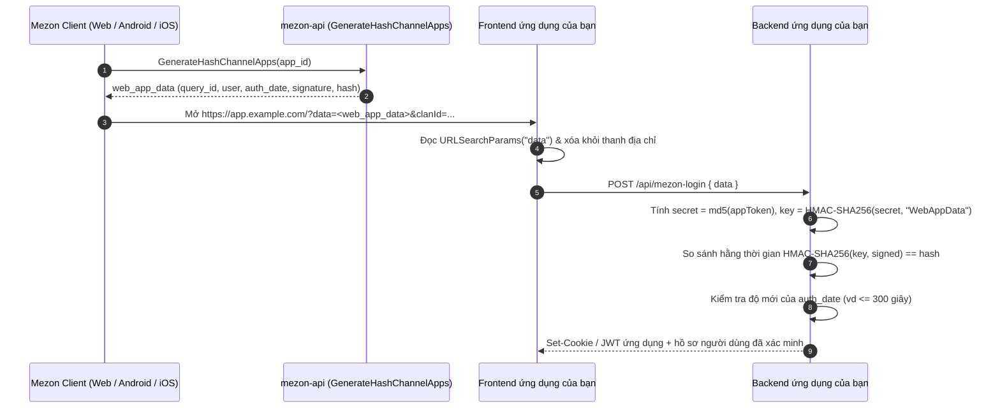

import Tabs from "@theme/Tabs";
import TabItem from "@theme/TabItem";

# Xác minh dữ liệu khởi chạy

Khi thành viên bấm **Launch App** trên Mezon (Web, Android hoặc iOS), Mezon gọi `GenerateHashChannelApps` để ký danh tính thành viên bằng **Token** ứng dụng của bạn và mở URL kèm `?data=...`. Backend của bạn phải kiểm tra chữ ký HMAC-SHA256 trước khi tạo phiên đăng nhập.

:::danger Không bao giờ xác minh `data` trên trình duyệt
Quá trình xác minh cần **Token** bí mật của ứng dụng. Hãy giữ token hoàn toàn trên máy chủ; tuyệt đối không đưa vào mã JavaScript frontend hay ứng dụng di động.
:::

## Luồng xác thực



## Cấu trúc của `data`

Sau khi giải mã tham số query `data` đúng một lần (như `URLSearchParams.get("data")` thực hiện), bạn nhận được năm tham số theo thứ tự cố định (`api_channel_app.go`):

```text
query_id=AbCdEfGhIjKlMnOpQrStUvWx&user=%7B%22id%22%3A1234567890123456789%2C...%7D&auth_date=1795083705&signature=ZGM5...%3D%3D&hash=e30db1ab...
```

| Tham số | Ý nghĩa |
|---|---|
| `query_id` | Chuỗi ngẫu nhiên 24 ký tự được sinh cho mỗi lần khởi chạy. |
| `user` | Chuỗi JSON đã mã hóa URL chứa thông tin thành viên mở ứng dụng. |
| `auth_date` | Mốc thời gian Unix (giây) khi `mezon-api` ký gói dữ liệu. |
| `signature` | Chữ ký phụ dạng Base64 trên `auth_date` bằng khóa `"WebAppSignature"`. Đã nằm trong vùng ký của `hash`, bạn không cần kiểm tra riêng. |
| `hash` | 64 ký tự hex chữ thường: chữ ký HMAC-SHA256 trên đúng chuỗi con đứng trước `&hash=`. |

Ví dụ JSON `user` sau khi giải mã:

```json
{
  "id": 1234567890123456789,
  "username": "mai.nguyen",
  "display_name": "Mai Nguyen",
  "avatar_url": "https://example.com/avatar.png"
}
```

:::warning Độ chính xác Snowflake ID 64-bit trong JavaScript
`user.id` được tuần tự hóa thành số JSON 64-bit (tới 19 chữ số). `JSON.parse()` mặc định của JavaScript sẽ âm thầm làm tròn các số lớn hơn `Number.MAX_SAFE_INTEGER` (`2^53 - 1`), làm sai lệch ID người dùng. Luôn trích xuất `id` dưới dạng chuỗi (hoặc dùng bộ phân tích JSON hỗ trợ BigInt) như ví dụ Node.js bên dưới.
:::

## Thuật toán xác minh HMAC chính xác

`mezon-api` tính `hash` qua ba bước cố định:

1. `secret` = `md5(appToken)` ở dạng **32 ký tự hex chữ thường** (chuỗi UTF-8, **không** phải 16 byte nhị phân thô).
2. `key` = `HMAC-SHA256(key = secret, message = "WebAppData")` (giá trị digest nhị phân 32 byte).
3. `expected_hash` = `HMAC-SHA256(key = key, message = signed)` ở dạng **64 ký tự hex chữ thường**, trong đó `signed` là đúng chuỗi con của `data` nằm trước `&hash=` cuối cùng.

Sau đó thực hiện hai bước kiểm tra bắt buộc:

- **So sánh hằng thời gian** (constant-time) giữa `expected_hash` và `hash`.
- **Kiểm tra độ mới** của `auth_date`: Mezon không tự giới hạn tuổi của `data` phía máy chủ. Hãy từ chối dữ liệu cũ hơn ngưỡng cho phép (ví dụ `300` giây) và chặn mốc thời gian lệch quá xa về tương lai.

:::caution Không mã hóa lại, sắp xếp lại hay giải mã `data` hai lần
Hãy băm đúng chuỗi con `signed` sau một lần giải mã query duy nhất. Việc sắp xếp lại tham số hoặc gọi thêm `decodeURIComponent` sẽ khiến chữ ký HMAC không bao giờ khớp.
:::

## Mã xác minh trên backend

<Tabs groupId="backend-lang">
<TabItem value="node" label="Node.js" default>

```js
const crypto = require("node:crypto");

function checkMezonData(data, appToken, maxAgeSeconds = 300) {
  const at = data.lastIndexOf("&hash=");
  if (at < 0) return null;

  const signed = data.slice(0, at);
  const hash = Buffer.from(data.slice(at + "&hash=".length), "utf8");

  const secret = crypto.createHash("md5").update(appToken).digest("hex");
  const key = crypto.createHmac("sha256", secret).update("WebAppData").digest();
  const expected = Buffer.from(
    crypto.createHmac("sha256", key).update(signed).digest("hex"),
    "utf8",
  );

  if (hash.length !== expected.length || !crypto.timingSafeEqual(hash, expected)) {
    return null;
  }

  const params = new URLSearchParams(signed);
  const authDate = Number(params.get("auth_date"));
  const age = Date.now() / 1000 - authDate;
  if (!Number.isFinite(authDate) || age > maxAgeSeconds || age < -60) {
    return null;
  }

  const userJson = params.get("user") ?? "";
  const user = JSON.parse(userJson);
  // Giữ nguyên Snowflake ID 64-bit dạng chuỗi, tránh lỗi làm tròn IEEE-754
  user.id = /"id":\s*(\d+)/.exec(userJson)?.[1] ?? String(user.id);
  return user;
}

module.exports = { checkMezonData };
```

</TabItem>
<TabItem value="python" label="Python">

```python
import hashlib
import hmac
import json
import time
from urllib.parse import parse_qs


def check_mezon_data(data: str, app_token: str, max_age_seconds: int = 300) -> dict | None:
    signed, sep, received_hash = data.rpartition("&hash=")
    if not sep:
        return None

    secret = hashlib.md5(app_token.encode("utf-8")).hexdigest()
    key = hmac.new(secret.encode("utf-8"), b"WebAppData", hashlib.sha256).digest()
    expected = hmac.new(key, signed.encode("utf-8"), hashlib.sha256).hexdigest()

    if not hmac.compare_digest(expected, received_hash):
        return None

    params = parse_qs(signed, keep_blank_values=True)
    auth_date = int(params["auth_date"][0])
    age = time.time() - auth_date
    if age > max_age_seconds or age < -60:
        return None

    user = json.loads(params["user"][0])
    # Số nguyên Python không bị mất độ chính xác; chuyển sang str khi trả về cho JS
    user["id"] = str(user["id"])
    return user
```

</TabItem>
<TabItem value="go" label="Go">

```go
package main

import (
	"crypto/hmac"
	"crypto/md5"
	"crypto/sha256"
	"encoding/hex"
	"encoding/json"
	"errors"
	"net/url"
	"strconv"
	"strings"
	"time"
)

type MezonUser struct {
	ID          int64  `json:"id"`
	Username    string `json:"username"`
	DisplayName string `json:"display_name"`
	AvatarURL   string `json:"avatar_url"`
}

func CheckMezonData(data, appToken string, maxAge time.Duration) (*MezonUser, error) {
	at := strings.LastIndex(data, "&hash=")
	if at < 0 {
		return nil, errors.New("missing hash")
	}
	signed, received := data[:at], data[at+len("&hash="):]

	sum := md5.Sum([]byte(appToken))
	secret := hex.EncodeToString(sum[:])

	keyMac := hmac.New(sha256.New, []byte(secret))
	keyMac.Write([]byte("WebAppData"))

	dataMac := hmac.New(sha256.New, keyMac.Sum(nil))
	dataMac.Write([]byte(signed))
	expected := hex.EncodeToString(dataMac.Sum(nil))

	if !hmac.Equal([]byte(expected), []byte(received)) {
		return nil, errors.New("invalid hash")
	}

	params, err := url.ParseQuery(signed)
	if err != nil {
		return nil, err
	}
	authDate, err := strconv.ParseInt(params.Get("auth_date"), 10, 64)
	if err != nil {
		return nil, errors.New("invalid auth_date")
	}
	age := time.Since(time.Unix(authDate, 0))
	if age > maxAge || age < -time.Minute {
		return nil, errors.New("launch data expired")
	}

	var user MezonUser
	if err := json.Unmarshal([]byte(params.Get("user")), &user); err != nil {
		return nil, err
	}
	return &user, nil
}
```

</TabItem>
<TabItem value="csharp" label="C#">

```csharp
using System.Security.Cryptography;
using System.Text;
using System.Text.Json;
using System.Web;

public sealed record MezonUser(long Id, string Username, string DisplayName, string AvatarUrl);

public static class MezonLaunchDataVerifier
{
    public static MezonUser? Verify(string data, string appToken, TimeSpan maxAge)
    {
        var at = data.LastIndexOf("&hash=", StringComparison.Ordinal);
        if (at < 0) return null;

        var signed = data[..at];
        var received = data[(at + "&hash=".Length)..];

        var secret = Convert.ToHexString(MD5.HashData(Encoding.UTF8.GetBytes(appToken))).ToLowerInvariant();
        var key = HMACSHA256.HashData(Encoding.UTF8.GetBytes(secret), Encoding.UTF8.GetBytes("WebAppData"));
        var expected = Convert.ToHexString(HMACSHA256.HashData(key, Encoding.UTF8.GetBytes(signed))).ToLowerInvariant();

        var expectedBytes = Encoding.ASCII.GetBytes(expected);
        var receivedBytes = Encoding.ASCII.GetBytes(received);
        if (expectedBytes.Length != receivedBytes.Length ||
            !CryptographicOperations.FixedTimeEquals(expectedBytes, receivedBytes))
        {
            return null;
        }

        var query = HttpUtility.ParseQueryString(signed);
        if (!long.TryParse(query["auth_date"], out var authUnix)) return null;
        var age = DateTimeOffset.UtcNow - DateTimeOffset.FromUnixTimeSeconds(authUnix);
        if (age > maxAge || age < TimeSpan.FromMinutes(-1)) return null;

        using var doc = JsonDocument.Parse(query["user"] ?? "{}");
        var root = doc.RootElement;
        return new MezonUser(
            root.GetProperty("id").GetInt64(),
            root.TryGetProperty("username", out var u) ? u.GetString() ?? "" : "",
            root.TryGetProperty("display_name", out var d) ? d.GetString() ?? "" : "",
            root.TryGetProperty("avatar_url", out var a) ? a.GetString() ?? "" : "");
    }
}
```

</TabItem>
</Tabs>

## Gửi `data` từ frontend lên backend

Đọc `data` một lần bằng `URLSearchParams`, xóa khỏi thanh địa chỉ bằng `history.replaceState` để tránh rò rỉ qua header `Referer` hay lịch sử trình duyệt, rồi gửi `POST` lên backend:

```html
<script>
  const data = new URLSearchParams(location.search).get("data");
  if (data) {
    history.replaceState(null, "", location.pathname);
    fetch("/api/mezon-login", {
      method: "POST",
      headers: { "Content-Type": "application/json" },
      body: JSON.stringify({ data }),
    })
      .then((res) => (res.ok ? res.json() : Promise.reject(res.status)))
      .then(({ user }) => {
        document.body.textContent = `Xin chào ${user.display_name || user.username}`;
      })
      .catch(() => {
        document.body.textContent = "Hãy mở ứng dụng bằng nút Launch App trong Mezon.";
      });
  }
</script>
```

## Các lỗi xác minh thường gặp

| Hiện tượng | Nguyên nhân & cách xử lý |
|---|---|
| `data` là `null` | Thành viên chọn trực tiếp kênh ứng dụng thay vì bấm **Launch App**. |
| `hash` không bao giờ khớp | Token ứng dụng bị sai hoặc đã reset, **hoặc** `data` bị giải mã hai lần (ví dụ gọi `decodeURIComponent()` sau khi lấy từ `URLSearchParams.get("data")`), **hoặc** dùng 16 byte MD5 thô thay vì chuỗi 32 ký tự hex chữ thường làm `secret`. |
| Các chữ số cuối của `user.id` biến thành `00` trong JS | `JSON.parse()` làm tròn Snowflake ID 64-bit. Hãy trích `id` dưới dạng chuỗi từ văn bản JSON gốc. |

## Liên quan

- [Tổng quan Channel App](./overview.md)
- [Hướng dẫn với Express](./tutorial-express.md)
- [Mã lỗi và xử lý sự cố](../../reference/error-codes-and-troubleshooting.md)
