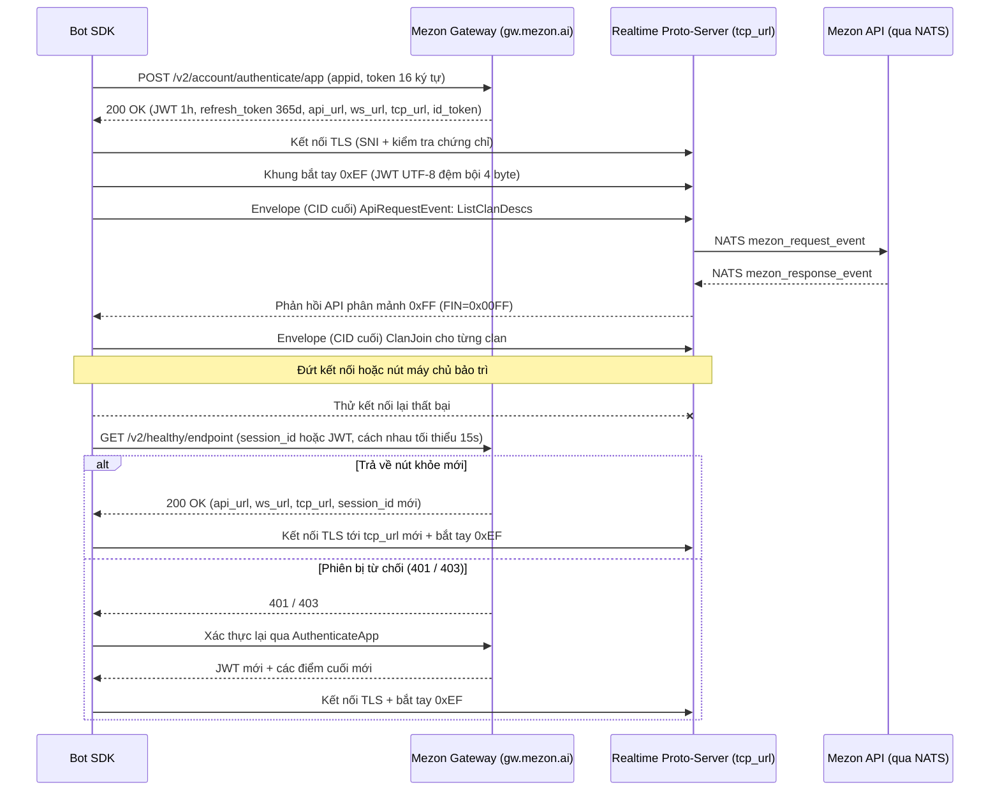

# Kiến trúc & tầng truyền tải

Mezon tách biệt rõ **xác thực và định tuyến** khỏi **nhắn tin thời gian thực** và **RPC nghiệp vụ**. Hiểu rõ cấu trúc này giúp bạn lý giải vì sao SDK giữ được độ trễ thấp khi lượng tin nhắn lớn và tự phục hồi mượt mà khi máy chủ phía sau xoay vòng nút.

## Bản đồ dịch vụ

| Dịch vụ | Điểm cuối mặc định / Vai trò | Giao thức |
| --- | --- | --- |
| **Mezon Gateway** (`mezon-gw`) | `https://gw.mezon.ai:443` — xác thực bot/ứng dụng và trả về điểm cuối phân mảnh (`api_url`, `ws_url`, `tcp_url`) | HTTPS REST / gRPC-gateway |
| **Realtime Proto-Server** (`mezon-proto-server`) | Máy chủ socket có trạng thái xử lý sự kiện `Envelope` thời gian thực và các lời gọi API-qua-socket trên nhánh nóng | TLS TCP rút gọn (`0xEF`) hoặc WebSocket |
| **Mezon API** (`mezon-api`) | Dịch vụ RPC nghiệp vụ gắn PostgreSQL, nhận yêu cầu qua NATS từ `mezon-proto-server` (và qua HTTPS) | NATS / gRPC / HTTP |
| **Voice SFU & Streaming** (`mezon-sfu`, `mezon-streaming-server`) | Phòng thoại/họp WebRTC và kênh phát trực tiếp WHIP/LL-HLS, ủy quyền bằng mã cấp phép ngắn hạn | WebRTC / WHIP / LL-HLS |
| **Mạng Mezon Đồng** (`dong.mezon.ai`) | `https://dong.mezon.ai/mmn-api/` và `https://dong.mezon.ai/zk-api/` cho giao dịch chuyển token có chứng minh ZK | HTTP / gRPC |

## Vòng đời khởi tạo qua Gateway & chuyển dự phòng

Cả `mezon-sdk` (Node.js) và `Mezon.Net.Sdk` (.NET) đều thực thi cùng một chu trình kết nối gồm 3 bước:

1. **Khởi tạo qua Gateway** <ApiBadge method="POST" path="/v2/account/authenticate/app" /> — Gửi `(botId, token)` để nhận phiên làm việc gồm JWT truy cập có hạn 1 giờ, refresh token 365 ngày, `api_url`, `ws_url`, `tcp_url` và (với bot thường) `id_token`.
2. **Mở socket TLS TCP rút gọn** <ApiBadge method="TCP" path="0xEF TLS Abridged" /> — Kết nối thẳng tới `tcp_url` qua TLS có xác minh SNI, gửi khung bắt tay `0xEF` chứa JWT và tham gia chat của từng clan (`joinClanChat`).
3. **Chuyển dự phòng bằng kiểm tra sức khỏe** <ApiBadge method="GET" path="/v2/healthy/endpoint" /> — Khi kết nối lại socket thất bại, SDK gọi `getHealthyEndpoint` (giới hạn tối đa 1 lần mỗi 15 giây trong `mezon-sdk`). Nếu Gateway trả về `tcp_url`/`api_url` mới, SDK tự động chuyển socket; nếu nhận `401` hoặc `403`, SDK ép xác thực lại từ đầu.

## Giao thức dây TLS TCP rút gọn

Các SDK bot chính thức kết nối tới `mezon-proto-server` bằng **TLS TCP rút gọn (Abridged TCP)** thay cho WebSocket trình duyệt nhằm loại bỏ chi phí nâng cấp HTTP và che mặt nạ (masking) từng khung gói.

### 1. Khung bắt tay (`0xEF`)

Ngay khi sự kiện TLS `secureConnect` hoàn tất, phía client gửi duy nhất một khung xác thực:

- **Byte mở đầu**: `0xEF`.
- **Dữ liệu**: Các byte UTF-8 của JWT phiên, được đệm thêm các byte `0x00` sao cho tổng độ dài chia hết cho 4 (`lengthDiv4 = paddedLen / 4`).
- **Tiêu đề độ dài**:
  - Nếu `lengthDiv4 < 0x7F` (127 từ = 508 byte): `[0xEF, lengthDiv4]` (header 2 byte).
  - Ngược lại: `[0xEF, 0x7F, len_lo, len_mid, len_hi]` (header 5 byte với `lengthDiv4` 24-bit little-endian).

### 2. Khung gửi đi (mã hóa CID ở cuối)

Mọi gói protobuf `Envelope` gửi đi đều áp dụng **mã hóa CID ở cuối (CID-last)**: mã tương quan (`cid`, trường protobuf số `1`, quay vòng từ `1..65535`) được ghi ở phần cuối gói protobuf (`0x08` + varint `cid`) để `mezon-proto-server` đọc hoặc tách trực tiếp mà không phải cấp phát lại bộ đệm.

- Dữ liệu protobuf được đệm `0x00` thành bội của 4 byte (tối đa `1 MiB` mỗi khung thời gian thực; hàng đợi ghi tối đa `8 MiB` trong `mezon-sdk`).
- **Tiêu đề**: 1 byte `lengthDiv4` nếu `< 0x7F`, hoặc `0x7F` kèm 3 byte `lengthDiv4` theo thứ tự little-endian.
- **Ping**: Khung điều khiển gọn 3 byte `[0x00, cid_hi, cid_lo]` (`u16` big-endian).

### 3. Tách khung nhận về

Byte đầu tiên của mỗi khung từ máy chủ quyết định bộ giải mã tương ứng:

| Byte đầu | Loại khung | Bố cục & giới hạn |
| --- | --- | --- |
| `0x00` | **TCP Pong** | Tổng 3 byte: `[0x00, cid_hi, cid_lo]` khớp với CID gói Ping của client |
| `0xFF` | **Phản hồi API thô phân mảnh** | Header 11 byte: `0xFF` + `cid` (`u16 BE`) + `code` (`u32 BE`, 16 bit cao là mã trạng thái, 16 bit thấp `0x00FF` là cờ `FIN`) + `payloadLength` (`u32 BE`), theo sau là byte phản hồi protobuf (ghép tối đa `16 MiB`) |
| `0x01`–`0x7E` | **`Envelope` rút gọn ngắn** | Độ dài tải = `firstByte * 4` byte (phần đệm 0 ở cuối được tách khi duyệt trường protobuf) |
| `0x7F` | **`Envelope` rút gọn mở rộng** | 3 byte little-endian `lengthDiv4` (`payloadLength = lengthDiv4 * 4`, tối đa `1 MiB`) |
| `0x82` | **Khung nhị phân WebSocket không che** | Khung nhị phân RFC 6455 đóng đường hầm qua TCP mang `Envelope` hoặc `ChannelMessage` thô |

Mọi sự kiện đẩy tự động từ máy chủ đều mang `cid = 0`.

## Hai nhánh yêu cầu trên cùng một socket

Sau khi xác thực, bot ghép kênh hai nhóm yêu cầu trên duy nhất một kết nối TLS TCP:

1. **Thông điệp `Envelope` thời gian thực** — Gửi trực tiếp nhánh `oneof` trong `Envelope` protobuf (ví dụ `channel_message_send`, `ephemeral_message_send`, `channel_join`, `clan_join`, `message_reaction`). Độ trễ rất thấp, gửi và nhận xác nhận tức thì.
2. **API qua socket (API-over-socket)** — Đóng gói trong `Envelope.api_request_event { api_index, api_name, body }`. `mezon-proto-server` kiểm tra `is_bot_allowed_api(api_index)`, tự phục vụ các RPC nhánh nóng (như `GetStreamPlayback`) và chuyển tiếp các RPC hợp lệ khác sang `mezon-api` qua NATS (`mezon_request_event` / `mezon_response_event`).

:::note Bảng `api_index` chỉ thêm mới (append-only)
Bảng chỉ số `api_index` chỉ cho phép nối thêm và được đồng bộ giữa `mezon-proto-server`, `mezon-api`, `mezon-sdk` và `Mezon.Net`. Hãy luôn cập nhật SDK để các RPC mới ánh xạ đúng chỉ số.
:::

## Liên quan

- [Xác thực & vòng đời phiên](./authentication-and-sessions.md) — thời hạn token, các trường JWT và bot ẩn.
- [Phân quyền & danh sách API cho bot](./permissions-and-api-access.md) — bảng danh sách RPC được phép trên tầng socket và API.
- [Mã lỗi & xử lý sự cố](../reference/error-codes-and-troubleshooting.md) — chẩn đoán đứt kết nối, lệch khung và quá thời gian chờ.
