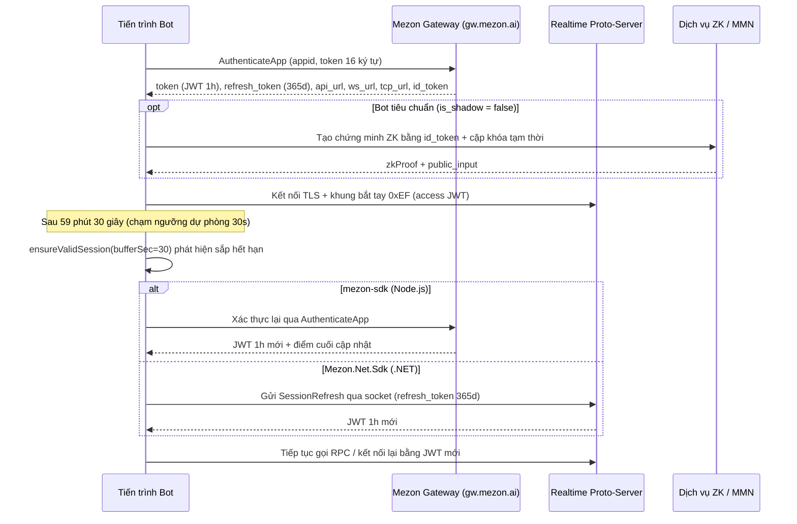

# Xác thực & vòng đời phiên

Mezon sử dụng **JWT phiên HS256 ngắn hạn** đi kèm **refresh token dài hạn** cho mọi phiên bot. Các SDK tự động làm mới token, nhưng hiểu rõ các trường claim và thời hạn giúp bạn chẩn đoán nhanh lỗi `401`/`403` và triển khai an toàn.

## Các loại thông tin xác thực

| Thành phần | Định dạng | Nơi cấp phát | Mục đích sử dụng |
| --- | --- | --- | --- |
| **Bot / App ID** | Số nguyên Snowflake 64-bit (`string` trong JS, `long` trong .NET) | Developer Portal → Thông tin chung | Yêu cầu `AuthenticateApp` (`account.appid`) |
| **Bot / App Token** | Chuỗi bí mật 16 ký tự (`LEN_TOKEN_APP = 16`), hiện một lần | Developer Portal → Thông tin chung | `AuthenticateApp` (`account.token`) & xác minh HMAC của Ứng dụng kênh |
| **Access JWT (`token`)** | JWT ký HS256, **hạn 1 giờ** (`3600s`) | Trả về từ `gw.mezon.ai` `AuthenticateApp` | Khung bắt tay socket `0xEF` & header `Authorization: Bearer` |
| **Refresh Token (`refresh_token`)** | JWT ký HS256, **hạn 365 ngày** (`31536000s`) | Trả về từ `gw.mezon.ai` `AuthenticateApp` | Gia hạn phiên không cần gửi lại bí mật tĩnh (`.NET` `SessionRefresh`) |
| **ID Token (`id_token`)** | JWT định danh có chữ ký (bị bỏ qua với bot ẩn) | Trả về từ `gw.mezon.ai` `AuthenticateApp` | Tạo chứng minh ZK (`zk-api`) cho giao dịch Mezon Đồng (MMN) |

## Quy trình trao đổi token & tự động gia hạn

Khi gọi `client.login()` (`mezon-sdk`) hoặc `client.LoginAsync()` (`Mezon.Net.Sdk`), SDK gửi <ApiBadge method="POST" path="/v2/account/authenticate/app" /> tới `https://gw.mezon.ai:443`.



### Cách từng SDK xử lý hết hạn

- **`mezon-sdk` (`2.8.68`)**: Trước các lời gọi API và khi kết nối lại socket, `ensureValidSession(bufferSec = 30)` kiểm tra xem JWT có sắp hết hạn trong vòng 30 giây hay không. Nếu có, SDK gộp các yêu cầu đồng thời vào một `reAuthPromise` duy nhất, gọi `SessionManager.reAuthenticate()` lên `gw.mezon.ai`, cập nhật `clan.sessionToken` cho toàn bộ clan đang lưu đệm và áp dụng điểm cuối mới nếu thay đổi.
- **`Mezon.Net.Sdk` (`1.11.0`)**: Bật `autoRefreshSession: true` trong `LoginAsBotInternalAsync`, tự động làm mới JWT truy cập qua socket `SessionRefresh` bằng refresh token 365 ngày. Gọi `client.GetAuthTokenAsync()` hoặc `client.GetSessionIdAsync()` luôn trả về thông tin còn hiệu lực.

## Các trường trong Session JWT (`SessionTokenClaims`)

`mezon-gw` ký mọi token truy cập của bot với cấu trúc claim JSON như sau:

```json
{
  "tid": "550e8400-e29b-41d4-a716-446655440000",
  "uid": 1234567890123456789,
  "usn": "my-bot",
  "vrs": {
    "appname": "my-bot",
    "shadow": "false",
    "creator": "9876543210987654321"
  },
  "exp": 1795749600
}
```

Cả `mezon-proto-server` (`handshake.c`) lẫn `mezon-api` (`server/api.go`) xác định một kết nối là **bot** khi `vrs` chứa **đồng thời** hai khóa `appname` và `shadow`:

- **`isBot = has("appname") && has("shadow")`** → Áp dụng [Danh sách API cho phép bot](./permissions-and-api-access.md#bot-api-allowlist).
- **`isExternal = vrs["appname"] == "external"`** (cấp bởi `AuthenticateIdToken` cho `mezon-light-sdk`) → Áp dụng [Danh sách 5 RPC cho token External](./permissions-and-api-access.md#external-token-allowlist-mezon-light-sdk).

## Bot Ẩn (Shadow Bot) {#shadow-bots}

Khi bot được tạo với công tắc **Bot Ẩn** bật (`is_shadow: true`), hàm `AuthenticateApp` trong `mezon-gw/server/api_authenticate.go` thay đổi hành vi phiên theo ba điểm cụ thể:

1. **Kế thừa danh tính người tạo**: `uid` và `usn` trong phiên được gán bằng `user_id` và `username` của **người tạo bot** thay vì ID Snowflake của bot, đồng thời đặt `vrs["shadow"] = "true"`.
2. **Không cấp `id_token` (không dùng MMN/ZK)**: `AuthenticateApp` bỏ qua `GenIdToken` và trả về `id_token` rỗng. Do đó bot ẩn không thể khởi tạo chứng minh ZK hay gửi giao dịch Mezon Đồng.
3. **Chỉ được gửi tin nhắn trực tiếp (DM)**: `mezon-api` từ chối mọi thao tác gửi bên ngoài DM từ phiên bot ẩn (`isBot && isShadow == "true" && mode != StreamModeDM` trả về `PermissionDenied`). Bot ẩn vẫn nhận sự kiện của tài khoản người tạo và gửi được tin nhắn trực tiếp (`STREAM_MODE_DM`), nhưng không thể gửi tin hay thả biểu cảm vào kênh clan, luồng hoặc nhóm.

:::tip Khi nào nên bật chế độ Bot Ẩn
Hãy để **tắt** đối với mọi bot clan thông thường. Chỉ bật khi bạn xây dựng công cụ tự động cá nhân gắn riêng với tài khoản của chính mình để lắng nghe hoạt động và nhắn kết quả qua DM.
:::

## Danh sách kiểm tra bảo mật vận hành

- **Không ghi cứng khóa bí mật**: Nạp `MEZON_BOT_ID` và `MEZON_BOT_TOKEN` từ biến môi trường hoặc trình quản lý bí mật.
- **Không ghi log token phiên**: Không in `session.token`, `session.refresh_token`, `session.id_token`, `session_id`, JWT phòng họp hay URL cấp quyền WHIP/HLS ra stdout hoặc hệ thống thu thập log.
- **Xoay vòng ngay khi lộ khóa**: Nhấn **Đặt lại Token** trong Developer Portal sẽ lập tức chặn mọi lần gọi `AuthenticateApp` mới bằng chuỗi bí mật cũ.

## Liên quan

- [Tạo bot](../getting-started/create-a-bot.md) — cách tạo và xoay vòng token 16 ký tự.
- [Phân quyền & danh sách API cho bot](./permissions-and-api-access.md) — phạm vi gọi API của token bot, bot ẩn và external.
- [Tổng quan Mezon Đồng & MMN](../payments-and-mmn/overview.md) — cách `id_token` phục vụ giao dịch chuyển token có chứng minh ZK.
