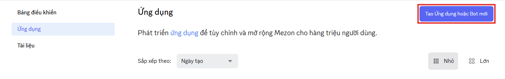
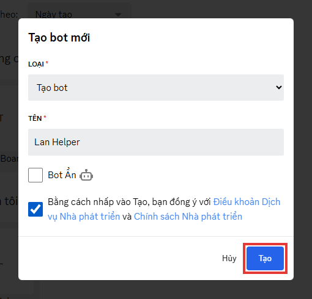
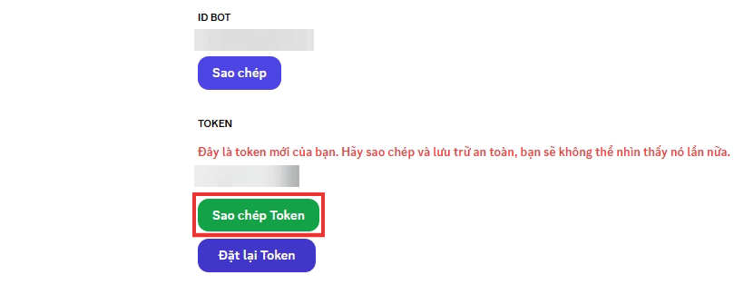
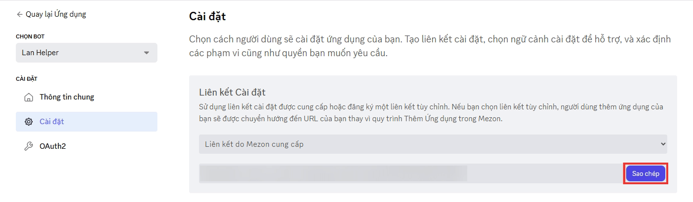
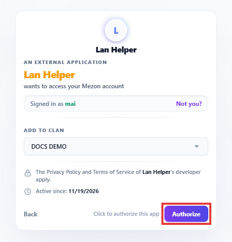

# Tạo bot

Đăng ký tài khoản bot trên Mezon Developer Portal, lưu lại **ID Bot** cùng **Token**, sau đó cấp quyền đưa bot vào một clan. Hãy dùng trình duyệt trên máy tính và đăng nhập bằng tài khoản Mezon của bạn.

## 1. Tạo tài khoản bot

1. Mở [Mezon Developer Portal](https://mezon.ai/developers/applications) và đăng nhập bằng tài khoản Mezon.
2. Nhấn **Tạo Ứng dụng hoặc Bot mới**.

   

3. Ở mục **LOẠI**, chọn **Tạo bot**.
4. Ở mục **TÊN**, nhập tên hiển thị cho bot.
5. Đánh dấu ô đồng ý với Điều khoản Dịch vụ Nhà phát triển và Chính sách Nhà phát triển của Mezon. Nút **Tạo** chỉ sáng lên sau khi bạn đánh dấu.
6. Nhấn **Tạo**.

   

Trang **Thông tin chung** của bot sẽ tự động mở ra.

:::info Công tắc Bot Ẩn (Shadow Bot)
Biểu mẫu tạo có tùy chọn bật/tắt **Bot Ẩn** (`is_shadow: true`). Hãy để **tắt** đối với bot thông thường. Khi bật, `AuthenticateApp` gắn phiên đăng nhập với `user_id` và `username` của người tạo, không cấp `id_token` (nên không dùng được giao dịch MMN/ZK), và chỉ cho phép gửi tin nhắn trực tiếp (`STREAM_MODE_DM`) — mọi thao tác gửi vào kênh, luồng hay nhóm sẽ bị trả về `PermissionDenied`. Xem chi tiết tại [Bot Ẩn](../core-concepts/authentication-and-sessions.md#shadow-bots).
:::

## 2. Lưu ID Bot và token

Chương trình của bạn xác thực với `gw.mezon.ai` bằng hai giá trị trên trang **Thông tin chung**:

- **ID Bot**: ID người dùng Snowflake 64-bit của bot (dùng kiểu `string` trong JavaScript/TypeScript hoặc `long` trong C#).
- **Token**: Chuỗi bí mật dài 16 ký tự (`LEN_TOKEN_APP = 16`).

1. Nhấn **Sao chép Token**.
2. Lưu cả hai giá trị vào trình quản lý bí mật hoặc biến môi trường (ví dụ `MEZON_BOT_ID` và `MEZON_BOT_TOKEN`).

   

:::warning Token chỉ hiện một lần
Developer Portal chỉ hiển thị token **duy nhất một lần** ngay khi tạo. Nếu bạn làm mất, hãy nhấn **Đặt lại Token** để sinh chuỗi bí mật 16 ký tự mới và cập nhật vào môi trường chạy. Việc đặt lại token sẽ vô hiệu hóa các lần xác thực mới dùng khóa cũ.
:::

## 3. Thêm bot vào clan

Bot chỉ nhận sự kiện và gửi tin nhắn trong các clan đã cài đặt nó. Để thêm bot, bạn cần có quyền **Quản lý Clan** trong clan đích.

1. Mở thẻ **Cài đặt** của bot.
2. Ở mục **Liên kết Cài đặt**, nhấn **Sao chép**.

   

3. Mở liên kết cài đặt trong trình duyệt.
4. Ở mục **Add to clan** (trang ủy quyền hiển thị nhãn tiếng Anh), chọn clan muốn thêm bot.
5. Nhấn **Authorize**.

   

Trang **Success!** xác nhận bot đã vào clan. Bạn có thể chia sẻ cùng **Liên kết Cài đặt** này cho các quản trị viên clan khác muốn cài bot của bạn.

:::tip Kênh riêng tư
Sau khi vào clan, bot tự động thấy các kênh công khai. Để bot đọc hoặc trả lời trong **kênh riêng tư**, hãy thêm bot vào danh sách thành viên của kênh đó trong ứng dụng Mezon.
:::

## Bước tiếp theo

- [Bắt đầu nhanh với bot JavaScript/TypeScript](../bot-sdks/javascript/quickstart.md) (`mezon-sdk` 2.8.68 trên Node.js)
- [Bắt đầu nhanh với bot .NET](../bot-sdks/dotnet/quickstart.md) (`Mezon.Net.Sdk` 1.11.0 trên .NET)
- [Phân quyền & danh sách API cho bot](../core-concepts/permissions-and-api-access.md) — nắm rõ danh sách API máy chủ cho phép bot gọi
