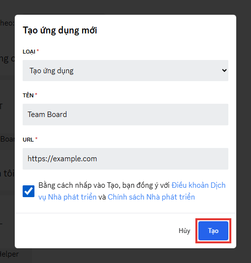
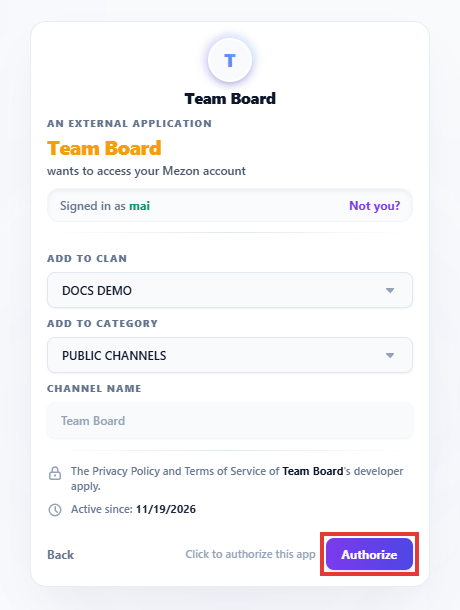
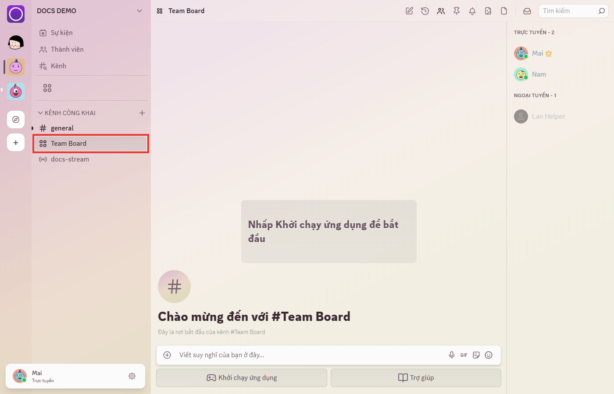

# Tạo ứng dụng trong kênh

**Ứng dụng trong kênh (Channel App)** là một ứng dụng web tiêu chuẩn chạy trên máy chủ HTTPS của riêng bạn và được mở trực tiếp từ một kênh trong clan Mezon. Khi thành viên mở ứng dụng, Mezon đính kèm dữ liệu khởi chạy có chữ ký về người dùng và clan vào tham số URL (`?data=`) để backend của bạn xác thực danh tính mà không cần màn hình đăng nhập riêng.

Hãy dùng trình duyệt trên máy tính và đăng nhập bằng tài khoản Mezon của bạn.

## 1. Đăng ký ứng dụng

1. Mở [Mezon Developer Portal](https://mezon.ai/developers/applications) và đăng nhập bằng tài khoản Mezon.
2. Nhấn **Tạo Ứng dụng hoặc Bot mới**.
3. Ở mục **LOẠI**, chọn **Tạo ứng dụng**.
4. Ở mục **TÊN**, nhập tên ứng dụng.
5. Ở mục **URL**, nhập địa chỉ HTTPS của trang web (ví dụ `https://app.example.com`).
6. Đánh dấu ô đồng ý với Điều khoản Dịch vụ Nhà phát triển và Chính sách Nhà phát triển của Mezon.
7. Nhấn **Tạo**.

   

Trang **Thông tin chung** của ứng dụng sẽ mở ra cùng **App ID** và **Token**.

:::warning Giữ App Token trên máy chủ backend
Nhấn **Sao chép Token** và lưu chuỗi bí mật 16 ký tự này hoàn toàn trên máy chủ backend. Developer Portal chỉ hiển thị token **duy nhất một lần**. Máy chủ của bạn dùng token này để kiểm tra chữ ký HMAC của dữ liệu khởi chạy — tuyệt đối không đưa vào mã trình duyệt. Xem [Xác minh dữ liệu khởi chạy](../channel-apps-and-widgets/channel-apps/verifying-launch-data.mdx).
:::

## 2. Cài ứng dụng vào clan

Việc cài đặt sẽ tạo một kênh ứng dụng (`CHANNEL_TYPE_APP = 8`) trong clan đích. Bạn cần có quyền **Quản lý kênh** trong clan đó.

1. Mở thẻ **Cài đặt** của ứng dụng.
2. Ở mục **Liên kết Cài đặt**, nhấn **Sao chép**.
3. Mở liên kết trong trình duyệt.
4. Ở mục **Add to clan** (trang ủy quyền hiển thị nhãn tiếng Anh), chọn clan đích.
5. Ở mục **Add to category**, chọn danh mục chứa kênh ứng dụng.
6. Ở mục **Channel Name**, nhập tên kênh hoặc để trống để dùng tên ứng dụng. Tên giữ lại chữ cái, chữ số, khoảng trắng, `-` và `_`, tối đa 32 ký tự.
7. Nhấn **Authorize**.

   

Ứng dụng lúc này xuất hiện như một kênh chuyên biệt trong danh sách kênh của clan:

## Bước tiếp theo

- [Tổng quan ứng dụng trong kênh](../channel-apps-and-widgets/channel-apps/overview.md) — tìm hiểu vòng đời khởi chạy và dữ liệu truyền qua URL.
- [Xác minh dữ liệu khởi chạy](../channel-apps-and-widgets/channel-apps/verifying-launch-data.mdx) — kiểm tra chữ ký HMAC an toàn trên máy chủ.
- [Hướng dẫn với Express](../channel-apps-and-widgets/channel-apps/tutorial-express.md) — xây dựng hoàn chỉnh một ứng dụng trong kênh.
