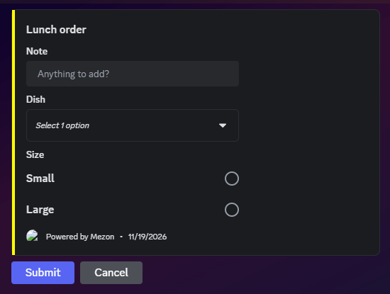

import Tabs from "@theme/Tabs";
import TabItem from "@theme/TabItem";

# Tin nhắn tương tác

Bot Mezon có thể đính kèm nút bấm, ô nhập liệu, danh sách chọn (dropdown), nhóm radio, bộ chọn ngày và thẻ hoạt ảnh ngay trong tin nhắn kênh hoặc tin nhắn trực tiếp (DM). Khi thành viên bấm nút hoặc gửi biểu mẫu, Mezon gửi sự kiện tương tác thời gian thực về luồng thông báo của bot.

:::danger Ranh giới bảo mật: `MessageButtonClicked.user_id` do client gửi lên
`mezon-api` chuyển tiếp nguyên vẹn sự kiện `MessageButtonClicked` về bot mà không ghi đè `user_id` từ phiên đã xác thực (`api_interactive_message.go`). Bất kỳ client nào đã đăng nhập đều có thể giả mạo `event.user_id` khi bấm nút.

- **KHÔNG** chỉ dựa vào `MessageButtonClicked.user_id` để phân quyền các hành động nhạy cảm (cấp vai trò, chuyển token, lệnh quản trị, hoặc truy xuất dữ liệu riêng tư).
- Ngược lại, `DropdownBoxSelected.user_id` **được** máy chủ ghi đè bằng ID người dùng của phiên đã xác thực.
- Trong `Mezon.Net.Sdk`, `InteractionRouter` mô hình hóa rõ sự khác biệt này qua `InteractionActorTrust.ClientSupplied` (nút bấm) và `InteractionActorTrust.ServerAuthenticated` (menu chọn).
:::

## Gửi nút bấm

Nút bấm nằm trong các hàng hành động (action row) thuộc mảng `components`. Mỗi hàng hành động là một đối tượng bọc mảng các thành phần nút (`components: [{ components: row }]`).

<Tabs groupId="sdk-lang">
<TabItem value="ts" label="TypeScript (mezon-sdk)" default>

```ts
import { ButtonBuilder, EButtonMessageStyle } from "mezon-sdk";

const channel = await client.channels.fetch("CHANNEL_ID");

const row = new ButtonBuilder()
  .addButton("approve", "Duyệt", EButtonMessageStyle.SUCCESS)
  .addButton("reject", "Từ chối", EButtonMessageStyle.DANGER)
  .build();

await channel.send({
  t: "Phê duyệt đơn nghỉ phép này?",
  components: [{ components: row }],
});
```

</TabItem>
<TabItem value="csharp" label="C# (Mezon.Net.Sdk)">

```csharp
using Mezon.Net.Client;
using Mezon.Net.Sdk.Builders;

var channel = await client.GetChannelAsync(channelId);

var row = new ButtonBuilder()
    .AddButton("approve", "Duyệt", (int)MessageButtonStyle.Success)
    .AddButton("reject", "Từ chối", (int)MessageButtonStyle.Danger)
    .BuildComponents();

var content = new MessageContentBuilder()
    .SetText("Phê duyệt đơn nghỉ phép này?")
    .AddActionRow(row)
    .Build();

await channel.SendMessageAsync(content);
```

</TabItem>
</Tabs>

### Kiểu hiển thị nút bấm

| Kiểu | Giá trị số | Enum `mezon-sdk` | Enum `Mezon.Net.Sdk` |
|---|---|---|---|
| Chính (Primary) | `1` | `EButtonMessageStyle.PRIMARY` | `MessageButtonStyle.Primary` |
| Phụ (Secondary) | `2` | `EButtonMessageStyle.SECONDARY` | `MessageButtonStyle.Secondary` |
| Thành công (Success) | `3` | `EButtonMessageStyle.SUCCESS` | `MessageButtonStyle.Success` |
| Cảnh báo (Danger) | `4` | `EButtonMessageStyle.DANGER` | `MessageButtonStyle.Danger` |
| Liên kết (Link) | `5` | `EButtonMessageStyle.LINK` | `MessageButtonStyle.Link` |

:::warning Cấu trúc lồng nhau của hàng hành động
`components` bắt buộc phải là mảng các hàng hành động (`[{ components: [...] }]`). Nếu truyền thẳng mảng phẳng do `ButtonBuilder.build()` trả về dạng `components: row`, ứng dụng Mezon sẽ không hiển thị nút nào.
:::

## Xử lý bấm nút và định tuyến tương tác

<Tabs groupId="sdk-lang">
<TabItem value="ts" label="TypeScript (mezon-sdk)" default>

```ts
client.onMessageButtonClicked(async (event) => {
  const channel = await client.channels.fetch(event.channel_id);

  if (event.button_id === "approve") {
    await channel.send({ t: "Đã đánh dấu phê duyệt." });
  } else if (event.button_id === "reject") {
    await channel.send({ t: "Đã đánh dấu từ chối." });
  }
});
```

</TabItem>
<TabItem value="csharp" label="C# (Mezon.Net.Sdk)">

`Mezon.Net.Sdk` cung cấp `InteractionRouter` hỗ trợ khớp ID chính xác hoặc theo tiền tố (`*`), route chạy một lần (one-shot), hết hạn tự động và kiểm soát mức độ tin cậy của người thao tác:

```csharp
using Mezon.Net.Sdk.Interactions;

var router = new InteractionRouter();

router
    .OnButton("approve", async ctx =>
    {
        await ctx.Channel.SendTextAsync("Đã đánh dấu phê duyệt.");
    })
    .OneShot()
    .ExpiresAfter(TimeSpan.FromMinutes(15));

router
    .OnSelect("role_*", async ctx =>
    {
        var select = (SelectInteraction)ctx.Interaction;
        await ctx.Channel.SendTextAsync($"Đã chọn: {string.Join(", ", select.Values)}");
    })
    .RequireServerAuthenticatedActor();

client.UseInteractions(router);
```

:::note `RequireServerAuthenticatedActor()` trên route nút bấm
Vì sự kiện bấm nút mang `InteractionActorTrust.ClientSupplied`, việc gắn `.RequireServerAuthenticatedActor()` vào `OnButton(...)` sẽ khiến mọi lượt bấm trả về `InteractionExecutionResult.Unauthorized`. Tương tự, `.WithOwner(userId)` trên route nút bấm chỉ giúp lọc thao tác bấm nhầm, không phải ranh giới bảo mật mật mã.
:::

</TabItem>
</Tabs>

### Các trường dữ liệu sự kiện

| Sự kiện | Trường dữ liệu | Độ tin cậy của `user_id` |
|---|---|---|
| `MessageButtonClicked` | `message_id`, `channel_id`, `button_id`, `sender_id` (bot), `user_id`, `extra_data` (chuỗi JSON hoặc văn bản thuần) | **Client gửi lên** (không tin cậy cho phân quyền) |
| `DropdownBoxSelected` | `message_id`, `channel_id`, `selectbox_id`, `sender_id`, `user_id`, `values` (`string[]`) | **Máy chủ xác thực** |

## Thẻ biểu mẫu tương tác

Dùng `InteractiveBuilder` (trong `mezon-sdk`) hoặc `MessageEmbedBuilder` / `InteractiveBuilder` (trong `Mezon.Net.Sdk`) để tạo thẻ chứa trường chỉ đọc, ô nhập chữ, danh sách chọn, lựa chọn radio và bộ chọn ngày, kết hợp với nút gửi/hủy trong `components`.

<Tabs groupId="sdk-lang">
<TabItem value="ts" label="TypeScript (mezon-sdk)" default>

```ts
import { ButtonBuilder, EButtonMessageStyle, InteractiveBuilder } from "mezon-sdk";

const channel = await client.channels.fetch("CHANNEL_ID");

const embed = new InteractiveBuilder("Đặt cơm trưa")
  .setDescription("Chọn món cho bữa trưa thứ Sáu.")
  .addInputField("note", "Ghi chú", "Bạn cần dặn thêm gì không?")
  .addSelectField("dish", "Món ăn", [
    { label: "Phở", value: "pho" },
    { label: "Cơm", value: "rice" },
  ])
  .addRadioField("size", "Kích cỡ", [
    { label: "Nhỏ", value: "s" },
    { label: "Lớn", value: "l" },
  ])
  .build();

const actions = new ButtonBuilder()
  .addButton("order_submit", "Gửi đơn", EButtonMessageStyle.PRIMARY)
  .addButton("order_cancel", "Hủy", EButtonMessageStyle.SECONDARY)
  .build();

await channel.send({
  embed: [embed],
  components: [{ components: actions }],
});
```

</TabItem>
<TabItem value="csharp" label="C# (Mezon.Net.Sdk)">

```csharp
using Mezon.Net.Client;
using Mezon.Net.Sdk.Builders;

var embed = new MessageEmbedBuilder()
    .SetTitle("Đặt cơm trưa")
    .SetDescription("Chọn món cho bữa trưa thứ Sáu.")
    .AddInputField(
        "Ghi chú",
        string.Empty,
        new InputMessageComponent("note", placeholder: "Bạn cần dặn thêm gì không?"))
    .AddInputField(
        "Món ăn",
        string.Empty,
        new SelectMessageComponent("dish", new[]
        {
            new MessageSelectOption("Phở", "pho"),
            new MessageSelectOption("Cơm", "rice"),
        }))
    .AddInputField(
        "Kích cỡ",
        string.Empty,
        new RadioMessageComponent("size", new[]
        {
            new MessageRadioOption("Nhỏ", "s"),
            new MessageRadioOption("Lớn", "l"),
        }))
    .Build();

var actions = new ButtonBuilder()
    .AddButton("order_submit", "Gửi đơn", (int)MessageButtonStyle.Primary)
    .AddButton("order_cancel", "Hủy", (int)MessageButtonStyle.Secondary)
    .BuildComponents();

var content = new MessageContentBuilder()
    .AddEmbed(embed)
    .AddActionRow(actions)
    .Build();

await channel.SendMessageAsync(content);
```

</TabItem>
</Tabs>



### Tham chiếu `InteractiveBuilder` (`mezon-sdk`)

| Phương thức | Thành phần thêm vào |
|---|---|
| `new InteractiveBuilder(title?)` | Thẻ với tiêu đề tùy chọn, màu viền ngẫu nhiên, mốc thời gian hiện tại và chân thẻ mặc định. |
| `setAuthor(name, icon_url?, url?)` | Dòng tác giả ở đầu thẻ. |
| `setDescription(text)` | Nội dung mô tả chính. |
| `setThumbnail(url)` | Ảnh thu nhỏ (thumbnail). |
| `setImage(url, width?, height?)` | Ảnh lớn toàn chiều rộng thẻ. |
| `addField(name, value, inline?)` | Trường tên/giá trị chỉ đọc. |
| `addInputField(id, name, placeholder?, options?, description?)` | Ô nhập liệu (`options`: `{ type?, textarea?, defaultValue? }`). |
| `addSelectField(id, name, options, valueSelected?, description?)` | Danh sách thả xuống (`options`: `[{ label, value }]`). |
| `addRadioField(id, name, options, description?, max_options?)` | Nhóm lựa chọn đơn hoặc nhiều lựa chọn. Gán `name` khác nhau cho từng mục và đặt `max_options` để cho phép chọn nhiều. |
| `addDatePickerField(id, name, description?)` | Bộ chọn ngày. |
| `addAnimation(id, config, name?, description?)` | Thành phần hoạt ảnh từ chuỗi hình ảnh. |
| `build()` | Hoàn tất đối tượng thẻ để truyền vào mảng `embed`. |

### Ví dụ radio chọn nhiều mục (`mezon-sdk`)

```ts
import { InteractiveBuilder } from "mezon-sdk";

const card = new InteractiveBuilder("Lịch lên văn phòng")
  .addRadioField(
    "days",
    "Ngày làm việc tại văn phòng",
    [
      { label: "Thứ Hai", value: "mon", name: "mon" },
      { label: "Thứ Tư", value: "wed", name: "wed" },
      { label: "Thứ Sáu", value: "fri", name: "fri" },
    ],
    "Chọn tối đa hai ngày",
    2,
  )
  .build();
```

## Đọc dữ liệu biểu mẫu (`extra_data`)

Khi thành viên bấm nút gửi dưới thẻ biểu mẫu, `event.extra_data` chứa chuỗi JSON là một object với khóa là `id` của từng trường đã tương tác:

```json
{ "note": "Không hành", "dish": "pho", "size": "l" }
```

- Ô nhập liệu, dropdown, radio chọn một và bộ chọn ngày trả về chuỗi (`string`).
- Radio chọn nhiều trả về mảng chuỗi (`string[]`).
- Trường nào thành viên không chạm vào sẽ không xuất hiện; nếu không chạm trường nào, `extra_data` rỗng.
- Luôn kiểm tra và làm sạch dữ liệu phía bot.

```ts
client.onMessageButtonClicked(async (event) => {
  if (event.button_id !== "order_submit") return;

  let values: Record<string, string | string[]> = {};
  if (event.extra_data) {
    try {
      values = JSON.parse(event.extra_data);
    } catch {
      return;
    }
  }

  const channel = await client.channels.fetch(event.channel_id);
  await channel.send({
    t: `Đã nhận đơn: ${values.dish ?? "chưa chọn món"}, cỡ ${values.size ?? "?"}`,
  });
});
```

:::tip Sự kiện chọn dropdown trên ứng dụng web
Mỗi khi thành viên đổi mục trong dropdown của thẻ biểu mẫu, ứng dụng web lập tức phát ra một sự kiện `MessageButtonClicked` với `button_id` là `id` của dropdown và `extra_data` là `value` vừa chọn ở dạng **văn bản thuần** (không phải JSON). Hãy kiểm tra đúng `button_id` của nút gửi và bọc `JSON.parse` trong `try/catch`. Hiện tại ứng dụng web không gửi `DropdownBoxSelected` cho dropdown trong thẻ biểu mẫu.
:::

## Giới hạn hiện tại

- Trong `mezon-sdk`, `addInputField` khai báo tùy chọn `disabled` trong kiểu TypeScript nhưng builder không truyền trường này ra payload.
- `EMessageComponentType.GRID` (`7`) chưa có hàm builder trong `mezon-sdk` và chưa được hiển thị trên web (`Mezon.Net.Sdk` có `ButtonBuilder.AddGrid` để đầy đủ giao thức).
- Với nhu cầu bình chọn đơn giản cần Mezon tự tổng hợp số phiếu và danh sách người bầu chọn phía máy chủ, hãy dùng [Bình chọn (Polls)](./polls.mdx).

## Liên quan

- [Bình chọn (Polls)](./polls.mdx)
- [Quick Menu](./quick-menu.mdx)
- [Lệnh và tương tác (.NET)](../bot-sdks/dotnet/commands-and-interactions.md)
- [Định dạng tin nhắn và thực thể](../core-concepts/message-format-and-entities.md)
