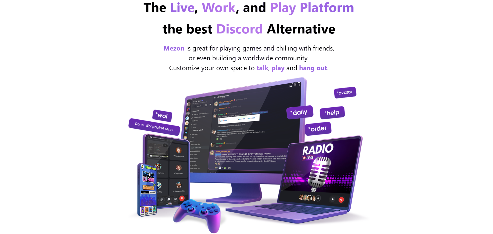

# 

## Tính năng nổi bật của nền tảng

<Columns> 
  <Column className='text--left'>
    ### **⚡ Hiệu năng cao**
    - Thời gian phản hồi dưới một mili giây
    - Hàng triệu kết nối đồng thời
    - Độ tin cậy và khả năng mở rộng ở cấp doanh nghiệp
  </Column>
  
  <Column className='text--left'>
  ### **🌐 Đa nền tảng**
    - Web, Desktop (Windows/macOS/Linux), Mobile (iOS/Android)
    - SDK đồng nhất với API nhất quán trên mọi nền tảng
    - Hỗ trợ Progressive Web App
  </Column>
  
  <Column className='text--left'>
  ### **💰 Nền kinh tế tích hợp**
    - Hệ thống token gốc cho phần thưởng và giao dịch
    - Công cụ kiếm tiền cho nhà phát triển và nhà sáng tạo
    - Tích hợp liền mạch với các hệ thống thanh toán bên ngoài
  </Column>
</Columns>

---

## Xây dựng cùng Mezon

Mezon tuyệt vời để chơi game và thư giãn cùng bạn bè, hay thậm chí xây dựng một cộng đồng toàn cầu. Với các SDK mạnh mẽ, giao tiếp thời gian thực và một hệ sinh thái sôi động, Mezon trao quyền cho nhà phát triển xây dựng thế hệ tương tác xã hội tiếp theo.

<Columns> 
  <Column className='text--left'>
    <Card href="./mezon-sdk/integration-bot-sdk" hoverable={true} shadow='tl'>
    <CardHeader>
      <h3>🤖 Ứng dụng Bot</h3>
    </CardHeader>
    <CardBody>
      Phát triển các bot thông minh và tích hợp tự động để nâng cao trải nghiệm Mezon với khả năng xử lý mạnh mẽ ở phía máy chủ.
    </CardBody>
  </Card>
  </Column>
  <Column className='text--left'>
    <Card href="./mezon-sdk/channel-app-sdk" hoverable={true} shadow='tl'>
    <CardHeader>
      <h3>🌐 Ứng dụng Kênh</h3>
    </CardHeader>
    <CardBody>
     Xây dựng và tích hợp website của bạn trực tiếp trên kênh Mezon để mang lại trải nghiệm liền mạch với hệ sinh thái sẵn có.
    </CardBody>
  </Card>
  </Column>
</Columns>

---

## Webhooks

<Columns> 
  <Column className='text--left'>
    <Card href="./webhooks/clan-webhook" hoverable={true} shadow='tl'>
    <CardHeader>
      <h3>Clan webhook</h3>
    </CardHeader>
    <CardBody>
    Gửi tin nhắn đến hộp thư của các thành viên trong clan.
    </CardBody>
  </Card>
  </Column>
  <Column className='text--left'>
    <Card href="./webhooks/channel-webhook" hoverable={true} shadow='tl'>
    <CardHeader>
      <h3>Channel webhook</h3>
    </CardHeader>
    <CardBody>
    Gửi tin nhắn đến một kênh cụ thể.
    </CardBody>
  </Card>
  </Column>
</Columns>

---

## Tìm hỗ trợ

Kết nối với cộng đồng nhà phát triển, báo lỗi và cập nhật các thay đổi của nền tảng.

### **🤝 Hỗ trợ từ cộng đồng**
Nhận trợ giúp từ các nhà phát triển giàu kinh nghiệm và đội ngũ Mezon.

- **[Tham gia cộng đồng Mezon](https://mezon.ai/invite/1840697268164890624)** - Kết nối với các nhà phát triển khác và nhận hỗ trợ
- **[Cổng nhà phát triển](https://mezon.ai/developers)** - Quản lý ứng dụng và truy cập công cụ dành cho nhà phát triển
- **[Tài liệu API](./mezon-sdk)** - Tài liệu tham khảo đầy đủ cho mọi API hiện có

### **🚀 Bắt đầu ngay hôm nay**
Sẵn sàng xây dựng ứng dụng Mezon đầu tiên của bạn?

- Bắt đầu bằng cách tạo **[Bot](./quick-start/creating-mezon-bot)** hoặc **[App](./quick-start/creating-mezon-app)** của bạn.
- Làm theo **[Hướng dẫn](./mezon-sdk)** để xây dựng bot của riêng bạn.

---

*Sẵn sàng thay đổi cách mọi người kết nối và cộng tác? Hãy bắt đầu xây dựng trên Mezon ngay hôm nay và tham gia cùng hàng triệu người dùng trong thế hệ trải nghiệm xã hội tiếp theo.*
