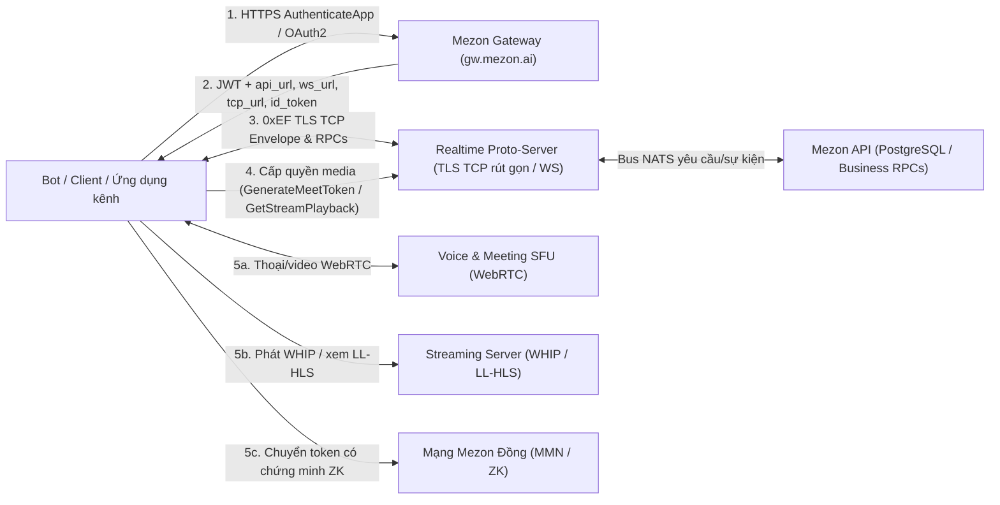

# Tài liệu cho lập trình viên Mezon

Mezon là nền tảng nhắn tin, thoại, phát trực tiếp và thanh toán có khả năng mở rộng cao. Mọi bot, ứng dụng trong kênh và ứng dụng OAuth2 đều bắt đầu tại [Mezon Developer Portal](https://mezon.ai/developers/applications), nơi bạn đăng ký ID ứng dụng và cấp phát thông tin xác thực.

## Chọn hướng tích hợp

<FeatureGrid columns={2}>
  <FeatureCard
    title="Bắt đầu"
    description="Làm quen với Developer Portal, tạo bot hoặc ứng dụng trong kênh và chọn SDK phù hợp từ bảng hệ sinh thái."
    to="/developer/getting-started/portal-overview"
    badge="Bắt đầu"
  />
  <FeatureCard
    title="Khái niệm cốt lõi"
    description="Khởi tạo qua Gateway, khung gói TLS TCP rút gọn, vòng đời JWT phiên, danh sách API cho bot và cấu trúc JSON tin nhắn."
    to="/developer/core-concepts/architecture-and-transport"
    badge="Kiến trúc"
  />
  <FeatureCard
    title="SDK JavaScript & TypeScript"
    description="SDK bot cho Node.js (mezon-sdk 2.8.68) với sự kiện có kiểu, bộ đệm SQLite cục bộ, builder tương tác và chuyển Mezon Đồng."
    to="/developer/bot-sdks/javascript/overview"
    badge="v2.8.68"
  />
  <FeatureCard
    title="SDK .NET (C#)"
    description="SDK bot .NET đa mục tiêu (Mezon.Net.Sdk 1.11.0) với DI, bộ lệnh, định tuyến tương tác và bộ đệm Redis/SQLite."
    to="/developer/bot-sdks/dotnet/overview"
    badge="v1.11.0"
  />
  <FeatureCard
    title="Tính năng tương tác"
    description="Xây dựng thẻ embed, nút bấm, biểu mẫu, danh sách chọn, bình chọn và lệnh quick menu trong clan."
    to="/developer/interactive-features/interactive-messages"
    badge="UX"
  />
  <FeatureCard
    title="Ứng dụng trong kênh & widget"
    description="Nhúng ứng dụng web vào kênh clan với dữ liệu khởi chạy có chữ ký, hoặc tích hợp khung chat Mezon lên website."
    to="/developer/channel-apps-and-widgets/channel-apps/overview"
    badge="Web"
  />
  <FeatureCard
    title="Thoại SFU & kênh phát trực tiếp"
    description="Tham gia phòng thoại thời gian thực bằng 6 SDK SFU, hoặc phát video qua WHIP lên kênh phát trực tiếp."
    to="/developer/media-voice-and-streaming/overview"
    badge="Media"
  />
  <FeatureCard
    title="Webhook, OAuth2 & thanh toán"
    description="Gửi tin nhắn bằng một yêu cầu HTTP, đăng nhập bằng Mezon OAuth2 hoặc chuyển Mezon Đồng qua MMN."
    to="/developer/webhooks/overview"
    badge="Tích hợp"
  />
</FeatureGrid>

## Kiến trúc nền tảng

Mọi bot và ứng dụng khách đều xác thực bước đầu với Mezon Gateway (`gw.mezon.ai`) để nhận các điểm cuối vùng/phân mảnh cho socket thời gian thực và API HTTP. Sau đó, bot duy trì kết nối TLS TCP rút gọn tới `mezon-proto-server`, trong khi media, thanh toán và sự kiện AI Agent đi qua các dịch vụ chuyên biệt.

## Tổng quan các hình thức tích hợp

| Hình thức tích hợp | Phù hợp nhất cho | Môi trường & giao thức | Điểm bắt đầu |
| --- | --- | --- | --- |
| **Bot** | Lệnh chat, thẻ tương tác, quản trị clan, bình chọn, phát trực tiếp, chuyển token | Tiến trình Node.js (`mezon-sdk`) hoặc .NET (`Mezon.Net.Sdk`) qua TLS TCP | [Tạo bot](./getting-started/create-a-bot.md) |
| **Ứng dụng trong kênh** | Ứng dụng web đầy đủ mở ngay trong kênh clan kèm ngữ cảnh người dùng có chữ ký | Mọi nền tảng web xác minh chữ ký HMAC (`?data=`) | [Tạo ứng dụng trong kênh](./getting-started/create-a-channel-app.md) |
| **Webhook** | Thông báo một chiều từ CI/CD, hệ thống giám sát hoặc tác vụ máy chủ | Một yêu cầu HTTPS `POST` — không cần bot hay SDK | [Tổng quan Webhook](./webhooks/overview.mdx) |
| **OAuth2** | Tính năng "Đăng nhập bằng Mezon" trên website bên ngoài | Luồng Authorization Code chuẩn + ID token | [Luồng OAuth2](./oauth2/authorization-code-flow.mdx) |
| **Light SDK & Chat Widget** | Nhúng trải nghiệm chat Mezon vào ứng dụng web bên thứ ba | JS trên trình duyệt (`mezon-light-sdk`, `mezon-chat-widget`) | [Light SDK](./channel-apps-and-widgets/light-sdk.md) |
| **Thoại SFU & phát trực tiếp** | Bot thoại, bộ ghi âm cuộc họp, nguồn phát video trực tiếp | SDK SFU WebRTC (6 ngôn ngữ) + WHIP / LL-HLS | [Tổng quan Media](./media-voice-and-streaming/overview.md) |
| **AI & MCP** | Nhận sự kiện phiên AI phòng họp và tích hợp công cụ LLM | Agent SSE (`connectMezonAgentSSE`) và MCP | [Sự kiện AI Agent](./ai-and-mcp/ai-agent-events.md) |

## Liên kết nhanh

- [Ma trận hệ sinh thái SDK](./getting-started/sdk-ecosystem-matrix.md) — so sánh phiên bản, môi trường chạy và mức độ ổn định.
- [Phân quyền & danh sách API cho bot](./core-concepts/permissions-and-api-access.md) — danh sách RPC được phép trên máy chủ cho token bot và external.
- [Tham chiếu sự kiện](./reference/events-reference.md) — danh mục đầy đủ sự kiện thời gian thực và SSE.
- [Mã lỗi & xử lý sự cố](./reference/error-codes-and-troubleshooting.md) — các lỗi HTTP, socket và SDK thường gặp.
- [Nhật ký thay đổi](./reference/changelog.md) — các thay đổi đáng chú ý của nền tảng và SDK.
