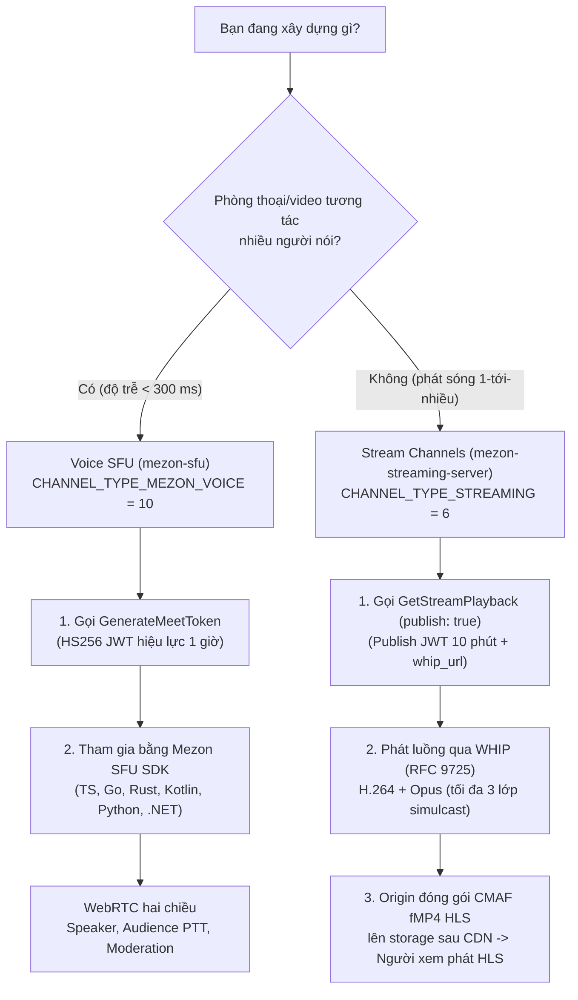

# Tổng quan Media, thoại & phát sóng

Mezon vận hành hai hệ thống media chuyên biệt tùy vào việc ứng dụng của bạn cần **hội thoại tương tác độ trễ dưới một giây** hay **phát sóng trực tiếp một-tới-nhiều**:

## So sánh trực diện

| Tiêu chí | Voice SFU (`mezon-sfu`) | Stream channels (`mezon-streaming-server`) |
|---|---|---|
| Loại kênh | `CHANNEL_TYPE_MEZON_VOICE` (`10`) | `CHANNEL_TYPE_STREAMING` (`6`) |
| Mô hình kết nối | Nhiều-tới-nhiều (nhiều speaker & audience) | **1 người phát (publisher)** mỗi kênh, không giới hạn người xem qua CDN |
| Độ trễ điển hình | Dưới 1 giây (WebRTC thời gian thực) | Khoảng 6 giây trở lên (HLS CMAF qua CDN; có tùy chọn WHEP độ trễ thấp) |
| RPC cấp quyền | `GenerateMeetToken` (bot được gọi, JWT HS256 1 giờ) | `GetStreamPlayback` (API 213, bot được gọi; JWT phát 10 phút / xem 6 giờ) |
| Giao thức phát | WebSocket `mezon-sfu` + WebRTC server-offer | Chuẩn **WHIP** (RFC 9725 `POST /whip/<channel>`) |
| Giao thức xem | WebRTC (`mezon-sfu` dynamic / fixed-slot / decoupled pools) | **HLS** (CMAF fMP4 H.264 + Opus qua CDN); WHEP WebRTC trên node |
| Codec | Âm thanh Opus, video VP8 / H.264 / VP9 (tùy SDK) | Âm thanh Opus 48 kHz + video H.264 Constrained Baseline (`42e01f`, không B-frame) hoặc VP8 |
| Bộ SDK chính thức | 6 SFU SDK pre-1.0 (TypeScript, Go, Rust, Kotlin, Python, .NET) | Chuẩn WHIP (OBS, ffmpeg, Pion, libwebrtc, trình duyệt) + API cấp grant của bot |

## Bước tiếp theo

- **Bot thoại, bot ghi âm và ứng dụng họp tùy biến:** Bắt đầu với [Khái niệm & Token SFU](./voice-sfu/concepts-and-tokens.md), so sánh 6 ngôn ngữ tại [Tổng quan SFU SDK](./voice-sfu/sdks-overview.md) và xem mã mẫu tại [Bắt đầu nhanh SFU](./voice-sfu/quickstarts.mdx).
- **Phát sóng trực tiếp bằng OBS, ffmpeg hoặc bot:** Xem [Phát luồng với WHIP](./stream-channels/publishing-with-whip.mdx) và [Phát lại & sự kiện thời gian thực](./stream-channels/playback-and-events.md).
