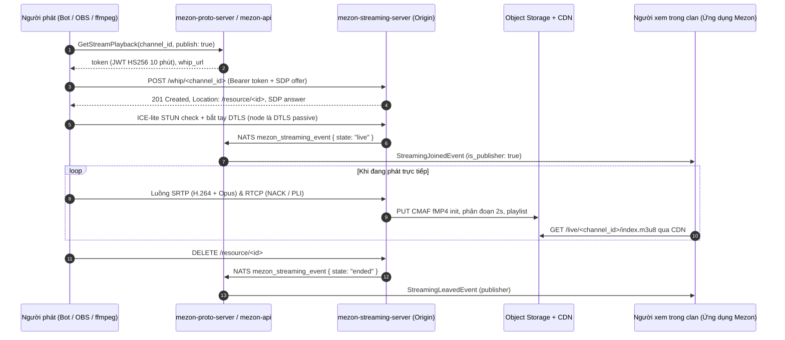

import Tabs from "@theme/Tabs";
import TabItem from "@theme/TabItem";

# Phát luồng lên Stream Channel bằng WHIP

Kênh phát sóng trên Mezon (`CHANNEL_TYPE_STREAMING = 6`) tiếp nhận video trực tiếp qua chuẩn **WHIP** ([RFC 9725](https://www.rfc-editor.org/rfc/rfc9725)) trên `mezon-streaming-server`. Bot xin quyền phát ngắn hạn bằng `GetStreamPlayback` (API index `213`), sau đó phát media bằng bất kỳ công cụ hỗ trợ WebRTC/WHIP nào (OBS Studio, `ffmpeg`, Pion, libwebrtc hoặc trình duyệt).

## Chuỗi phát sóng đầu cuối



## 1. Xin quyền phát (`GetStreamPlayback`)

<ApiBadge method="RPC" path="GetStreamPlayback (API 213)" /> <BotAccessBadge allowed={true} />

Bot bắt buộc phải là thành viên của clan chứa kênh stream. Gọi trên kênh không phải stream channel sẽ trả `400`; không thuộc clan sẽ trả `403`.

<Tabs groupId="sdk-lang">
<TabItem value="ts" label="TypeScript (mezon-sdk)" default>

```ts
const grant = await client.getStreamPlayback({
  channel_id: "STREAM_CHANNEL_ID",
  publish: true,
});

if (!grant?.token || !grant.whip_url) {
  throw new Error("Không nhận được quyền phát");
}
// Tuyệt đối không ghi log grant.token!
console.log("Quyền phát hết hạn lúc:", grant.expires_at);
```

</TabItem>
<TabItem value="csharp" label="C# (Mezon.Net.Sdk)">

```csharp
using Mezon.Net.Core;
using Mezon.Net.Models;

try
{
    var grant = await client.GetStreamPlaybackAsync(
        new GetStreamPlaybackParams(streamChannelId, publish: true));
    // Chuyển grant.WhipUrl và grant.Token cho bộ phát WHIP; tuyệt đối không ghi log grant.Token.
    Console.WriteLine($"Quyền phát có hiệu lực đến {grant.ExpiresAt}");
}
catch (MezonApiException ex)
{
    Console.Error.WriteLine($"Bị từ chối: {ex.RawCode} {ex.Message}");
}
```

</TabItem>
</Tabs>

### Các trường grant & thời hạn token

| Trường | Mô tả |
|---|---|
| `token` | JWT HS256 (`sub`, `channel`, `role: "publish"`, `exp`) có hiệu lực **10 phút**. Chỉ được kiểm tra lúc khởi tạo phiên WHIP — phiên đang phát tiếp tục chạy sau khi `exp` qua đi. |
| `whip_url` | Endpoint WHIP tại origin: `<origin_url>/whip/<channel_id>`. |
| `hls_url` | URL playlist phát lại cho người xem (`<hls_base_url>/live/<channel_id>/index.m3u8`). |
| `expires_at` | Mốc hết hạn theo Unix giây. |

## 2. Tạo và kết thúc phiên WHIP

```ts
async function startPublishing(channelId: string): Promise<string> {
  const grant = await client.getStreamPlayback({ channel_id: channelId, publish: true });
  if (!grant?.token || !grant.whip_url) throw new Error("Không có quyền phát");

  const sdpOffer = await createWebRtcOffer(); // Từ thư viện WebRTC của bạn

  const res = await fetch(grant.whip_url, {
    method: "POST",
    headers: {
      "Content-Type": "application/sdp",
      Authorization: `Bearer ${grant.token}`,
    },
    body: sdpOffer,
  });

  if (res.status !== 201) {
    throw new Error(`WHIP thất bại: ${res.status} ${await res.text()}`);
  }

  await applyWebRtcAnswer(await res.text());

  const location = res.headers.get("Location");
  if (!location) throw new Error("Phản hồi WHIP thiếu header Location");
  // Capability URL: /resource/<slot>.<gen>.<32 hex> — giữ bí mật như token
  return new URL(location, grant.whip_url).toString();
}

async function stopPublishing(resourceUrl: string): Promise<void> {
  await fetch(resourceUrl, { method: "DELETE" });
}
```

### Phát luồng bằng `ffmpeg`

Vì `mezon-streaming-server` luôn đóng vai DTLS server (`a=setup:passive`), hãy truyền `-whip_flags dtls_active` và cố định chu kỳ keyframe 2 giây (khớp `capacity.keyframe_ms = 2000`):

```bash
ffmpeg -re -i input.mp4 \
  -c:v libx264 -profile:v baseline -level 3.1 -bf 0 -g 60 -keyint_min 60 -sc_threshold 0 \
  -c:a libopus -ar 48000 -ac 2 \
  -f whip -whip_flags dtls_active \
  -authorization "$WHIP_BEARER_TOKEN" \
  "$WHIP_URL"
```

## 3. Yêu cầu giao thức, SDP và media (`spec.md` §2, §5, §8)

### Truyền tải HTTP & ICE/DTLS

- **Không có trickle ICE:** `PATCH` trả về `404`. Máy chủ chạy **ICE-lite**, trả một candidate UDP IPv4 duy nhất kèm `a=end-of-candidates`.
- **Vai trò DTLS:** Client BẮT BUỘC đề xuất `a=setup:actpass` hoặc `a=setup:active` (`a=setup:passive` bị từ chối với `400`).
- **Giới hạn HTTP:** Tổng header + body tối đa **64 KiB** (`413`), bắt buộc có `Content-Length` (không hỗ trợ chunked encoding), timeout đọc/ghi 5 giây.
- **Một người phát mỗi kênh:** Người phát thứ hai có **`sub` khác** nhận **`409 Conflict`**. Nếu gửi lại `POST` từ **cùng `sub`**, máy chủ tự thay thế phiên cũ ngay lập tức mà không báo `409` và không làm ngắt kết nối người xem.
- **Timeout không hoạt động:** Nếu không nhận được gói nào (STUN, DTLS, RTP, RTCP) trong **15 giây** (`capacity.timeout_ms`), node tự đóng phiên và phát sự kiện `ended`.

### Yêu cầu codec và phản hồi RTCP

| Track | Yêu cầu chính xác |
|---|---|
| **Video (H.264 mặc định)** | `H264/90000` với `packetization-mode=1`, Constrained Baseline (`profile-level-id=42e01f`), gửi **SPS/PPS nội luồng (in-band)** trước mỗi IDR (`sprop-parameter-sets` bị bỏ qua), **không dùng B-frame**. (Node cấu hình VP8 yêu cầu `VP8/90000`.) |
| **Âm thanh** | `opus/48000`, mono hoặc stereo. |
| **Media section & simulcast** | Tối đa **4 media section** trong offer (chấp nhận track âm thanh và video hợp lệ đầu tiên). Tối đa **3 lớp simulcast** qua `a=rid:<id> send`, `a=simulcast:send ...` và `sdes:rtp-stream-id`. |
| **Sửa mất gói (NACK)** | NACK **không dùng RTX** — truyền lại gói video bị mất trên **chính SSRC và số thứ tự gốc** trong vòng **150 ms**. Âm thanh không NACK. |
| **Keyframe & bitrate** | Phản hồi **PLI** (gửi định kỳ mỗi **2 giây**; đặt GOP cố định 2 giây nếu encoder không xử lý PLI). Node gửi REMB mỗi giây (`4 Mbit/s` một lớp, `6 Mbit/s` tổng simulcast). |

## 4. Bảng mã trạng thái HTTP của WHIP

| Mã trạng thái | Nguyên nhân | Cách xử lý phía client |
|---|---|---|
| `201` | Đã tạo phiên; `Location` chứa `/resource/<id>`, body là SDP answer | Áp dụng SDP answer và bắt đầu ICE/DTLS/SRTP |
| `400` | Tên kênh sai, SDP lỗi, thiếu ICE/fingerprint SHA-256 hoặc gửi `setup:passive` | Sửa offer/yêu cầu; không thử lại y nguyên |
| `401` | Thiếu, sai định dạng, sai chữ ký hoặc hết hạn Bearer JWT | Gọi lại `GetStreamPlayback` xin token 10 phút mới |
| `403` | Token sai kênh, vai trò `view`, hoặc gửi vào node edge | Xin grant `publish` và gửi đúng tới `whip_url` |
| `406` | Offer không có codec nào máy chủ hỗ trợ | Đề xuất H.264 (`packetization-mode=1`) và/hoặc Opus 48 kHz |
| `409` | Đang có người dùng (`sub`) khác phát trên kênh này | Thông báo cho người dùng; chờ luồng hiện tại kết thúc |
| `413` | Yêu cầu vượt quá 64 KiB | Rút gọn SDP |
| `500` | Lỗi khởi tạo ngữ cảnh DTLS nội bộ | Thử lại với backoff |
| `503` | Hết slot kênh/phiên, node tạm bận hoặc đang drain (`Retry-After: 5`) | Thử lại với backoff sau thời gian `Retry-After` |

## Liên quan

- [Phát lại & sự kiện stream thời gian thực](./playback-and-events.md)
- [Tổng quan Media](../overview.md)
- [WHIP (RFC 9725)](https://www.rfc-editor.org/rfc/rfc9725)
