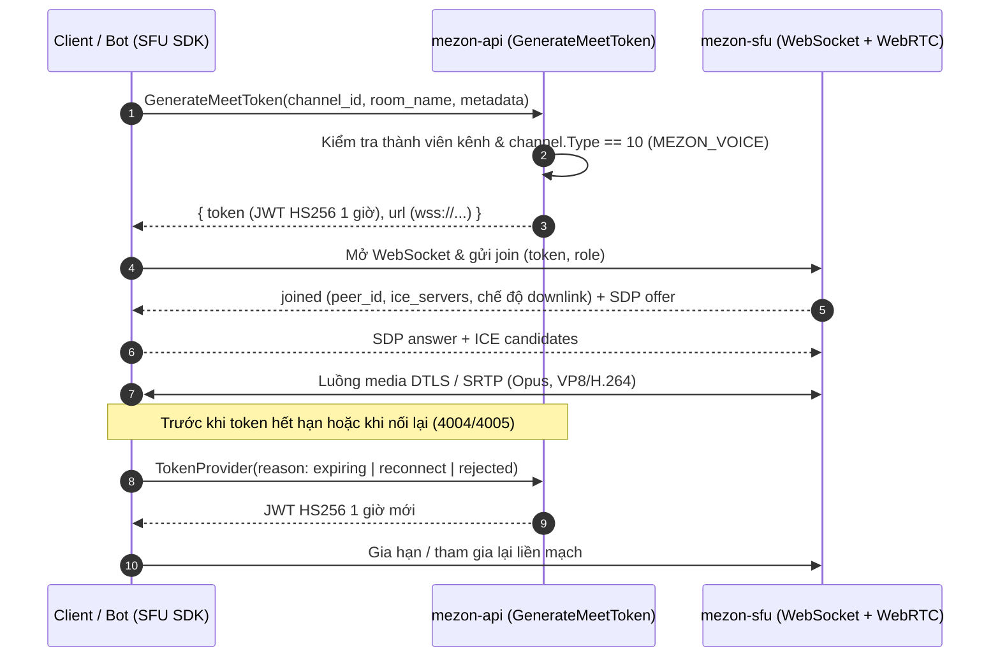

# Khái niệm & Token Voice SFU

Kênh thoại trên Mezon (`CHANNEL_TYPE_MEZON_VOICE = 10`) chạy trên **`mezon-sfu`**, bộ định tuyến WebRTC Selective Forwarding Unit viết bằng C hiệu năng cao. Trước khi kết nối bằng bất kỳ SFU SDK nào, bot hoặc ứng dụng cần xin một meet token HS256 ngắn hạn từ `mezon-api`.

## Chuỗi kết nối và làm mới token



## Xin meet token (`GenerateMeetToken`)

`GenerateMeetToken` được phép gọi từ cả tài khoản người dùng và phiên bot (`api_voice.go`, `core_voice.go`).

- **Kiểm tra loại kênh:** Chỉ chấp nhận `CHANNEL_TYPE_MEZON_VOICE` (`10`). Yêu cầu cho kênh văn bản, kênh stream hay kênh thoại cũ sẽ trả về `InvalidArgument`.
- **Kiểm tra thành viên:** Người gọi bắt buộc phải ở trong kênh (nếu không sẽ trả về `PermissionDenied`).
- **Claims & thời hạn JWT:** Ký bằng HS256 với khóa meet dùng chung, hiệu lực **1 giờ** (`exp = now + 1h`), gồm `iss` (chuỗi user ID), `room` (channel ID), `identity` (user ID), `exp` và `metadata` tùy chọn.
- **Bảo mật token:** Truyền token qua bộ nhớ hoặc biến môi trường — tuyệt đối không đặt trong query string, tham số dòng lệnh hay nhật ký log.

### Xin meet token từ bot

```ts
// TypeScript (mezon-sdk)
const meet = await client.generateMeetToken({
  channel_id: "VOICE_CHANNEL_ID",
  room_name: "VOICE_CHANNEL_ID",
  metadata: JSON.stringify({ displayName: "Voice Bot" }),
});
// Truyền meet.url và meet.token vào Room.connect(...) của SFU SDK
```

```csharp
// C# (Mezon.Net.Sdk)
var meet = await client.GenerateMeetTokenAsync(
    new GenerateMeetTokenParams(channelId, roomName: channelId.ToString(), metadata: "{}"));
```

## Vai trò tham gia: Speaker và Audience (PTT)

| Vai trò | Khả năng media mặc định | Hành vi phát tiếng |
|---|---|---|
| **Speaker** (`speaker`) | Âm thanh và camera đầy đủ (thêm chia sẻ màn hình ở bản TS trình duyệt) | Phiên mới luôn bắt đầu ở trạng thái **tắt mic** phía máy chủ. Gọi `setMicrophoneEnabled(true)` trước khi phát âm thanh. |
| **Audience** (`audience`) | Nghe media trong phòng mà không chiếm slot speaker cố định | Nói tạm thời qua **nhấn để nói (push-to-talk)**: gọi `setPushToTalk(true)` để phát và `setPushToTalk(false)` để nhả. |

:::tip Mức âm lượng RFC 6464 & nhận diện người đang nói
Trong phòng chế độ fixed-slot, `mezon-sfu` chọn người nói chính dựa trên header mở rộng **RFC 6464 client-to-mixer audio level** (`0` to nhất … `127` im lặng). Khi tự đẩy gói Opus RTP thô (Go, Rust, .NET), hãy gửi kèm mức âm lượng (vd `WriteSampleWithLevel` / `write_opus(..., Some(level))`); nếu không SFU sẽ coi nguồn phát luôn đang nói miễn là có gói tin.
:::

## Các chế độ downlink

Phòng trên `mezon-sfu` vận hành theo một trong ba kiến trúc downlink:

1. **Dynamic mode:** SFU thương lượng lại track động mỗi khi speaker bật/tắt luồng.
2. **Fixed-slot mode:** Máy chủ cấp sẵn số lượng slot cố định và gán động những người nói to nhất vào các slot đó mà không cần thương lượng lại toàn bộ SDP. Khi đổi người chiếm slot, SDK phát cặp sự kiện unsubscribe + subscribe.
3. **Decoupled media pools (`media_pool_mode: "decoupled"`, `media_pool_version: 1`):** Tách riêng các pool slot cho âm thanh, camera và chia sẻ màn hình (`max_audio_slots`, `max_camera_slots`, `max_screen_slots`). Hiện đã được hỗ trợ trên **`Mezon.Net.Sdk.Sfu`**.

## `TokenProvider` và vòng đời tự kết nối lại

Luôn truyền hàm **`TokenProvider`** (thay vì chuỗi token tĩnh) cho bot hoặc ứng dụng chạy dài hạn. Mọi SFU SDK gọi hàm này kèm lý do yêu cầu và token cũ:

| Lý do (`reason`) | Thời điểm SDK kích hoạt |
|---|---|
| `initial` | Lần gọi `connect()` đầu tiên. |
| `reconnect` | Tự động nối lại sau khi đứt WebSocket, lỗi ICE hoặc máy chủ khởi động lại. |
| `expiring` | Chủ động xin JWT mới trước khi hết hạn 1 giờ. |
| `rejected` | Sau khi SFU từ chối token trước đó (`4004` / `4005`). Token tĩnh không thể phục hồi sau `4005` và sẽ dừng với `auth_failed`. |

### Mã đóng kết nối: tự nối lại và dừng hẳn

- **Tự động kết nối lại kèm jittered backoff:** `1001`, `1006`, `1011`, `4001`, `4002`, `4007`–`4010`, `4013`, `4014` (và `room_creation_failed`). Mỗi lần nối lại tạo một peer ID mới và tự khôi phục trạng thái mic, camera, chia sẻ màn hình, push-to-talk, chế độ nhận video và metadata.
- **Dừng hẳn (không thử lại):**
  - `1000` (máy chủ đóng bình thường)
  - `4003` (máy chủ cấu hình sai)
  - `4006` (bị điều hành viên kick)
  - `4011` (hết thời gian chờ khi ở một mình)
  - `4012` (`duplicate_session` — **mỗi user ID chỉ giữ được một phiên SFU hoạt động tại một thời điểm**; tham gia bất kỳ phòng nào bằng cùng user ID sẽ ngắt phiên cũ)
  - Phòng đầy hoặc `invalid_room` (`join_failed`)

## Liên quan

- [Tổng quan SFU SDK](./sdks-overview.md)
- [Bắt đầu nhanh SFU (6 ngôn ngữ)](./quickstarts.mdx)
- [Tổng quan Media](../overview.md)
