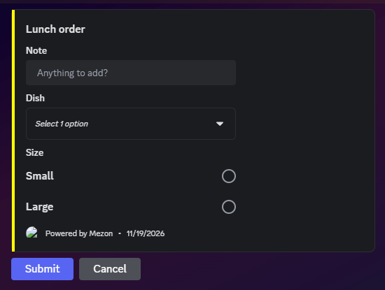

# Tin nhắn tương tác

Bot có thể gửi tin nhắn có nút bấm, và các thẻ có ô nhập, danh sách chọn, lựa chọn và ô chọn ngày. Khi thành viên nhấn nút, bot nhận được lượt nhấn và các giá trị thành viên đã nhập.

Trang này dùng `mezon-sdk` 2.8.66. Trang mô tả cách ứng dụng web Mezon (phiên bản 2.1.5) hiển thị các tin nhắn này và gửi lại những gì; ứng dụng máy tính và điện thoại chưa được kiểm tra.

## Nút bấm {#buttons}

Tạo nút bằng `ButtonBuilder` và gửi trong `components`, bên trong một hàng hành động: `components: [{ components: buttons }]`.

```ts
import { ButtonBuilder, EButtonMessageStyle } from "mezon-sdk";

const channel = await client.channels.fetch("CHANNEL_ID");
const row = new ButtonBuilder()
  .addButton("approve", "Approve", EButtonMessageStyle.SUCCESS)
  .addButton("reject", "Reject", EButtonMessageStyle.DANGER)
  .build();

await channel.send({
  t: "Approve the leave request?",
  components: [{ components: row }],
});
```

`addButton(id, label, style)` nhận:

- `id`: tên bạn đặt cho nút. Giá trị này quay lại trong `button_id` khi có người nhấn.
- `label`: chữ trên nút.
- `style`: `EButtonMessageStyle.PRIMARY` (1), `SECONDARY` (2), `SUCCESS` (3), `DANGER` (4) hoặc `LINK` (5). Kiểu quyết định màu nút.

:::warning
`components` là danh sách các hàng. Nếu truyền thẳng mảng từ `build()`, như `components: row`, ứng dụng web sẽ không hiện nút nào.
:::

## Xử lý lượt nhấn {#handle-clicks}

```ts
client.onMessageButtonClicked(async (event) => {
  const channel = await client.channels.fetch(event.channel_id);
  if (event.button_id === "approve") {
    await channel.send({ t: "Approved." });
  } else if (event.button_id === "reject") {
    await channel.send({ t: "Rejected." });
  }
});
```

Sự kiện có các trường sau:

| Trường | Ý nghĩa |
|---|---|
| `button_id` | `id` của nút (hoặc danh sách chọn) vừa được dùng. |
| `user_id` | Thành viên đã nhấn. |
| `message_id`, `channel_id` | Tin nhắn và kênh chứa nó. |
| `sender_id` | Người gửi tin nhắn, tức là bot. |
| `extra_data` | Các giá trị thành viên đã nhập trong thẻ, dạng chuỗi JSON. Xem [Đọc giá trị biểu mẫu](#read-the-form-values). |

## Biểu mẫu {#forms}

`InteractiveBuilder` tạo một thẻ (embed) có tiêu đề, văn bản, hình ảnh và các trường biểu mẫu. Gửi thẻ trong `embed`, kèm các nút trong `components`:

```ts
import { ButtonBuilder, EButtonMessageStyle, InteractiveBuilder } from "mezon-sdk";

const channel = await client.channels.fetch("CHANNEL_ID");
const embed = new InteractiveBuilder("Lunch order")
  .setDescription("Choose your lunch for Friday.")
  .addInputField("note", "Note", "Anything to add?")
  .addSelectField("dish", "Dish", [
    { label: "Pho", value: "pho" },
    { label: "Rice", value: "rice" },
  ])
  .addRadioField("size", "Size", [
    { label: "Small", value: "s" },
    { label: "Large", value: "l" },
  ])
  .build();

const actions = new ButtonBuilder()
  .addButton("order_submit", "Submit", EButtonMessageStyle.PRIMARY)
  .addButton("order_cancel", "Cancel", EButtonMessageStyle.SECONDARY)
  .build();

await channel.send({ embed: [embed], components: [{ components: actions }] });
```



Mỗi thẻ có một màu ngẫu nhiên, thời gian hiện tại và dòng chân trang "Powered by Mezon".

### Các phương thức của builder {#builder-methods}

| Phương thức | Thêm |
|---|---|
| `new InteractiveBuilder(title?)` | Một thẻ, có thể kèm tiêu đề. |
| `setAuthor(name, icon_url?, url?)` | Dòng tác giả ở đầu thẻ. |
| `setDescription(text)` | Nội dung chính. |
| `setThumbnail(url)` | Một ảnh nhỏ. |
| `setImage(url, width?, height?)` | Một ảnh lớn. |
| `addField(name, value, inline?)` | Một cặp tên và giá trị chỉ để đọc. |
| `addInputField(id, name, placeholder?, options?, description?)` | Một ô nhập. `options`: `{ type?, textarea?, defaultValue? }`, trong đó `type` là kiểu input HTML như `"email"`, còn `textarea: true` cho phép nhập nhiều dòng. |
| `addSelectField(id, name, options, valueSelected?, description?)` | Một danh sách thả xuống. `options`: `[{ label, value }]`; `valueSelected` là mục được chọn sẵn. |
| `addRadioField(id, name, options, description?, max_options?)` | Các lựa chọn. `options`: `[{ label, value, name?, description?, style?, disabled? }]`. |
| `addDatePickerField(id, name, description?)` | Một ô chọn ngày. |
| `addAnimation(id, config, name?, description?)` | Một ảnh động ghép từ nhiều ảnh. |
| `build()` | Trả về thẻ, để đặt vào `embed`. |

Để thành viên chọn được nhiều mục trong `addRadioField`, hãy đặt `name` khác nhau cho từng lựa chọn và đặt `max_options` bằng số mục tối đa được chọn. Nếu các lựa chọn cùng `name` (hoặc không có), thành viên chỉ chọn được một.

```ts
import { InteractiveBuilder } from "mezon-sdk";

new InteractiveBuilder("Profile")
  .addRadioField(
    "days",
    "Office days",
    [
      { label: "Monday", value: "mon", name: "mon" },
      { label: "Wednesday", value: "wed", name: "wed" },
      { label: "Friday", value: "fri", name: "fri" },
    ],
    "Pick up to two",
    2,
  )
  .build();
```

## Đọc giá trị biểu mẫu {#read-the-form-values}

Khi thành viên nhấn một nút dưới thẻ, `extra_data` chứa những gì thành viên đã nhập, dạng đối tượng JSON với khóa là `id` của từng trường:

```json
{ "note": "No onions", "dish": "pho", "size": "l" }
```

- Ô nhập, danh sách chọn, lựa chọn đơn và ngày cho ra một chuỗi.
- Lựa chọn nhiều cho ra một mảng chuỗi.
- Trường nào thành viên không đụng tới thì không có mặt. Nếu thành viên không đụng tới trường nào, `extra_data` để trống.

```ts
client.onMessageButtonClicked(async (event) => {
  if (event.button_id !== "order_submit") return;

  const values: Record<string, string | string[]> = event.extra_data
    ? JSON.parse(event.extra_data)
    : {};
  const channel = await client.channels.fetch(event.channel_id);
  await channel.send({ t: `Order received: ${values.dish ?? "no dish"}, size ${values.size ?? "?"}` });
});
```

Hãy kiểm tra các giá trị ở phía bot: thành viên có thể gửi bất cứ thứ gì.

### Danh sách chọn cũng gửi lượt nhấn {#selects-send-a-click-too}

Mỗi khi thành viên chọn một mục trong danh sách chọn, ứng dụng web cũng gửi ngay một sự kiện nhấn: `button_id` là `id` của danh sách chọn và `extra_data` là `value` vừa chọn (chuỗi thường, không phải JSON). Nếu bot chỉ đọc nút gửi, hãy bỏ qua các sự kiện này.

SDK cũng có `onDropdownBoxSelected`, nhưng ứng dụng web không gửi sự kiện đó.

## Giới hạn {#limits}

- `addInputField` nhận tùy chọn `disabled`, nhưng builder không truyền tùy chọn này đi.
- `EMessageComponentType.GRID` (7) không có phương thức builder, và ứng dụng web không hiển thị nó.
- Với các cuộc bỏ phiếu đơn giản, hãy dùng [bình chọn](../mezon-sdk/integration-bot-sdk/usage-and-examples.md#create-a-poll): Mezon đếm phiếu giúp bạn.

## Liên quan {#related}

- [Cách dùng và ví dụ](../mezon-sdk/integration-bot-sdk/usage-and-examples.md)
- [Tham chiếu API](../mezon-sdk/integration-bot-sdk/api-references.md)
