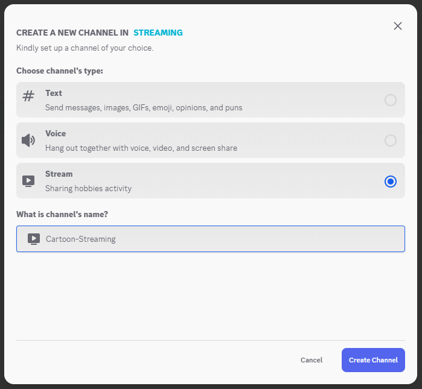
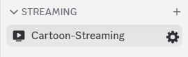

# Kênh Streaming

Kênh streaming trên Mezon cho phép phát video thời gian thực và trải nghiệm streaming tương tác trong clan. Tính năng này giúp người dùng phát sóng video trực tiếp tới thành viên kênh, tạo trải nghiệm đa phương tiện hấp dẫn cho cộng đồng.

## Tổng quan

Kênh streaming cung cấp nền tảng cho:

- **Phát video trực tiếp** trong kênh clan
- **Tương tác người xem thời gian thực** qua chat và cảm xúc
- **Streaming dựa trên WebRTC** để truyền chất lượng cao, độ trễ thấp
- **Tích hợp bot** để quản lý streaming tự động
- **Hỗ trợ đa nền tảng** cho web, desktop và mobile

## Loại kênh

### Loại kênh Streaming

```typescript
ChannelType.CHANNEL_TYPE_STREAMING = 6;
```

Kênh streaming là loại kênh riêng được thiết kế cho chức năng phát video.

## Cách stream trong kênh Streaming

### Bước 1: Tạo kênh Stream

Trước tiên, bạn cần tạo kênh mới trong một Clan.

Đi tới phần kênh và chọn danh mục để tạo kênh mới. Khi được hỏi loại kênh, chọn **Stream**. Các loại khác là Text và Voice.



Bạn cần đặt tên cho kênh stream. Hoàn tất quá trình tạo.



### Bước 2: Lấy thông tin kênh

Sau khi tạo kênh, bạn phải lấy `clan_id` và `channel_id`. Có thể lấy từ URL trình duyệt hoặc lắng nghe sự kiện tạo kênh nếu đã có Bot/App trong clan.

```javascript
//mezon.ai/chat/clans/1840666462012837888/channels/1977287012746530816

// hoặc

https: this.client.onChannelCreated((channel) => {
  this.logger.info("New channel created:", channel.channel_id);
  this.logger.info("In clan:", channel.clan_id);
});
```

Các giá trị này sẽ được dùng trong các lời gọi API tiếp theo.

### Bước 3: Tích hợp Bot và Streaming

Để phát stream, bạn cần tạo bot xử lý tích hợp mã và giao tiếp WebSocket.

#### Khởi tạo Bot

Khởi tạo Mezon client bằng bot token và đăng nhập để lấy token xác thực cho kết nối WebSocket.

```javascript
const client = new MezonClient(BOT_TOKEN);
const dataLogin = await client.login();
const data = JSON.parse(dataLogin);
const token = data.token;
```

#### Khởi tạo kết nối WebSocket

Dùng token ở bước trước để thiết lập kết nối WebSocket với dịch vụ `stn`.

```javascript
const ws = new WebSocket(`wss://stn.mezon.ai/ws?token=${token}`);
```

#### Phát Stream

Để bắt đầu stream, bạn phải gửi một đối tượng message cụ thể qua WebSocket.

1. **Định nghĩa tham số (`params`)**: Đối tượng này chứa chi tiết stream.

   ```json
   {
     "ChannelId": "channel_streaming_id",
     "Password": "",
     "FileUrl": ""
   }
   ```

2. **Tạo Socket Message (`messageSocket`)**: Message này báo cho server bắt đầu publisher (người phát).

   - `ClanId`: ID của clan.
   - `ChannelId`: ID của kênh streaming.
   - `UserId`: User ID của Bot.
   - `Value`: Đối tượng `params` đã định nghĩa ở trên.
   - `Key`: Phải là `connect_publisher` để khởi tạo stream.

   ```javascript
   const messageSocket = {
     ClanId: "clan_id",
     ChannelId: "channel_streaming_id",
     UserId: process.env.BOT_KOMU_ID,
     Value: params,
     Key: "connect_publisher",
   };
   ```

3. **Gửi Message**: Chuyển `messageSocket` thành chuỗi JSON và gửi. Đảm bảo kết nối WebSocket đã mở trước khi gửi.

   ```javascript
   const json = JSON.stringify(messageSocket);
   if (this.ws.readyState === WebSocket.OPEN) {
     this.ws.send(json);
   } else {
     console.debug("ws: send not ready, skipping...");
   }
   ```

#### Dừng Stream

Để dừng stream, gửi message khác với key khác.

1.  **Định nghĩa tham số (`params`)**: Cấu trúc giống khi bắt đầu stream.

    ```json
    {
      "ChannelId": "channel_streaming_id",
      "Password": "",
      "FileUrl": ""
    }
    ```

2.  **Tạo Socket Message (`messageSocket`)**: Cấu trúc tương tự message bắt đầu, nhưng `Key` khác.

    - `Key`: Phải là `'stop_publisher'` để kết thúc stream.

    ```javascript
    const messageSocket = {
        "ClanId": "clan_id",
        "ChannelId": "channel_streaming_id",
        "UserId": process.env.BOT_KOMU_ID,
        "Value": params,
        "Key": "stop_publisher"
    };
    ```

3.  **Gửi Message**: Chuyển đối tượng thành chuỗi JSON và gửi qua kết nối WebSocket đang mở.

    ```javascript
    const json = JSON.stringify(messageSocket);
    if (this.ws.readyState === WebSocket.OPEN) {
      this.ws.send(json);
    } else {
      console.debug("ws: send not ready, skipping...");
    }
    ```

---

Kênh streaming là nền tảng mạnh để xây dựng trải nghiệm video trực tiếp hấp dẫn trong cộng đồng Mezon. Dù bạn tạo bot giải trí, nội dung giáo dục hay sự kiện cộng đồng, hạ tầng streaming đều hỗ trợ tương tác đa phương tiện phong phú.
