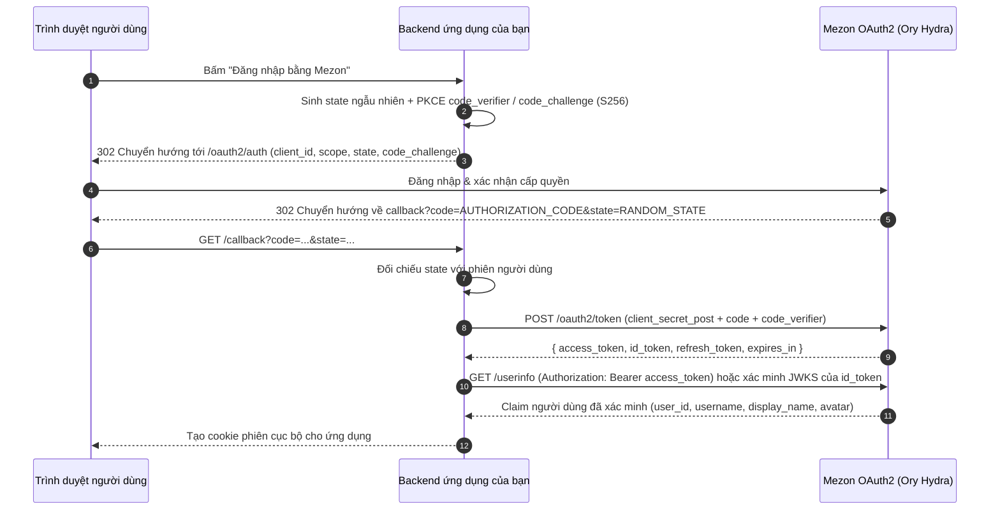

import Tabs from "@theme/Tabs";
import TabItem from "@theme/TabItem";

# Luồng OAuth2 Authorization Code

Mezon vận hành nhà cung cấp danh tính chuẩn OAuth 2.0 và OpenID Connect (OIDC) dựa trên **Ory Hydra** tại `https://oauth2.mezon.ai`. Trang web và hệ thống backend bên ngoài sử dụng luồng Authorization Code để cho phép người dùng đăng nhập bằng tài khoản Mezon và nhận các claim danh tính đã xác minh (`user_id`, `username`, `display_name`, `avatar`, `email`).

## Sơ đồ luồng xác thực



## 1. Cấu hình ứng dụng OAuth2

1. Mở [Cổng nhà phát triển Mezon](https://mezon.ai/developers/applications) và chọn ứng dụng của bạn (hoặc [tạo mới](../getting-started/create-a-channel-app.md)).
2. Chuyển sang thẻ **OAuth2**.
3. Trong mục **Redirects**, thêm URL callback chính xác (ví dụ `https://your-app.example.com/callback`). URL phải bắt đầu bằng `http://` hoặc `https://`.
4. Trong mục **OAuth2 URL Generator → Scopes**, chọn các scope cần thiết (`openid` và tùy chọn `offline`) rồi lưu lại.
5. Sao chép **Client ID** và bấm **Reset secret** để tạo **Client Secret** (cần lưu ít nhất một redirect URI trước).

:::danger Giữ Client Secret hoàn toàn trên máy chủ
Ứng dụng tạo trên cổng nhà phát triển Mezon sử dụng phương thức xác thực `client_secret_post` dành cho confidential client. Tuyệt đối không đưa `YOUR_CLIENT_SECRET` vào mã JavaScript trình duyệt, ứng dụng SPA hay tệp cài đặt di động.
:::

## Tài liệu khám phá và các endpoint

Toàn bộ URL được công bố tại tài liệu OIDC Discovery `https://oauth2.mezon.ai/.well-known/openid-configuration`:

| Endpoint | Phương thức & URL |
|---|---|
| Discovery | <ApiBadge method="GET" path="https://oauth2.mezon.ai/.well-known/openid-configuration" /> |
| Ủy quyền (Authorization) | <ApiBadge method="GET" path="https://oauth2.mezon.ai/oauth2/auth" /> |
| Đổi token (Token) | <ApiBadge method="POST" path="https://oauth2.mezon.ai/oauth2/token" /> |
| Thông tin người dùng (UserInfo) | <ApiBadge method="GET" path="https://oauth2.mezon.ai/userinfo" /> |
| Thu hồi token (Revocation) | <ApiBadge method="POST" path="https://oauth2.mezon.ai/oauth2/revoke" /> |
| Đăng xuất (Logout) | <ApiBadge method="GET" path="https://oauth2.mezon.ai/oauth2/sessions/logout" /> |
| Khóa công khai JWKS (RS256) | <ApiBadge method="GET" path="https://oauth2.mezon.ai/.well-known/jwks.json" /> |

## Scopes

| Scope | Quyền cấp |
|---|---|
| `openid` | Cấp `id_token` ký RS256 và mở khóa các claim người dùng Mezon tại `/userinfo`. |
| `offline` | Cấp `refresh_token` để backend gia hạn access token đã hết hạn mà không cần người dùng đăng nhập lại. |

Chỉ yêu cầu những scope đã bật trong phần cấu hình ứng dụng của bạn.

## 2. Chuyển hướng người dùng tới `/oauth2/auth`

Sinh chuỗi `state` ngẫu nhiên an toàn mật mã (tối thiểu 32 byte dạng hex/base64url) để chống CSRF cùng cặp PKCE `code_verifier` + `code_challenge` (`S256`, RFC 7636) để chống đánh cắp mã ủy quyền. Lưu `state` và `code_verifier` vào phiên máy chủ rồi chuyển hướng trình duyệt tới:

```text
https://oauth2.mezon.ai/oauth2/auth?client_id=YOUR_CLIENT_ID&redirect_uri=https%3A%2F%2Fyour-app.example.com%2Fcallback&response_type=code&scope=openid%20offline&state=RANDOM_STATE&code_challenge=PKCE_S256_CHALLENGE&code_challenge_method=S256
```

| Tham số | Bắt buộc | Mô tả |
|---|---|---|
| `client_id` | Có | Client ID của ứng dụng. |
| `redirect_uri` | Có | URL callback đã mã hóa URL; phải khớp từng ký tự với redirect URI đã khai báo. |
| `response_type` | Có | Bắt buộc là `code`. |
| `scope` | Có | Danh sách scope cách nhau bằng dấu cách (`%20`), vd `openid offline`. |
| `state` | Khuyến nghị bắt buộc | Token chống CSRF được đối chiếu lại khi nhận callback. |
| `code_challenge` | Khuyến nghị (PKCE) | `BASE64URL(SHA256(ASCII(code_verifier)))`. |
| `code_challenge_method` | Khi dùng PKCE | `S256`. |

## 3. Nhận callback và đổi mã lấy token

Sau khi đăng nhập, Mezon chuyển hướng trình duyệt về callback URL:

```text
https://your-app.example.com/callback?code=AUTHORIZATION_CODE&scope=openid+offline&state=RANDOM_STATE
```

Đối chiếu `state` với giá trị đã lưu trong phiên, rồi gửi `POST` tới `/oauth2/token` với định dạng **`application/x-www-form-urlencoded`** (không chấp nhận JSON) theo phương thức `client_secret_post`:

<Tabs groupId="backend-lang">
<TabItem value="node" label="Node.js" default>

```js
async function exchangeCode({ code, codeVerifier }) {
  const body = new URLSearchParams({
    grant_type: "authorization_code",
    code,
    redirect_uri: "https://your-app.example.com/callback",
    client_id: process.env.MEZON_CLIENT_ID,
    client_secret: process.env.MEZON_CLIENT_SECRET,
    code_verifier: codeVerifier,
  });

  const res = await fetch("https://oauth2.mezon.ai/oauth2/token", {
    method: "POST",
    headers: { "Content-Type": "application/x-www-form-urlencoded" },
    body,
  });
  if (!res.ok) throw new Error(`Đổi token thất bại: ${res.status} ${await res.text()}`);
  return res.json();
}
```

</TabItem>
<TabItem value="python" label="Python">

```python
import os
import requests

TOKEN_URL = "https://oauth2.mezon.ai/oauth2/token"
REDIRECT_URI = "https://your-app.example.com/callback"


def exchange_code(code: str, code_verifier: str) -> dict:
    res = requests.post(
        TOKEN_URL,
        data={
            "grant_type": "authorization_code",
            "code": code,
            "redirect_uri": REDIRECT_URI,
            "client_id": os.environ["MEZON_CLIENT_ID"],
            "client_secret": os.environ["MEZON_CLIENT_SECRET"],
            "code_verifier": code_verifier,
        },
        timeout=10,
    )
    res.raise_for_status()
    return res.json()
```

</TabItem>
<TabItem value="go" label="Go">

```go
package main

import (
	"encoding/json"
	"net/http"
	"net/url"
	"os"
)

func exchangeCode(code, codeVerifier string) (map[string]any, error) {
	form := url.Values{
		"grant_type":    {"authorization_code"},
		"code":          {code},
		"redirect_uri":  {"https://your-app.example.com/callback"},
		"client_id":     {os.Getenv("MEZON_CLIENT_ID")},
		"client_secret": {os.Getenv("MEZON_CLIENT_SECRET")},
		"code_verifier": {codeVerifier},
	}
	resp, err := http.PostForm("https://oauth2.mezon.ai/oauth2/token", form)
	if err != nil {
		return nil, err
	}
	defer resp.Body.Close()
	var tokens map[string]any
	err = json.NewDecoder(resp.Body).Decode(&tokens)
	return tokens, err
}
```

</TabItem>
<TabItem value="csharp" label="C#">

```csharp
using System.Net.Http.Json;

using var http = new HttpClient();
var form = new FormUrlEncodedContent(new Dictionary<string, string>
{
    ["grant_type"] = "authorization_code",
    ["code"] = authorizationCode,
    ["redirect_uri"] = "https://your-app.example.com/callback",
    ["client_id"] = Environment.GetEnvironmentVariable("MEZON_CLIENT_ID")!,
    ["client_secret"] = Environment.GetEnvironmentVariable("MEZON_CLIENT_SECRET")!,
    ["code_verifier"] = codeVerifier,
});

var response = await http.PostAsync("https://oauth2.mezon.ai/oauth2/token", form);
response.EnsureSuccessStatusCode();
var tokens = await response.Content.ReadFromJsonAsync<Dictionary<string, object>>();
```

</TabItem>
<TabItem value="bash" label="curl">

```bash
curl -X POST https://oauth2.mezon.ai/oauth2/token \
  -H "Content-Type: application/x-www-form-urlencoded" \
  --data-urlencode "grant_type=authorization_code" \
  --data-urlencode "code=AUTHORIZATION_CODE" \
  --data-urlencode "redirect_uri=https://your-app.example.com/callback" \
  --data-urlencode "client_id=YOUR_CLIENT_ID" \
  --data-urlencode "client_secret=YOUR_CLIENT_SECRET" \
  --data-urlencode "code_verifier=PKCE_CODE_VERIFIER"
```

</TabItem>
</Tabs>

### Phản hồi token

```json
{
  "access_token": "ACCESS_TOKEN",
  "expires_in": 3600,
  "id_token": "ID_TOKEN",
  "refresh_token": "REFRESH_TOKEN",
  "scope": "openid offline",
  "token_type": "bearer"
}
```

`id_token` xuất hiện khi có scope `openid`; `refresh_token` xuất hiện khi có scope `offline`.

## 4. Làm mới và thu hồi token

Xin `access_token` mới bằng `refresh_token`:

```bash
curl -X POST https://oauth2.mezon.ai/oauth2/token \
  -H "Content-Type: application/x-www-form-urlencoded" \
  --data-urlencode "grant_type=refresh_token" \
  --data-urlencode "refresh_token=REFRESH_TOKEN" \
  --data-urlencode "client_id=YOUR_CLIENT_ID" \
  --data-urlencode "client_secret=YOUR_CLIENT_SECRET"
```

Thu hồi token khi người dùng đăng xuất:

```bash
curl -X POST https://oauth2.mezon.ai/oauth2/revoke \
  -H "Content-Type: application/x-www-form-urlencoded" \
  --data-urlencode "token=REFRESH_TOKEN" \
  --data-urlencode "client_id=YOUR_CLIENT_ID" \
  --data-urlencode "client_secret=YOUR_CLIENT_SECRET"
```

## Bước tiếp theo

Đọc [Claims và ID Token](./claims-and-id-tokens.md) để xác minh ID token RS256, sử dụng đúng `user_id` và nối đăng nhập OAuth2 vào `mezon-light-sdk`.

## Liên quan

- [Claims và ID Token](./claims-and-id-tokens.md)
- [Mezon Light SDK](../channel-apps-and-widgets/light-sdk.md)
- [Mezon Chat Widget](../channel-apps-and-widgets/chat-widget.md)
- [OAuth 2.0 (RFC 6749)](https://www.rfc-editor.org/rfc/rfc6749) · [PKCE (RFC 7636)](https://www.rfc-editor.org/rfc/rfc7636)
