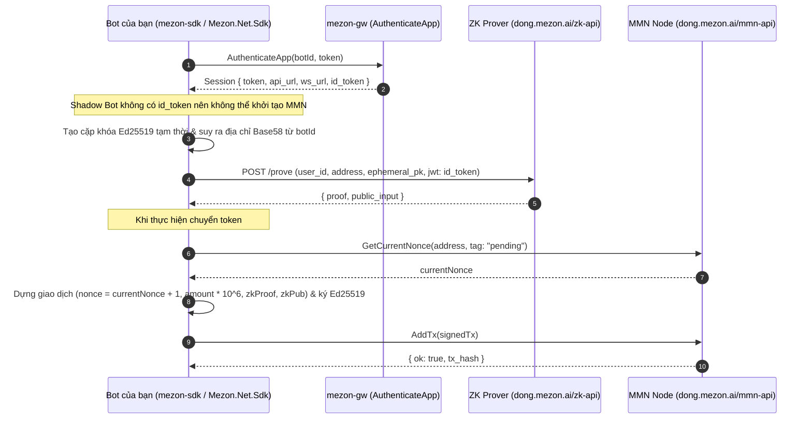

# Tổng quan Thanh toán & MMN

**Mezon Dong (₫)** là đồng token gốc của Mezon vận hành trên **MMN (Mezon Mainnet)**. Cả người dùng lẫn bot tiêu chuẩn đều sở hữu địa chỉ ví MMN xác định từ Snowflake ID Mezon của mình, có thể tra cứu số dư và lịch sử giao dịch trên trình khám phá công khai tại [`https://dong.mezon.ai`](https://dong.mezon.ai), cũng như gửi giao dịch chuyển token có chữ ký mật mã.

## Kiến trúc mật mã khi chuyển token

MMN áp dụng mô hình **xác thực kiểu zkLogin**, kết hợp cặp khóa **Ed25519 tạm thời** với **bằng chứng không tiết lộ (ZK Proof)** gắn liền với `id_token` của bot:

## Các endpoint công khai và đơn vị tiền tệ

| Tài nguyên | URL / Giá trị mặc định | Mục đích |
|---|---|---|
| Explorer công khai | `https://dong.mezon.ai` | Tra cứu ví, số dư và mã băm giao dịch |
| MMN JSON-RPC API | `https://dong.mezon.ai/mmn-api/` | Tra cứu tài khoản, pending nonce và gửi `AddTx` |
| ZK Prover API | `https://dong.mezon.ai/zk-api/` | Sinh bằng chứng ZK ràng buộc `id_token` với khóa công khai Ed25519 tạm thời |
| Độ chính xác token | **6 chữ số thập phân** (`1 ₫ = 1.000.000` đơn vị nhỏ nhất) | `mmn-client-js` tự nhân qua `scaleAmountToDecimals()`; `Mezon.Net.Sdk` nhận `BigInteger` đã quy đổi sẵn |

## Giới hạn với Shadow Bot

:::warning Shadow Bot không thể chuyển token MMN
Trong `mezon-gw` (`api_authenticate.go`), `AuthenticateApp` chủ động bỏ qua việc cấp `id_token` khi `isShadow == true`. Vì ZK Prover bắt buộc phải có JWT `id_token` hợp lệ để xác thực khóa Ed25519 tạm thời, **Shadow Bot không thể khởi tạo MMN hay gọi `sendToken` / `SendTransferAsync`**. Hãy sử dụng bot tiêu chuẩn nếu bot cần gửi Mezon Dong.
:::

## Quản lý đồng thời nonce

Mỗi giao dịch sử dụng `pendingNonce + 1` của tài khoản gửi. Nếu gửi đồng thời hai giao dịch mà không xếp hàng, hai giao dịch có thể lấy trùng nonce và một giao dịch sẽ bị từ chối:

- `Mezon.Net.Sdk` (`1.11.0`) tự động tuần tự hóa các giao dịch qua `SemaphoreSlim` nội bộ (`_mmnTransferGate`).
- Trong `mezon-sdk` (`2.8.68`), hãy xếp hàng các lời gọi `client.sendToken(...)` ở tầng ứng dụng của bạn để tránh đụng độ nonce.

## Liên quan

- [Chuyển token từ bot](./bot-token-transfers.mdx)
- [Các MMN SDK độc lập](./mmn-sdks.md)
- [Xác thực và phiên làm việc](../core-concepts/authentication-and-sessions.md)
