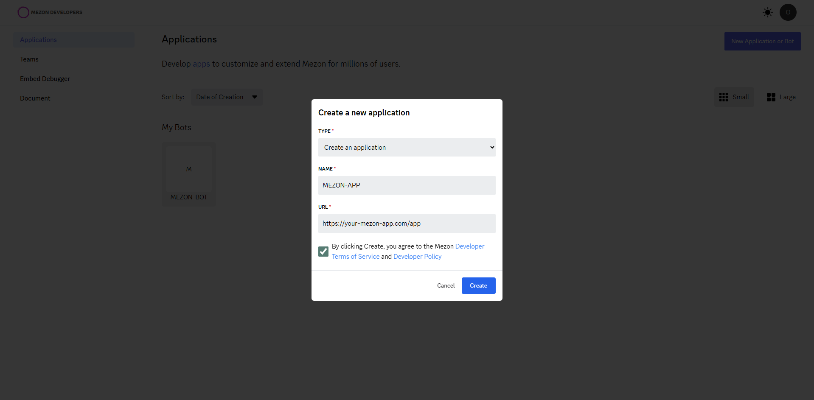
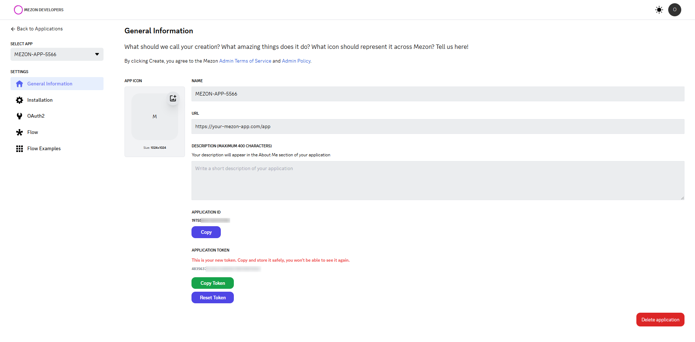
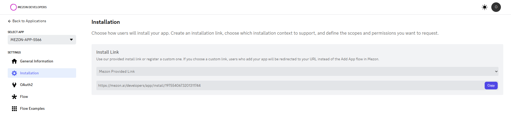
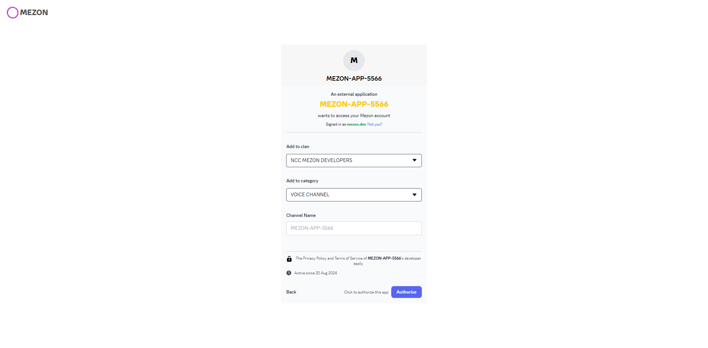
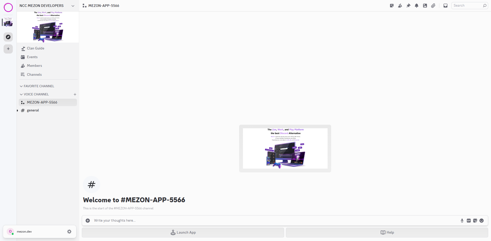

# Tạo tài khoản App Mezon

Tương tự như tài khoản bot, việc tạo tài khoản app cũng khá đơn giản.

1. Đảm bảo bạn đã đăng nhập vào [trang Mezon](https://mezon.ai/).

2. Truy cập [cổng nhà phát triển](https://mezon.ai/developers).

3. Nhấn vào nút `New Application`.

4. Chọn loại là `Create an application`, đặt tên cho app rồi nhấn `Create`.
5. Cấu hình URL trỏ tới ứng dụng web của bạn.
    

6. Mục `General Information` cung cấp thông tin về app của bạn.

  - Dùng `App Id` làm token để đăng nhập khi sử dụng **[Mezon App SDK](../mezon-sdk/channel-app-sdk/overview)**

## Cài đặt App của bạn

Bạn đã tạo một `App User` nhưng người dùng đó chưa thực sự thuộc clan nào. Nếu muốn dùng app, bạn phải cài đặt app qua đường dẫn cài đặt trong tab `Installation`.

1. Đảm bảo bạn đã đăng nhập vào [trang Mezon](https://mezon.ai/).

2. Vào mục `Installation` trong [cổng nhà phát triển](https://mezon.ai/developers).

Bây giờ bạn có thể dùng đường dẫn cài đặt để thêm app vào clan. Sao chép và dán URL vào trình duyệt, chọn clan để cài đặt app rồi nhấn `Authorize`.

Bạn có thể tùy chỉnh tên cho channel app, hoặc nó sẽ dùng tên mặc định. App của bạn sẽ xuất hiện như một kênh trong danh sách kênh của clan.

:::info LƯU Ý
Người thêm app cần có quyền `Manage Clan` để thực hiện việc này.
:::
