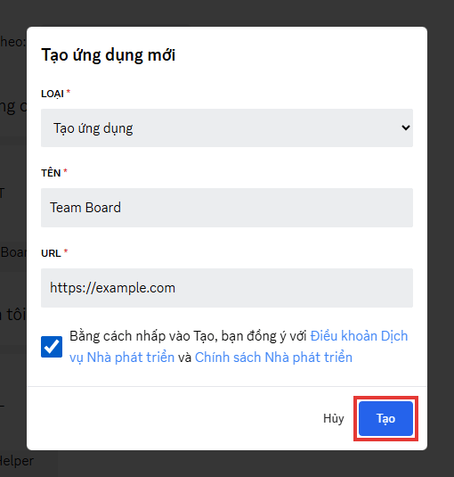
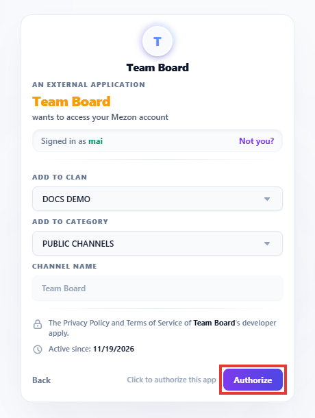
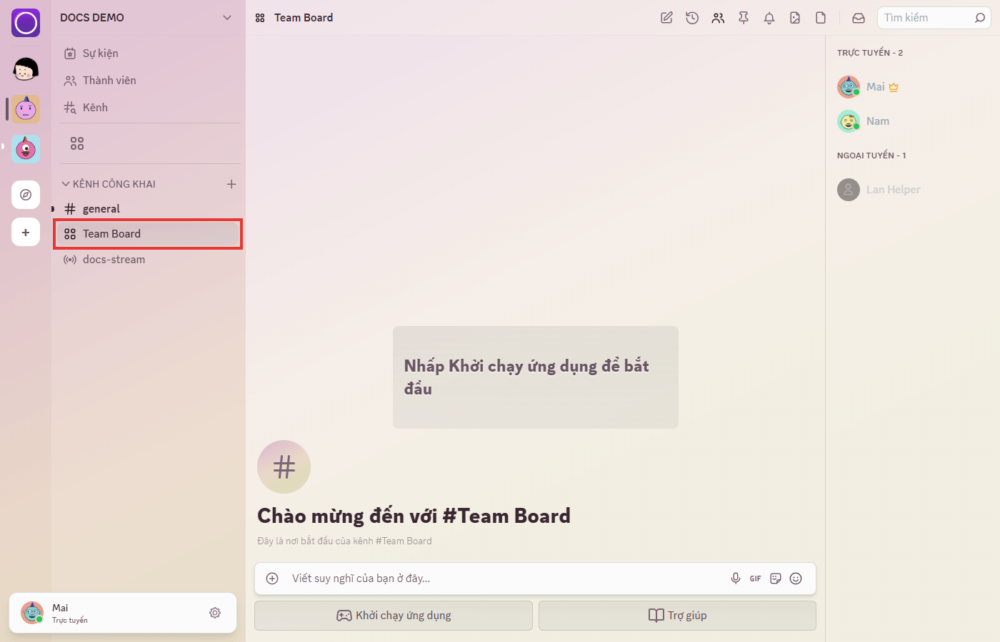

# Tạo ứng dụng trong kênh

Ứng dụng trong kênh là trang web của bạn, được mở từ một kênh của clan. Hãy đăng ký ứng dụng trên Mezon Developer Portal, rồi cài vào một clan. Dùng trình duyệt trên máy tính; bạn cần có tài khoản Mezon.

## Tạo ứng dụng

1. Mở [Mezon Developer Portal](https://mezon.ai/developers/applications) và đăng nhập bằng tài khoản Mezon.
2. Nhấn **Tạo Ứng dụng hoặc Bot mới**.
3. Ở mục **LOẠI**, chọn **Tạo ứng dụng**.
4. Ở mục **TÊN**, nhập tên ứng dụng.
5. Ở mục **URL**, nhập địa chỉ trang web, ví dụ `https://app.example.com`.
6. Đánh dấu ô đồng ý với Điều khoản Dịch vụ Nhà phát triển và Chính sách Nhà phát triển của Mezon.
7. Nhấn **Tạo**.

   

Trang **Thông tin chung** của ứng dụng mở ra. Trang này hiện ID của ứng dụng và **Token**, giống như với bot.

:::warning
Nhấn **Sao chép Token** và giữ token trên máy chủ của bạn. Developer Portal chỉ hiện token một lần. Máy chủ cần token để kiểm tra ai đã mở ứng dụng: xem [Kiểm tra ai đã mở ứng dụng](../mezon-sdk/channel-app-sdk/channel-app-auth-flow.mdx).
:::

## Cài ứng dụng vào clan

Khi cài, ứng dụng được thêm vào clan dưới dạng một kênh. Bạn cần quyền **Quản lý kênh** trong clan đó.

1. Mở thẻ **Cài đặt** của ứng dụng.
2. Ở mục **Liên kết Cài đặt**, nhấn **Sao chép**.
3. Mở liên kết trong trình duyệt.
4. Ở mục **Add to clan** (thêm vào clan), chọn clan. Trang này hiện nhãn bằng tiếng Anh.
5. Ở mục **Add to category** (thêm vào danh mục), chọn danh mục cho kênh của ứng dụng.
6. Ở mục **Channel Name** (tên kênh), nhập tên kênh, hoặc để trống để dùng tên ứng dụng. Tên chỉ giữ chữ cái, chữ số, dấu cách, `-` và `_`, tối đa 32 ký tự.
7. Nhấn **Authorize** (ủy quyền).

   

Ứng dụng hiện ra như một kênh trong danh sách kênh của clan.

## Bước tiếp theo

- [Tổng quan về ứng dụng trong kênh](../mezon-sdk/channel-app-sdk/overview.md): thành viên mở ứng dụng thế nào và ứng dụng nhận được gì.
- [Kiểm tra ai đã mở ứng dụng](../mezon-sdk/channel-app-sdk/channel-app-auth-flow.mdx)
