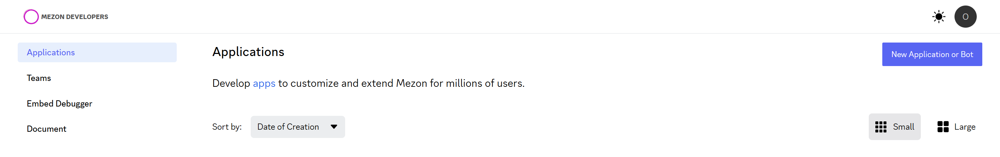
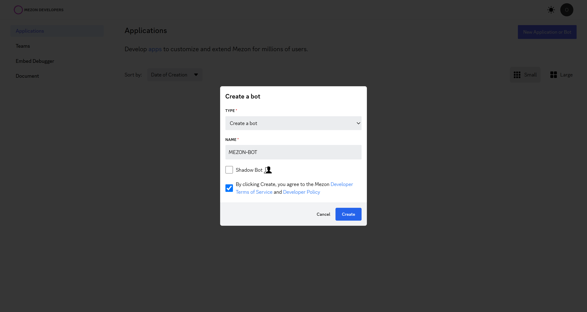
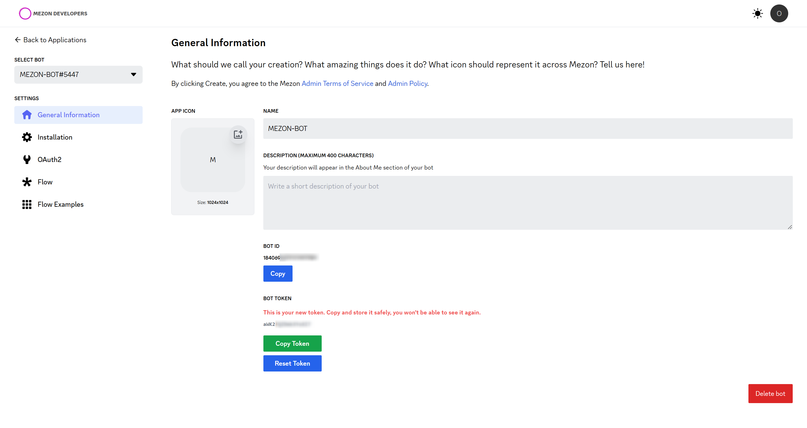
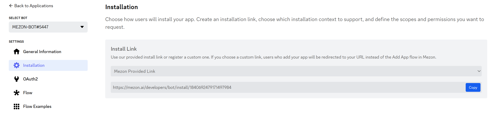

# Tạo tài khoản Bot Mezon

Để làm việc với thư viện và API của Mezon nói chung, trước tiên chúng ta cần tạo một tài khoản Bot Mezon.

Việc tạo tài khoản Bot khá đơn giản.

1. Đảm bảo bạn đã đăng nhập vào [trang Mezon](https://mezon.ai/).

2. Truy cập [cổng nhà phát triển](https://mezon.ai/developers).

3. Nhấn vào nút `New Application`.

4. Chọn loại là `Create a bot`, đặt tên cho bot rồi nhấn `Create`.
    

  - Bạn có thể ẩn bot của mình bằng tùy chọn `Shadow Bot`. Khi đó, các tương tác của bot sẽ hiển thị dưới tên của bạn trong các clan.

5. Mục `General Information` cung cấp thông tin về bot của bạn.

  - Dùng `Bot Id` làm token để đăng nhập khi sử dụng **[Mezon Bot SDK](../mezon-sdk/integration-bot-sdk/overview)**

## Mời Bot của bạn

Bạn đã tạo một Bot User nhưng nó chưa thực sự nằm trong clan nào.

Nếu muốn mời bot, bạn phải tạo một đường dẫn mời (invite URL) cho nó.

1. Đảm bảo bạn đã đăng nhập vào [trang Mezon](https://mezon.ai/).

2. Vào mục `Installation` trong [cổng nhà phát triển](https://mezon.ai/developers).

Bây giờ bạn có thể dùng đường dẫn cài đặt để thêm bot vào một clan. Sao chép và dán URL vào trình duyệt, chọn clan muốn mời bot vào, rồi nhấn `Authorize`.

:::info LƯU Ý
Người thêm bot cần có quyền `Manage Clan` để thực hiện việc này.
:::
