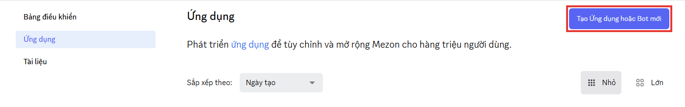
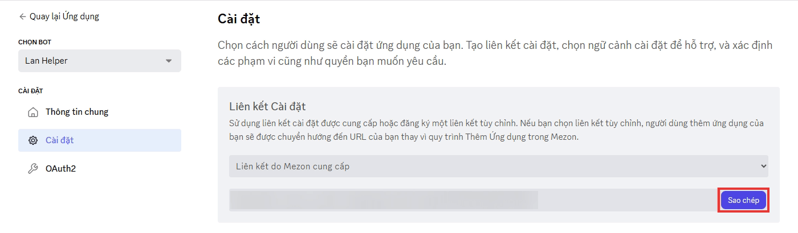

# Tạo bot

Tạo tài khoản cho bot trên Mezon Developer Portal, giữ lại ID Bot và token, rồi thêm bot vào một clan. Hãy dùng trình duyệt trên máy tính; bạn cần có tài khoản Mezon.

## Tạo bot

1. Mở [Mezon Developer Portal](https://mezon.ai/developers/applications) và đăng nhập bằng tài khoản Mezon.
2. Nhấn **Tạo Ứng dụng hoặc Bot mới**.

   

3. Ở mục **LOẠI**, chọn **Tạo bot**.
4. Ở mục **TÊN**, nhập tên bot.
5. Đánh dấu ô đồng ý với Điều khoản Dịch vụ Nhà phát triển và Chính sách Nhà phát triển của Mezon. Nút **Tạo** chỉ bật sau khi bạn đánh dấu.
6. Nhấn **Tạo**.

   

Trang **Thông tin chung** của bot mở ra.

:::note Bot Ẩn
Biểu mẫu tạo có công tắc **Bot Ẩn**. Ở chế độ ẩn, bot có thể nhận tất cả tin nhắn gửi đến người tạo, nhưng không thể gửi tin nhắn. Hãy tắt công tắc này với bot thông thường.
:::

## Giữ ID Bot và token

Chương trình của bạn đăng nhập bằng hai giá trị trên trang **Thông tin chung**:

- **ID Bot**: ID người dùng của bot.
- **Token**: khóa bí mật của bot.

1. Nhấn **Sao chép Token**.
2. Lưu token ở nơi an toàn, ví dụ trình quản lý bí mật hoặc biến môi trường trên máy chủ.

   

:::warning
Developer Portal chỉ hiện token một lần, ngay khi token được tạo. Nếu làm mất token, hãy nhấn **Đặt lại Token** để lấy token mới, rồi cập nhật chương trình. Đừng bao giờ ghi token vào mã nguồn hay gửi trong tin nhắn.
:::

## Thêm bot vào clan

Bot chỉ hoạt động trong các clan đã thêm nó. Để thêm bot, bạn cần quyền **Quản lý Clan** trong clan đó.

1. Mở thẻ **Cài đặt** của bot.
2. Ở mục **Liên kết Cài đặt**, nhấn **Sao chép**.

   

3. Mở liên kết trong trình duyệt.
4. Ở mục **Add to clan** (thêm vào clan; trang này hiện tiếng Anh), chọn clan.
5. Nhấn **Authorize** (ủy quyền).

   

Trang **Success!** xác nhận bot đã được thêm vào clan. Hãy gửi liên kết cài đặt cho các chủ sở hữu clan muốn dùng bot của bạn.

## Bước tiếp theo

- [Viết bot đầu tiên bằng JavaScript hoặc TypeScript](../mezon-sdk/integration-bot-sdk/getting-started.md)
- [Viết bot đầu tiên bằng .NET](../mezon-sdk/dotnet-sdk.md)
- [Bot được phép làm gì](../mezon-sdk/bot-api-access.md)
