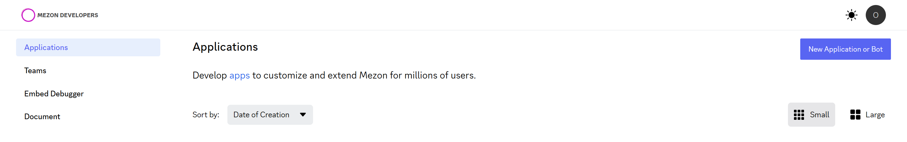

# Tổng quan về Bots/Apps trên Mezon

Trên trang này, chúng ta sẽ trả lời các câu hỏi:

- [Bots và apps có thể làm gì?](#what-can-bots-and-apps-do)
- [Apps được cài đặt ở đâu?](#where-are-apps-installed)
- [Apps có thể dùng những API nào?](#what-apis-can-apps-use)

---

## Bots và apps có thể làm gì? {#what-can-bots-and-apps-do}

Bạn sẽ khám phá hết tiềm năng của chúng khi tìm hiểu tài liệu và bắt tay vào xây dựng, nhưng trước tiên hãy xem qua một số tính năng chính bạn có thể xây dựng và tích hợp vào app của mình.

### Gửi và quản lý tin nhắn

Tin nhắn là nền tảng của Mezon, và bot cũng không ngoại lệ. Bot có thể gửi tin nhắn qua nhiều cách — dùng **[Mezon Bot SDK](../mezon-sdk/integration-bot-sdk/overview)** để nhắn tin trực tiếp, tạo và quản lý webhook cho tin nhắn tự động, hoặc phản hồi thông qua các tương tác của bot. Với quyền phù hợp, bot cũng có thể quản lý tin nhắn bằng cách chỉnh sửa, xóa và thả cảm xúc trong các kênh.

### Tạo trải nghiệm tương tác

Bot có thể tạo các phần tử tương tác trong tin nhắn, mà chúng ta gọi là **tin nhắn tương tác** (interactive messages). Tạo bình chọn, lời nhắc và nhiều hơn nữa... cho phép tương tác trực tiếp với các thành viên trong clan.

### Xây dựng ứng dụng kênh nhúng

**[Channel App SDK](../mezon-sdk/channel-app-sdk/overview)** cho phép các app tạo ra **ứng dụng web nhúng** chạy trực tiếp bên trong các kênh Mezon. Những ứng dụng này hoạt động trong iframe an toàn với giao tiếp hai chiều tới client Mezon, mang lại các trải nghiệm tương tác phong phú như trò chơi, công cụ năng suất, bình chọn và không gian cộng tác ngay nơi mọi người đang kết nối.

### Tùy biến clan và kênh

Với các endpoint API phù hợp và [quyền](../mezon-sdk/integration-bot-sdk/core-concepts#authentication-sessions) thích hợp, app có thể tùy biến trải nghiệm clan và kiểm duyệt bằng cách truy cập và quản lý các tài nguyên cốt lõi của Mezon — bao gồm [người dùng](../mezon-sdk/integration-bot-sdk/api-references#user-class), [kênh](../mezon-sdk/integration-bot-sdk/api-references), [clan](../mezon-sdk/integration-bot-sdk/api-references#clan-class), vai trò và công cụ kiểm duyệt. App có thể tạo kênh, quản lý quyền thành viên, triển khai kiểm duyệt tự động và tổ chức cấu trúc clan.

### Giao tiếp và sự kiện thời gian thực

App có thể sử dụng **kết nối WebSocket** để giao tiếp hai chiều thời gian thực với nền tảng Mezon. Điều này cho phép app nhận thông báo tức thì về tin nhắn, thay đổi trạng thái hiện diện của người dùng, hoạt động kênh thoại và các sự kiện khác trong clan. App có thể phản hồi ngay lập tức, mang lại trải nghiệm nhạy bén và tương tác.

### Tích hợp thoại và streaming

App Mezon có thể tích hợp với **kênh thoại** và **tính năng streaming**. App có thể quản lý thành viên kênh thoại, nhận sự kiện thoại, đăng ký kênh streaming cho bot và tạo trải nghiệm tương tác có hỗ trợ thoại. Điều này mở ra khả năng cho bot nhạc, lệnh kích hoạt bằng giọng nói và các trải nghiệm thoại cộng tác.

### Tính năng token và kinh tế

App có thể tích hợp với **hệ thống token** của Mezon để xây dựng các tính năng dựa trên nền kinh tế. Bot có thể gửi và nhận token giữa người dùng, theo dõi lịch sử giao dịch và tạo hệ thống phần thưởng, trò chơi hoặc tính năng chợ tận dụng nền kinh tế token tích hợp sẵn của Mezon.

### ...và nhiều hơn nữa

Tài liệu nhà phát triển này chứa rất nhiều tính năng và khả năng để khám phá. Hãy tìm hiểu những gì có thể bằng cách duyệt tài liệu hoặc [xây dựng app của riêng bạn](https://mezon.ai/developers).

---

## Apps được cài đặt ở đâu? {#where-are-apps-installed}

App Mezon có thể được cài đặt và sử dụng trong nhiều ngữ cảnh khác nhau tùy theo loại và cấu hình của chúng:

### Ứng dụng Bot

**Ứng dụng bot** được cài đặt vào các clan cụ thể bởi người dùng có quyền **Manage Clan**. Sau khi cài đặt:
- Bot có thể tương tác trong các kênh của clan đó và với các thành viên clan
- Bot có thể gửi tin nhắn trực tiếp đến những người tương tác với nó
- Bot hiển thị với tất cả thành viên clan và ai cũng có thể sử dụng
- Bot duy trì sự hiện diện liên tục và có thể phản hồi sự kiện 24/7

### Ứng dụng Kênh

**Ứng dụng kênh** chạy như các trải nghiệm web nhúng bên trong các kênh cụ thể:
- App kênh được tải trực tiếp trong giao diện kênh dưới dạng ứng dụng iframe
- Bất kỳ người dùng nào có quyền xem kênh đều có thể truy cập
- App kênh nhận tham số khởi tạo từ ứng dụng Mezon cha
- Chúng giao tiếp với Mezon qua các API postMessage an toàn để tương tác hai chiều

### Cài đặt và Quyền

Quá trình cài đặt và các ngữ cảnh khả dụng phụ thuộc vào:
- **Quyền trong clan**: Người dùng cần quyền phù hợp để cài đặt app trong clan
- **Cấu hình app**: Nhà phát triển có thể cấu hình app của họ hỗ trợ những ngữ cảnh cài đặt nào
- **Cài đặt bảo mật**: App hoạt động trong các ngữ cảnh an toàn với phạm vi quyền phù hợp

---

## Apps có thể dùng những API nào? {#what-apis-can-apps-use}

Có một số API và SDK bạn có thể chọn dựa trên chức năng của app và các tính năng Mezon bạn muốn truy cập. Dưới đây là tổng quan các API chính trên nền tảng nhà phát triển Mezon.

### Mezon Bot SDK (Ứng dụng Bot)

**[Mezon Bot SDK](../mezon-sdk/integration-bot-sdk/overview)** là một thư viện TypeScript toàn diện để xây dựng các ứng dụng bot tương tác với nền tảng Mezon thông qua REST API và kết nối WebSocket.

Dùng Mezon SDK để:
- **Xác thực bot** và quản lý phiên
- **Gửi và nhận tin nhắn** theo thời gian thực
- **Quản lý clan, kênh và người dùng**
- **Xử lý sự kiện thoại và streaming**
- **Xử lý giao dịch token**
- **Lắng nghe sự kiện thời gian thực** qua kết nối WebSocket

### Channel App SDK (Ứng dụng Web)

**[Channel App SDK](../mezon-sdk/channel-app-sdk/overview)** là một thư viện JavaScript gọn nhẹ để xây dựng các ứng dụng web chạy nhúng bên trong các kênh Mezon.

Dùng Channel App SDK để:
- **Giao tiếp với ứng dụng Mezon cha** qua các API postMessage an toàn
- **Nhận tham số khởi tạo** và ngữ cảnh từ Mezon
- **Xử lý thay đổi giao diện** và cập nhật thiết kế đáp ứng
- **Gửi sự kiện và dữ liệu** trở lại client Mezon
- **Quản lý trạng thái ứng dụng** qua các lần tải lại trang

### HTTP REST API

**HTTP REST API** là một giao diện toàn diện cho phép bạn tương tác với các tài nguyên cốt lõi của Mezon như kênh, clan, người dùng, tin nhắn và nhiều hơn nữa.

Dùng HTTP API để:
- **Lấy thông tin** về các tài nguyên Mezon
- **Tạo, cập nhật hoặc xóa** kênh, tin nhắn và các thực thể khác
- **Quản lý quan hệ giữa clan và người dùng**
- **Xử lý xác thực** và quản lý phiên
- **Tải lên và quản lý tệp đính kèm**

### WebSocket Gateway API

**WebSocket Gateway API** cung cấp luồng sự kiện thời gian thực cho các ứng dụng bot, gửi thông báo tức thì về các hoạt động đang diễn ra trên Mezon.

Dùng Gateway API để:
- **Nhận sự kiện thời gian thực** như tin nhắn mới, người dùng tham gia, sự kiện thoại
- **Duy trì kết nối liên tục** để phản hồi tức thì
- **Xử lý sự kiện clan và kênh** ngay khi chúng xảy ra
- **Xử lý trạng thái hiện diện** và cập nhật hoạt động của người dùng

### Webhook API

**Webhook** cung cấp cơ chế gửi sự kiện dựa trên HTTP cho các ứng dụng thích xử lý sự kiện theo kiểu REST thay vì kết nối WebSocket liên tục.

Dùng Webhook để:
- **Nhận thông báo HTTP POST** về các sự kiện Mezon
- **Xử lý sự kiện bất đồng bộ** trong ứng dụng của bạn
- **Tích hợp với kiến trúc serverless**
- **Xử lý sự kiện mà không cần duy trì kết nối liên tục**

---

## Bắt đầu xây dựng

Giờ thì chúng ta đã nắm được những điều cơ bản, đã đến lúc bắt đầu xây dựng app Mezon của bạn! Bạn có thể khám phá phần còn lại của tài liệu, ghé thăm [cổng nhà phát triển](https://mezon.ai/developers), hoặc xem các tài nguyên cho người mới bắt đầu bên dưới.

### Ứng dụng Bot
Xây dựng các ứng dụng bot mạnh mẽ để tự động hóa, kiểm duyệt và nâng cao trải nghiệm clan:

- **[Tổng quan Bot SDK](../mezon-sdk/integration-bot-sdk/overview)** - Tìm hiểu về Mezon SDK toàn diện cho phát triển bot
- **[Bắt đầu với Bot](../mezon-sdk/integration-bot-sdk/getting-started)** - Hướng dẫn từng bước để tạo bot Mezon đầu tiên của bạn
- **[Khái niệm cốt lõi](../mezon-sdk/integration-bot-sdk/core-concepts)** - Hiểu các khái niệm nền tảng của phát triển bot
- **[Ví dụ sử dụng Bot](../mezon-sdk/integration-bot-sdk/usage-and-examples)** - Các ví dụ thực tế và mẫu triển khai

### Ứng dụng Kênh
Xây dựng các ứng dụng web nhúng chạy trực tiếp bên trong các kênh Mezon:

- **[Tổng quan Channel App SDK](../mezon-sdk/channel-app-sdk/overview)** - Tìm hiểu về xây dựng ứng dụng kênh nhúng
- **[Ví dụ Channel App](../mezon-sdk/channel-app-sdk/usage-and-examples)** - Các ví dụ tương tác bao gồm trò chơi và công cụ cộng tác

### Đưa app đầu tiên của bạn vào hoạt động

Sẵn sàng xây dựng ứng dụng Mezon đầu tiên? Đây là cách bắt đầu:

1. **[Tạo tài khoản Bot](./creating-mezon-bot)** - Thiết lập tài khoản nhà phát triển và tạo bot đầu tiên của bạn
2. **Chọn loại app** - Lựa chọn giữa ứng dụng bot hoặc ứng dụng kênh tùy theo trường hợp sử dụng
3. **Cài đặt SDK phù hợp** - Dùng Mezon SDK cho bot hoặc Channel App SDK cho ứng dụng web
4. **Làm theo hướng dẫn bắt đầu** - Hoàn thành các hướng dẫn cho loại app bạn chọn
5. **Triển khai và kiểm thử** - Cài đặt app vào một clan thử nghiệm và tinh chỉnh cách triển khai

### Tài nguyên phát triển

- **[Tài liệu API](../mezon-sdk/integration-bot-sdk/api-references)** - Tài liệu đầy đủ về mọi API và phương thức hiện có
- **[Cổng nhà phát triển](https://mezon.ai/developers)** - Quản lý ứng dụng và truy cập công cụ dành cho nhà phát triển
- **[Hỗ trợ cộng đồng](https://mezon.ai/)** - Kết nối với các nhà phát triển khác và nhận trợ giúp

---

*Sẵn sàng thay đổi cách mọi người kết nối và cộng tác trên Mezon? Hãy bắt đầu xây dựng app của bạn ngay hôm nay!*
