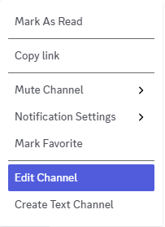
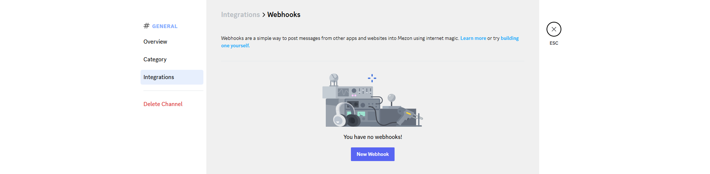
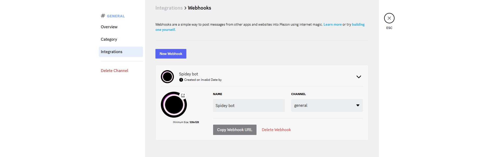
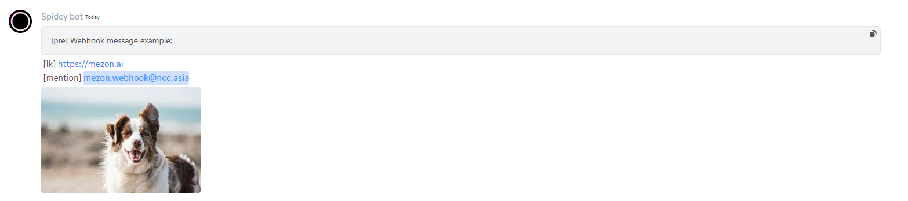

# Channel Webhook

Mezon cung cấp tính năng cho phép người dùng gửi tin nhắn tới các channel thông qua webhook tương ứng đã tạo.

## Tạo Channel Webhook

Trước tiên, để làm việc với channel webhook, bạn cần đảm bảo bạn là thành viên của một clan và có quyền truy cập vào channel.

Tạo webhook là quy trình khá đơn giản.

1. Vào channel bạn muốn tạo webhook, nhấp chuột phải để mở popup các thao tác có thể thực hiện trên channel đó.

   

2. Nhấp vào tùy chọn **`Edit Channel`** rồi vào tab **`Integrations`**.

   

3. Nhấp **`New Webhook`** để tiến hành tạo webhook mới.

   

- Bạn sẽ có một user (ở đây tên Spidey bot) và có thể tùy chỉnh tên và avatar của bot này.

- Nhấp **`Copy Webhook URL`** để lấy endpoint webhook, dùng cùng **[payload webhook](#webhook-specification)** để gửi tin nhắn tới channel.

## Đặc tả Webhook {#webhook-specification}

### Endpoint

Webhook được gửi qua yêu cầu HTTP POST tới URL duy nhất được tạo cho mỗi tích hợp webhook.

**Cấu trúc URL:**

```
https://webhook.mezon.ai/webhooks/{channelId}/{token}
```

**Tham số URL:**

| Tham số     | Kiểu   | Mô tả                                                                                                                                                                                |
| :---------- | :----- | :----------------------------------------------------------------------------------------------------------------------------------------------------------------------------------- |
| `channelId` | string | Định danh duy nhất của channel.                                                                                                                                                      |
| `token`     | string | Token bảo mật để xác thực yêu cầu. Có vẻ là chuỗi base64 hoặc JSON Web Token (JWT) chứa thông tin xác minh tính xác thực của yêu cầu.                                               |

### Request Header

| Header         | Giá trị            | Mô tả                                              |
| -------------- | ------------------ | -------------------------------------------------- |
| `Content-Type` | `application/json` | Cho biết body yêu cầu ở định dạng JSON.            |

### Request Body

Body yêu cầu chứa đối tượng JSON với chi tiết tin nhắn kích hoạt webhook.

#### Đối tượng gốc

| Trường    | Kiểu   | Bắt buộc | Mô tả                                                              |
| --------- | ------ | -------- | ------------------------------------------------------------------ |
| `type`    | string | Có       | Loại sự kiện webhook. Trong ví dụ này là `"hook"`.                 |
| `message` | object | Có       | Đối tượng chứa chi tiết tin nhắn.                                  |

---

### Định dạng tin nhắn

Đối tượng này bao gồm nội dung và metadata của tin nhắn.

| Trường     | Kiểu             | Bắt buộc | Mô tả                                                                                                                                                                                                                                                            |
| ---------- | ---------------- | -------- | ---------------------------------------------------------------------------------------------------------------------------------------------------------------------------------------------------------------------------------------------------------------- |
| `t`        | string           | Có       | Nội dung văn bản thô của tin nhắn.                                                                                                                                                                                                                               |
| `mk`       | array of objects | Không    | Mảng đối tượng mô tả markdown hoặc định dạng đặc biệt áp dụng cho văn bản tin nhắn. Lưu ý có thể có nhiều mảng `mk`. Các giá trị có thể của `type` trong đối tượng này gồm `lk` (link) và `pre` (văn bản định dạng sẵn).                                        |
| `mentions` | array of objects | Không    | Mảng đối tượng, mỗi đối tượng đại diện một người dùng được mention trong tin nhắn.                                                                                                                                                                               |
| `images`   | array of objects | Không    | Mảng đối tượng, mỗi đối tượng đại diện một ảnh đính kèm tin nhắn.                                                                                                                                                                                                |
| `hg`       | array of objects | Không    | Mảng đối tượng, mỗi đối tượng đại diện một hashtag channel được mention trong tin nhắn.                                                                                                                                                                        |

#### Đối tượng `mk` (markdown)

| Trường | Kiểu    | Bắt buộc | Mô tả                                                                    |
| ------ | ------- | -------- | ------------------------------------------------------------------------ |
| `type` | string  | Có       | Loại định dạng áp dụng (ví dụ `"lk"`, `"pre"`).                          |
| `s`    | integer | Có       | Chỉ số ký tự bắt đầu của đoạn định dạng trong chuỗi `t`.                |
| `e`    | integer | Có       | Chỉ số ký tự kết thúc của đoạn định dạng trong chuỗi `t`.                |

#### Đối tượng `mentions`

| Trường     | Kiểu    | Bắt buộc | Mô tả                                                          |
| ---------- | ------- | -------- | -------------------------------------------------------------- |
| `username` | string  | Không    | Username của người dùng được mention.                          |
| `user_id`  | string  | Không    | Định danh duy nhất của người dùng được mention.                |
| `s`        | integer | Có       | Chỉ số ký tự bắt đầu của mention trong chuỗi `t`.              |
| `e`        | integer | Có       | Chỉ số ký tự kết thúc của mention trong chuỗi `t`.             |

:::tip Lưu ý
Bạn có thể mention mọi người trong channel theo hai cách:
- **Theo user_id**: Dùng định danh duy nhất **`1775731111020111321`** để mention mọi người trong channel
- **Theo username**: Dùng **`here`** làm username để mention mọi người trong channel (@here)

Cần cung cấp `username` hoặc `user_id`, nhưng không được cung cấp cả hai.
:::

**Ví dụ 1: Mention @here theo user_id**

```json
"mentions": [
  {
    "user_id": "1775731111020111321",
    "s": 65,
    "e": 88
  }
]
```

**Ví dụ 2: Mention @here theo username**

```json
"mentions": [
  {
    "username": "here",
    "s": 65,
    "e": 88
  }
]
```

#### Đối tượng `images`

| Trường | Kiểu    | Bắt buộc | Mô tả                                              |
| ------ | ------- | -------- | -------------------------------------------------- |
| `fn`   | string  | Có       | Tên tệp ảnh.                                       |
| `sz`   | integer | Có       | Kích thước ảnh tính bằng byte.                     |
| `url`  | string  | Có       | URL công khai để truy cập ảnh.                     |
| `ft`   | string  | Có       | MIME type của ảnh (ví dụ `"image/jpeg"`).          |
| `w`    | integer | Có       | Chiều rộng ảnh tính bằng pixel.                    |
| `h`    | integer | Có       | Chiều cao ảnh tính bằng pixel.                    |

#### Đối tượng `hg` (hashtag)

| Trường      | Kiểu    | Bắt buộc | Mô tả                                                           |
| ----------- | ------- | -------- | --------------------------------------------------------------- |
| `channelId` | string  | Có       | Định danh duy nhất của channel được tham chiếu.                 |
| `s`         | integer | Có       | Chỉ số ký tự bắt đầu của hashtag trong chuỗi `t`.              |
| `e`         | integer | Có       | Chỉ số ký tự kết thúc của hashtag trong chuỗi `t`.              |

### Ví dụ Channel Webhook

import Tabs from "@theme/Tabs";
import TabItem from "@theme/TabItem";

<Tabs>
  <TabItem value="Bash" label="Bash" default>
    ```bash
    curl --location 'https://webhook.mezon.ai/webhooks/YOUR_CHANNEL_ID/YOUR_WEBHOOK_TOKEN' \
    --header 'Content-Type: application/json' \
    --data-raw '{
        "type": "hook",
        "message": {
          "t": "[pre] Webhook message example: [lk] https://mezon.ai \n [mention] @aliceinmezon #general",
          "mk": [
            {
              "type": "pre",
              "s": 0,
              "e": 30
            },
            {
              "type": "lk",
              "s": 36,
              "e": 54
            }
          ],
          "mentions": [
            {
              "user_id": "1783755414765047808",
              "s": 65,
              "e": 77
            }
          ],
          "images": [
            {
              "fn": "thumbnail_dog1.jpg",
              "sz": 5620,
              "url": "https://cdn.mezon.vn/0/1843962578301095936/1829065039080853500/95_0thumbnail_dog1.jpg",
              "ft": "image/jpeg",
              "w": 275,
              "h": 183
            }
          ],
          "hg": [
            {
              "channelId": "1973524969530855424",
              "s": 79,
              "e": 86
            }
          ]
        }
      }
    ```
  </TabItem>
  <TabItem value="Python" label="Python">
    ```python
    import http.client
    import json

    conn = http.client.HTTPSConnection("webhook.mezon.ai")
    payload = json.dumps({
      "type": "hook",
      "message": {
        "t": "[pre] Webhook message example: [lk] https://mezon.ai \n [mention] @aliceinmezon #general",
        "mk": [
          {
            "type": "pre",
            "s": 0,
            "e": 30
          },
          {
            "type": "lk",
            "s": 36,
            "e": 54
          }
        ],
        "mentions": [
          {
            "user_id": "1783755414765047808",
            "s": 65,
            "e": 77
          }
        ],
        "images": [
          {
            "fn": "thumbnail_dog1.jpg",
            "sz": 5620,
            "url": "https://cdn.mezon.vn/0/1843962578301095936/1829065039080853500/95_0thumbnail_dog1.jpg",
            "ft": "image/jpeg",
            "w": 275,
            "h": 183
          }
        ],
        "hg": [
          {
            "channelId": "1973524969530855424",
            "s": 79,
            "e": 86
          }
        ]
      }
    })
    headers = {
      'Content-Type': 'application/json'
    }
    conn.request("POST", "/webhooks/YOUR_CHANNEL_ID/YOUR_WEBHOOK_TOKEN", payload, headers)
    res = conn.getresponse()
    data = res.read()
    print(data.decode("utf-8"))
    ```
  </TabItem>
  <TabItem value="Go" label="Go">
    ```go
    package main

    import (
      "fmt"
      "strings"
      "net/http"
      "io"
    )

    func main() {

      url := "https://webhook.mezon.ai/webhooks/YOUR_CHANNEL_ID/YOUR_WEBHOOK_TOKEN"
      method := "POST"

      payload := strings.NewReader(`{`+"
    "+`
      "type": "hook",`+"
    "+`
      "message": {`+"
    "+`
        "t": "[pre] Webhook message example: [lk] https://mezon.ai \n [mention] @aliceinmezon #general",`+"
    "+`
        "mk": [`+"
    "+`
          {`+"
    "+`
            "type": "pre",`+"
    "+`
            "s": 0,`+"
    "+`
            "e": 30`+"
    "+`
          },`+"
    "+`
          {`+"
    "+`
            "type": "lk",`+"
    "+`
            "s": 36,`+"
    "+`
            "e": 54`+"
    "+`
          }`+"
    "+`
        ],`+"
    "+`
        "mentions": [`+"
    "+`
          {`+"
    "+`
            "user_id": "1783755414765047808",`+"
    "+`
            "s": 65,`+"
    "+`
            "e": 77`+"
    "+`
          }`+"
    "+`
        ],`+"
    "+`
        "images": [`+"
    "+`
          {`+"
    "+`
            "fn": "thumbnail_dog1.jpg",`+"
    "+`
            "sz": 5620,`+"
    "+`
            "url": "https://cdn.mezon.vn/0/1843962578301095936/1829065039080853500/95_0thumbnail_dog1.jpg",`+"
    "+`
            "ft": "image/jpeg",`+"
    "+`
            "w": 275,`+"
    "+`
            "h": 183`+"
    "+`
          }`+"
    "+`
        ],`+"
    "+`
        "hg": [`+"
    "+`
          {`+"
    "+`
            "channelId": "1973524969530855424",`+"
    "+`
            "s": 79,`+"
    "+`
            "e": 86`+"
    "+`
          }`+"
    "+`
        ]`+"
    "+`
      }`+"
    "+`
    }`)

      client := &http.Client {
      }
      req, err := http.NewRequest(method, url, payload)

      if err != nil {
        fmt.Println(err)
        return
      }
      req.Header.Add("Content-Type", "application/json")

      res, err := client.Do(req)
      if err != nil {
        fmt.Println(err)
        return
      }
      defer res.Body.Close()

      body, err := io.ReadAll(res.Body)
      if err != nil {
        fmt.Println(err)
        return
      }
      fmt.Println(string(body))
    }
    ```
  </TabItem>
  <TabItem value="Java" label="Java">
    ```java
    OkHttpClient client = new OkHttpClient().newBuilder()
      .build();
    MediaType mediaType = MediaType.parse("application/json");
    RequestBody body = RequestBody.create(mediaType, "{\r\n  \"type\": \"hook\",\r\n  \"message\": {\r\n    \"t\": \"[pre] Webhook message example: [lk] https://mezon.ai \\n [mention] @aliceinmezon #general\",\r\n    \"mk\": [\r\n      {\r\n        \"type\": \"pre\",\r\n        \"s\": 0,\r\n        \"e\": 30\r\n      },\r\n      {\r\n        \"type\": \"lk\",\r\n        \"s\": 36,\r\n        \"e\": 54\r\n      }\r\n    ],\r\n    \"mentions\": [\r\n      {\r\n        \"user_id\": \"1783755414765047808\",\r\n        \"s\": 65,\r\n        \"e\": 77\r\n      }\r\n    ],\r\n    \"images\": [\r\n      {\r\n        \"fn\": \"thumbnail_dog1.jpg\",\r\n        \"sz\": 5620,\r\n        \"url\": \"https://cdn.mezon.vn/0/1843962578301095936/1829065039080853500/95_0thumbnail_dog1.jpg\",\r\n        \"ft\": \"image/jpeg\",\r\n        \"w\": 275,\r\n        \"h\": 183\r\n      }\r\n    ],\r\n    \"hg\": [\r\n      {\r\n        \"channelId\": \"1973524969530855424\",\r\n        \"s\": 79,\r\n        \"e\": 86\r\n      }\r\n    ]\r\n  }\r\n}");
    Request request = new Request.Builder()
      .url("https://webhook.mezon.ai/webhooks/YOUR_CHANNEL_ID/YOUR_WEBHOOK_TOKEN")
      .method("POST", body)
      .addHeader("Content-Type", "application/json")
      .build();
    Response response = client.newCall(request).execute();
    ```
  </TabItem>
  <TabItem value="CSharp" label="C#">
    ```CSharp
    var client = new HttpClient();
    var request = new HttpRequestMessage(HttpMethod.Post, "https://webhook.mezon.ai/webhooks/YOUR_CHANNEL_ID/YOUR_WEBHOOK_TOKEN");
    var content = new StringContent("{\r\n  \"type\": \"hook\",\r\n  \"message\": {\r\n    \"t\": \"[pre] Webhook message example: [lk] https://mezon.ai \\n [mention] @aliceinmezon #general\",\r\n    \"mk\": [\r\n      {\r\n        \"type\": \"pre\",\r\n        \"s\": 0,\r\n        \"e\": 30\r\n      },\r\n      {\r\n        \"type\": \"lk\",\r\n        \"s\": 36,\r\n        \"e\": 54\r\n      }\r\n    ],\r\n    \"mentions\": [\r\n      {\r\n        \"user_id\": \"1783755414765047808\",\r\n        \"s\": 65,\r\n        \"e\": 77\r\n      }\r\n    ],\r\n    \"images\": [\r\n      {\r\n        \"fn\": \"thumbnail_dog1.jpg\",\r\n        \"sz\": 5620,\r\n        \"url\": \"https://cdn.mezon.vn/0/1843962578301095936/1829065039080853500/95_0thumbnail_dog1.jpg\",\r\n        \"ft\": \"image/jpeg\",\r\n        \"w\": 275,\r\n        \"h\": 183\r\n      }\r\n    ],\r\n    \"hg\": [\r\n      {\r\n        \"channelId\": \"1973524969530855424\",\r\n        \"s\": 79,\r\n        \"e\": 86\r\n      }\r\n    ]\r\n  }\r\n}", null, "application/json");
    request.Content = content;
    var response = await client.SendAsync(request);
    response.EnsureSuccessStatusCode();
    Console.WriteLine(await response.Content.ReadAsStringAsync());
    ```
  </TabItem>
  <TabItem value="Javascript" label="Javascript">
    ```js
    const myHeaders = new Headers();
    myHeaders.append("Content-Type", "application/json");

    const raw = JSON.stringify({
      "type": "hook",
      "message": {
        "t": "[pre] Webhook message example: [lk] https://mezon.ai \n [mention] @aliceinmezon #general",
        "mk": [
          {
            "type": "pre",
            "s": 0,
            "e": 30
          },
          {
            "type": "lk",
            "s": 36,
            "e": 54
          }
        ],
        "mentions": [
          {
            "user_id": "1783755414765047808",
            "s": 65,
            "e": 77
          }
        ],
        "images": [
          {
            "fn": "thumbnail_dog1.jpg",
            "sz": 5620,
            "url": "https://cdn.mezon.vn/0/1843962578301095936/1829065039080853500/95_0thumbnail_dog1.jpg",
            "ft": "image/jpeg",
            "w": 275,
            "h": 183
          }
        ],
        "hg": [
          {
            "channelId": "1973524969530855424",
            "s": 79,
            "e": 86
          }
        ]
      }
    });

    const requestOptions = {
      method: "POST",
      headers: myHeaders,
      body: raw,
      redirect: "follow"
    };

    fetch("https://webhook.mezon.ai/webhooks/YOUR_CHANNEL_ID/YOUR_WEBHOOK_TOKEN", requestOptions)
      .then((response) => response.text())
      .then((result) => console.log(result))
      .catch((error) => console.error(error));
    ```
  </TabItem>
</Tabs>

**Kết quả**


