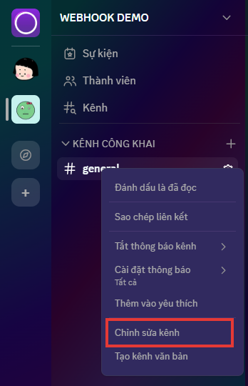
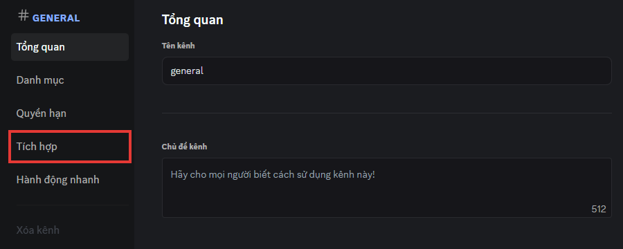
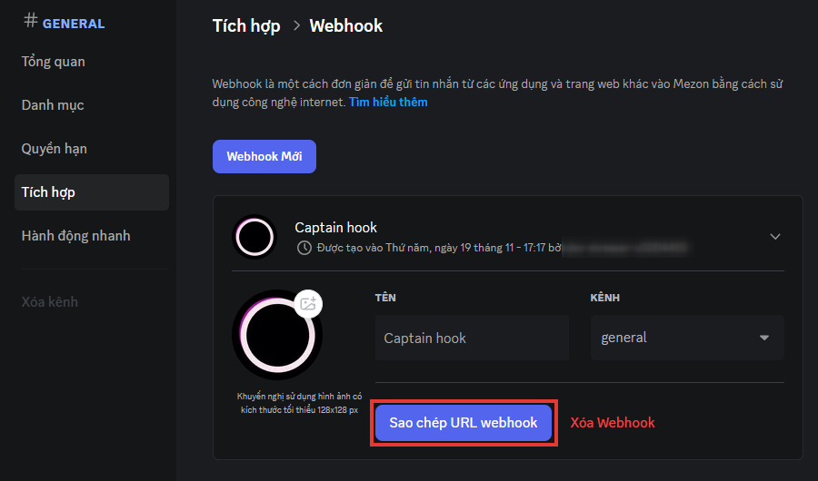

import Tabs from "@theme/Tabs";
import TabItem from "@theme/TabItem";

# Channel webhook

Channel webhook gửi tin nhắn vào một kênh (hoặc luồng) Mezon cố định dưới tên và ảnh đại diện đã cấu hình cho webhook.

<ApiBadge method="POST" path="https://webhook.mezon.ai/webhooks/YOUR_CHANNEL_ID/YOUR_WEBHOOK_TOKEN" />

## Tạo Channel Webhook

Bạn cần quyền **Manage Channel** trong clan.

1. Nhấp chuột phải vào kênh đích trên thanh danh sách kênh và chọn **Edit Channel**.

   

2. Mở thẻ **Integrations**.

   

3. Bấm **Create Webhook** (hoặc **View Webhook** nếu kênh đã có webhook), sau đó bấm **New Webhook**.
4. Mở webhook vừa tạo và bấm **Copy Webhook URL**.

   

Lưu URL này vào biến môi trường bí mật, ví dụ `WEBHOOK_URL`.

## 3 định dạng payload được hỗ trợ

`mezon-api` (`webhook_service.go`) kiểm tra khóa JSON ở cấp cao nhất theo **thứ tự ưu tiên cố định** để định tuyến sang một trong ba bộ phân tích tích hợp sẵn:

| Thứ tự ưu tiên | Khóa kích hoạt | Bộ phân tích | Phù hợp cho |
|---|---|---|---|
| 1 | `repository` | **GitHub Webhook** | Trỏ thẳng webhook kho mã GitHub vào Mezon không cần trung gian |
| 2 | `type` | **Mezon gốc** | Kiểm soát đầy đủ định dạng markdown UTF-16 (`mk`), `@mentions` và `images` |
| 3 | `content` | **Tương thích Discord (`COMMON`)** | Dùng ngay với các công cụ gửi webhook theo chuẩn Discord |
| — | *(không có khóa nào trên)* | Bỏ qua | Trả về `200 OK` nhưng **không đăng tin nhắn** |

:::tip Thứ tự ưu tiên khóa
Vì `repository` được kiểm tra trước `type`, và `type` trước `content`, đừng trộn các khóa cấp cao nhất của nhiều định dạng trong cùng một body JSON.
:::

---

### Định dạng 1: Mezon gốc (khóa `type`)

Đặt khóa cấp cao nhất `type` bất kỳ (ví dụ `"hook"`) và đặt nội dung tin nhắn trong đối tượng `message`:

```json
{
  "type": "hook",
  "message": {
    "t": "Build passed: https://example.com/builds/42 @Hoa",
    "mk": [
      { "type": "b", "s": 0, "e": 12 },
      { "type": "lk", "s": 14, "e": 43 }
    ],
    "mentions": [
      { "user_id": "USER_ID", "s": 44, "e": 48 }
    ],
    "images": [
      {
        "url": "https://example.com/chart.png",
        "fn": "chart.png",
        "ft": "image/png",
        "w": 640,
        "h": 360,
        "sz": 42180
      }
    ],
    "username": "ci-bot"
  }
}
```

| Trường | Kiểu | Bắt buộc | Ý nghĩa |
|---|---|---|---|
| `type` | string | Có | Khóa định tuyến (giá trị bất kỳ, vd `"hook"`). |
| `message.t` | string | Có | Văn bản nội dung tin nhắn. |
| `message.mk` | array | Không | Các vùng định dạng `{ "type", "s", "e" }` tính theo đơn vị mã UTF-16 (`e` không bao gồm). Ví dụ: `"b"` (in đậm), `"lk"` (liên kết), `"t"` (khối mã). |
| `message.mentions` | array | Không | Danh sách nhắc tên `{ "user_id" hoặc "username", "s", "e" }`. Chỉ thành viên có quyền xem kênh mới nhận thông báo; tên khác giữ nguyên văn bản thuần. Không hỗ trợ `@here`. |
| `message.images` | array | Không | Ảnh đính kèm `{ "url", "fn", "ft", "w", "h", "sz" }`. Mọi `url` phải là URL đầy đủ có `http://` hoặc `https://`, nếu không sẽ trả về `400 Invalid attachment URL`. |
| `message.username` | string | Không | Chuỗi siêu dữ liệu tùy chọn (Mezon luôn hiển thị tên và ảnh đại diện cấu hình trên webhook). |

---

### Định dạng 2: GitHub Webhook (khóa `repository`)

Dán thẳng URL Channel Webhook Mezon vào kho GitHub tại **Settings → Webhooks → Add webhook**, chọn **Content type** là `application/json`.

`mezon-api` (`github_handler.go`) tự động định dạng các sự kiện GitHub sau kèm liên kết bấm được:

- **Sự kiện Push** (`head_commit`, `commits`, `pusher`, `ref`): hiển thị người đẩy, tên kho + nhánh, số lượng commit và tối đa **5 commit** kèm thông điệp, liên kết và tên người commit.
- **Mở Pull Request** (`action: "opened"`, `pull_request`): hiển thị người tạo, tên kho, cặp nhánh `head -> base` và liên kết PR.
- **Merge Pull Request** (`action: "closed"`, `pull_request.merged: true`): hiển thị người merge, tên kho, cặp nhánh `head -> base` và liên kết PR.

Các sự kiện GitHub khác (như `ping` hay `issues`) vẫn trả `200 OK` nhưng không đăng tin nhắn.

---

### Định dạng 3: Tương thích Discord (khóa `content`)

Mọi công cụ gửi webhook kiểu Discord hoạt động ngay khi body JSON có khóa `content` ở cấp cao nhất:

```json
{
  "content": "Triển khai hoàn tất: https://status.example.com\n```bash\nversion=v2.4.0\n```",
  "username": "Release Bot",
  "avatar_url": "https://example.com/avatar.png"
}
```

`mezon-api` (`common/event.go`) tự động nhận diện và chuyển đổi:

- **Liên kết `http://` và `https://`** → vùng định dạng liên kết `lk` (chỉ số UTF-16).
- **Khối mã ba dấu huyền** (```` ```...``` ````) → vùng định dạng khối mã `t` (chỉ số UTF-16).

:::note Chưa hỗ trợ mảng `embeds` của Discord
Bộ phân tích `COMMON` hiện chỉ đọc `content`, `username` và `avatar_url`. Mảng `embeds` của Discord được bỏ qua; hãy dùng định dạng Mezon gốc nếu bạn cần gửi ảnh hoặc định dạng phong phú.
:::

## Ví dụ mã nguồn

Đặt `WEBHOOK_URL="https://webhook.mezon.ai/webhooks/YOUR_CHANNEL_ID/YOUR_WEBHOOK_TOKEN"` trước khi chạy.

<Tabs groupId="code">
<TabItem value="bash" label="curl" default>

```bash
# Định dạng Mezon gốc
curl -X POST "$WEBHOOK_URL" \
  -H "Content-Type: application/json" \
  -d '{"type":"hook","message":{"t":"Build passed: https://example.com/builds/42 @Hoa","mk":[{"type":"b","s":0,"e":12},{"type":"lk","s":14,"e":43}],"mentions":[{"user_id":"USER_ID","s":44,"e":48}]}}'

# Định dạng tương thích Discord
curl -X POST "$WEBHOOK_URL" \
  -H "Content-Type: application/json" \
  -d '{"content":"Build passed: https://example.com/builds/42"}'
```

</TabItem>
<TabItem value="js" label="JavaScript">

```js
const payload = {
  type: "hook",
  message: {
    t: "Build passed: https://example.com/builds/42 @Hoa",
    mk: [
      { type: "b", s: 0, e: 12 },
      { type: "lk", s: 14, e: 43 },
    ],
    mentions: [{ user_id: "USER_ID", s: 44, e: 48 }],
  },
};

const res = await fetch(process.env.WEBHOOK_URL, {
  method: "POST",
  headers: { "Content-Type": "application/json" },
  body: JSON.stringify(payload),
});
console.log(res.status, await res.text());
```

</TabItem>
<TabItem value="python" label="Python">

```python
import json
import os
import urllib.request

payload = {
    "type": "hook",
    "message": {
        "t": "Build passed: https://example.com/builds/42 @Hoa",
        "mk": [
            {"type": "b", "s": 0, "e": 12},
            {"type": "lk", "s": 14, "e": 43},
        ],
        "mentions": [{"user_id": "USER_ID", "s": 44, "e": 48}],
    },
}

req = urllib.request.Request(
    os.environ["WEBHOOK_URL"],
    data=json.dumps(payload).encode("utf-8"),
    headers={"Content-Type": "application/json"},
    method="POST",
)
with urllib.request.urlopen(req) as res:
    print(res.status, res.read().decode())
```

</TabItem>
<TabItem value="go" label="Go">

```go
package main

import (
	"bytes"
	"encoding/json"
	"fmt"
	"io"
	"net/http"
	"os"
)

func main() {
	payload := map[string]any{
		"type": "hook",
		"message": map[string]any{
			"t": "Build passed: https://example.com/builds/42 @Hoa",
			"mk": []map[string]any{
				{"type": "b", "s": 0, "e": 12},
				{"type": "lk", "s": 14, "e": 43},
			},
			"mentions": []map[string]any{{"user_id": "USER_ID", "s": 44, "e": 48}},
		},
	}
	body, _ := json.Marshal(payload)

	resp, err := http.Post(os.Getenv("WEBHOOK_URL"), "application/json", bytes.NewReader(body))
	if err != nil {
		panic(err)
	}
	defer resp.Body.Close()
	text, _ := io.ReadAll(resp.Body)
	fmt.Println(resp.StatusCode, string(text))
}
```

</TabItem>
<TabItem value="csharp" label="C#">

```csharp
using System.Net.Http.Json;

var payload = new
{
    type = "hook",
    message = new
    {
        t = "Build passed: https://example.com/builds/42 @Hoa",
        mk = new[]
        {
            new { type = "b", s = 0, e = 12 },
            new { type = "lk", s = 14, e = 43 },
        },
        mentions = new[] { new { user_id = "USER_ID", s = 44, e = 48 } },
    },
};

using var http = new HttpClient();
var response = await http.PostAsJsonAsync(Environment.GetEnvironmentVariable("WEBHOOK_URL"), payload);
Console.WriteLine($"{(int)response.StatusCode} {await response.Content.ReadAsStringAsync()}");
```

</TabItem>
</Tabs>

Tin nhắn hiển thị trong kênh như sau:


## Giới hạn và mã phản hồi

Mezon kiểm tra cú pháp JSON, URL ảnh và tính hợp lệ của token đồng bộ, sau đó đẩy tác vụ vào hàng đợi gửi (`webhook_service.go`). Các lỗi phát sinh sau bước này (như kênh đã bị xóa) không được phản hồi lại trong HTTP response.

| Giới hạn | Ngưỡng | Hành vi khi vượt ngưỡng |
|---|---|---|
| Kích thước body HTTP | **4 MiB** (`MaxRequestBodySize`) | Máy chủ HTTP từ chối trước khi vào handler |
| JSON tin nhắn Mezon gốc (`t` + `mk`) | **4.000 byte** | Thay nội dung bằng `"The original message was too long"` và xóa mentions (lưu ý ký tự tiếng Việt có dấu tốn 2–3 byte UTF-8) |
| Hashtag (`hg`) | Không hỗ trợ | Tên kênh trong `t` giữ nguyên văn bản thuần |

| Mã HTTP | Nội dung trả về | Nguyên nhân |
|---|---|---|
| `200` | *(rỗng)* | Đã chấp nhận (hoặc bỏ qua nếu thiếu cả `repository`, `type` và `content`). |
| `400` | `Invalid JSON` | Body không phải JSON hợp lệ. |
| `400` | `Invalid token` | Token sai, đã vô hiệu hóa hoặc thuộc kênh khác với URL. |
| `400` | `Invalid attachment URL` | Một mục `message.images[].url` không phải URL đầy đủ có scheme và host. |

## Liên quan

- [Tổng quan Webhooks](./overview.mdx)
- [Clan webhook](./clan-webhook.mdx)
- [Định dạng tin nhắn và thực thể](../core-concepts/message-format-and-entities.md)
