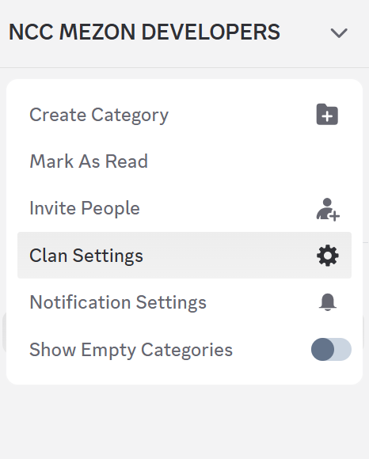
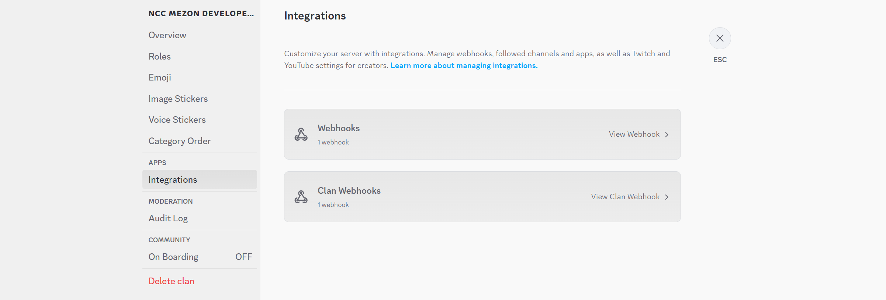
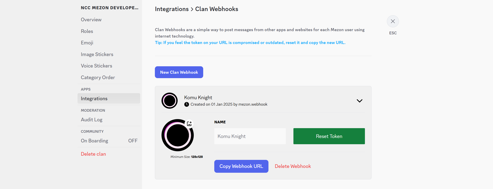
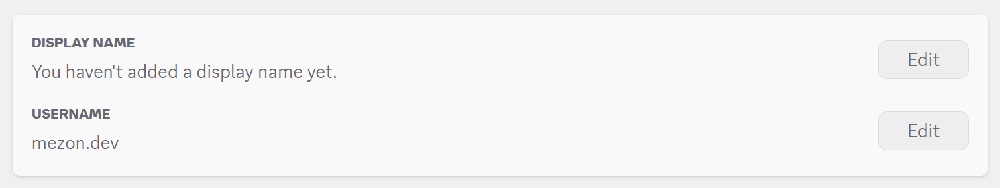
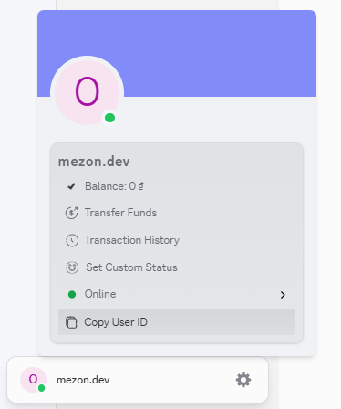
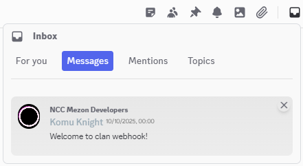

# Clan Webhook

Clan webhook gửi tin nhắn trực tiếp (DM) vào hộp thư đến của từng người; ai nhận tin phụ thuộc vào `username` hoặc `user ID` được cung cấp trên URL.

## Tạo Clan Mezon Webhook

Làm theo các bước sau để tạo webhook cho clan của bạn.

1. Vào clan bạn muốn tạo webhook, nhấp vào banner clan để mở popup các thao tác có thể thực hiện trên clan đó.

   

2. Nhấp **`Clan Settings`** rồi vào tab **`Integrations`**.

- Với tư cách quản lý clan, bạn cũng có thể quản lý cả channel webhook và clan webhook tại đây.

  

3. Nhấp **`Clan Webhooks`** rồi **`New Clan Webhook`** để tạo webhook mới.

   

- Bạn sẽ có một user (ở đây tên Komu Knight) và có thể tùy chỉnh tên và avatar của bot này.

- Nhấp **`Copy Webhook URL`** để lấy endpoint webhook, dùng cùng **[payload webhook](#webhook-specification)** để gửi tin nhắn tới người dùng trong clan.

- Có hai cách tạo Webhook URL đầy đủ sau khi sao chép URL cơ sở bằng nút Copy Webhook URL

  - **Cách 1**: Kết hợp URL đã sao chép với `Mezon Username` hợp lệ để có Webhook URL đầy đủ. `Mezon Username` có trong Account Settings của người dùng.

  

  - **Cách 2**: Hoặc dùng URL đã sao chép kết hợp với `Mezon User ID` hợp lệ. `Mezon User ID` có trong popup tài khoản người dùng.

  

:::tip Lưu ý
Nếu bạn cho rằng token trên URL đã bị lộ hoặc lỗi thời, hãy reset và sao chép URL mới, đồng thời đảm bảo người dùng đã tham gia clan của bạn.
:::

## Đặc tả Webhook {#webhook-specification}

### Endpoint

Webhook được gửi qua yêu cầu HTTP POST tới URL duy nhất được tạo cho mỗi tích hợp webhook, kết hợp với định danh người dùng duy nhất.

**Cấu trúc URL:**

```
https://webhook.mezon.ai/clanwebhooks/{token}/{user-identifier}
```

**Tham số URL:**

| Tham số           | Kiểu   | Mô tả                                                                                                                                                                                |
| :---------------- | :----- | :----------------------------------------------------------------------------------------------------------------------------------------------------------------------------------- |
| `token`           | string | Token bảo mật để xác thực yêu cầu. Có vẻ là chuỗi base64 hoặc JSON Web Token (JWT) chứa thông tin xác minh tính xác thực của yêu cầu.                                               |
| `user-identifier` | string | Định danh duy nhất của người dùng Mezon. Có thể là username hoặc user ID.                                                                                                          |

### Request Header

| Header         | Giá trị            | Mô tả                                              |
| -------------- | ------------------ | -------------------------------------------------- |
| `Content-Type` | `application/json` | Cho biết body yêu cầu ở định dạng JSON.            |

### Request Body

Body yêu cầu chứa đối tượng JSON với nội dung và tệp đính kèm của tin nhắn sẽ gửi dưới dạng tin nhắn trực tiếp tới người dùng.

#### Đối tượng gốc

| Trường        | Kiểu             | Bắt buộc | Mô tả                                                        |
| ------------- | ---------------- | -------- | ------------------------------------------------------------ |
| `content`     | string           | Có       | Chuỗi JSON-encoded chứa chi tiết nội dung tin nhắn           |
| `attachments` | array of objects | Không    | Mảng đối tượng đính kèm (ảnh, video, tệp, v.v.)              |

---

### Nội dung tin nhắn

Trường `content` chứa chuỗi JSON-encoded cần parse để truy cập cấu trúc tin nhắn.

**Đối tượng Content đã parse:**

| Trường | Kiểu             | Bắt buộc | Mô tả                                                          |
| ------ | ---------------- | -------- | -------------------------------------------------------------- |
| `t`    | string           | Có       | Nội dung văn bản thô của tin nhắn.                             |
| `mk`   | array of objects | Không    | Mảng đối tượng mô tả markdown hoặc định dạng đặc biệt.        |

#### Đối tượng `mk` (markdown)

| Trường | Kiểu    | Bắt buộc | Mô tả                                                                    |
| ------ | ------- | -------- | ------------------------------------------------------------------------ |
| `type` | string  | Có       | Loại định dạng (ví dụ `"lk"` cho link, `"pre"` cho văn bản định dạng sẵn). |
| `s`    | integer | Có       | Chỉ số ký tự bắt đầu của đoạn định dạng trong chuỗi `t`.                |
| `e`    | integer | Có       | Chỉ số ký tự kết thúc của đoạn định dạng trong chuỗi `t`.                |

### Tệp đính kèm

Mảng `attachments` chứa các đối tượng đại diện tệp đính kèm tin nhắn.

#### Đối tượng Attachment

| Trường     | Kiểu   | Bắt buộc | Mô tả                                                          |
| ---------- | ------ | -------- | -------------------------------------------------------------- |
| `url`      | string | Có       | URL CDN công khai để truy cập tệp đính kèm.                   |
| `filetype` | string | Có       | MIME type của tệp (ví dụ `"image/png"`, `"video/mp4"`).        |

### Ví dụ Clan Webhook

import Tabs from "@theme/Tabs";
import TabItem from "@theme/TabItem";

<Tabs>
  <TabItem value="Bash" label="Bash" default>
    ```bash
    curl --location --globoff 'https://webhook.mezon.ai/clanwebhooks/{YOUR_TOKEN}/{username_or_userid}' \
    --header 'Content-Type: application/json' \
    --data '{
        "content": "{\"t\":\"Welcome to Mezon Clan webhook!!! [pre] This is a block message. [lk] https://mezon.ai\",\"mk\":[{\"type\":\"pre\",\"s\":33,\"e\":64},{\"type\":\"lk\",\"s\":68,\"e\":85}]}",
        "attachments": [
            {
                "url": "https://cdn.mezon.vn/0/1843962578301095936/1829065039080853500/95_0thumbnail_dog1.jpg",
                "filetype": "image/png"
            },
            {
                "url": "https://cdn.mezon.vn/109056000/255856640/4198400/477_0bandicam_2024_11_19_11_10_14_507.mp4",
                "filetype": "video/mp4"
            }
        ]
    }'
    ```
  </TabItem>
  <TabItem value="Python" label="Python">
    ```python
    import http.client
    import json

    conn = http.client.HTTPSConnection("webhook.mezon.ai")
    payload = json.dumps({
      "content": "{\"t\":\"Welcome to Mezon Clan webhook!!! [pre] This is a block message. [lk] https://mezon.ai\",\"mk\":[{\"type\":\"pre\",\"s\":33,\"e\":64},{\"type\":\"lk\",\"s\":68,\"e\":85}]}",
      "attachments": [
        {
          "url": "https://cdn.mezon.vn/0/1843962578301095936/1829065039080853500/95_0thumbnail_dog1.jpg",
          "filetype": "image/png"
        },
        {
          "url": "https://cdn.mezon.vn/109056000/255856640/4198400/477_0bandicam_2024_11_19_11_10_14_507.mp4",
          "filetype": "video/mp4"
        }
      ]
    })
    headers = {
      'Content-Type': 'application/json'
    }
    conn.request("POST", "/clanwebhooks/{YOUR_TOKEN}/{username_or_userid}", payload, headers)
    res = conn.getresponse()
    data = res.read()
    print(data.decode("utf-8"))
    ```
  </TabItem>
  <TabItem value="Go" label="Go">
    ```go
    package main

    import (
      "fmt"
      "strings"
      "net/http"
      "io"
    )

    func main() {

      url := "https://webhook.mezon.ai/clanwebhooks/{YOUR_TOKEN}/{username_or_userid}"
      method := "POST"

      payload := strings.NewReader(`{`+"
    "+`
        "content": "{\"t\":\"Welcome to Mezon Clan webhook!!! [pre] This is a block message. [lk] https://mezon.ai\",\"mk\":[{\"type\":\"pre\",\"s\":33,\"e\":64},{\"type\":\"lk\",\"s\":68,\"e\":85}]}",`+"
    "+`
        "attachments": [`+"
    "+`
            {`+"
    "+`
                "url": "https://cdn.mezon.vn/0/1843962578301095936/1829065039080853500/95_0thumbnail_dog1.jpg",`+"
    "+`
                "filetype": "image/png"`+"
    "+`
            },`+"
    "+`
            {`+"
    "+`
                "url": "https://cdn.mezon.vn/109056000/255856640/4198400/477_0bandicam_2024_11_19_11_10_14_507.mp4",`+"
    "+`
                "filetype": "video/mp4"`+"
    "+`
            }`+"
    "+`
        ]`+"
    "+`
    }`)

      client := &http.Client {
      }
      req, err := http.NewRequest(method, url, payload)

      if err != nil {
        fmt.Println(err)
        return
      }
      req.Header.Add("Content-Type", "application/json")

      res, err := client.Do(req)
      if err != nil {
        fmt.Println(err)
        return
      }
      defer res.Body.Close()

      body, err := io.ReadAll(res.Body)
      if err != nil {
        fmt.Println(err)
        return
      }
      fmt.Println(string(body))
    }
    ```
  </TabItem>
  <TabItem value="Java" label="Java">
    ```java
    OkHttpClient client = new OkHttpClient().newBuilder()
      .build();
    MediaType mediaType = MediaType.parse("application/json");
    RequestBody body = RequestBody.create(mediaType, "{\r\n    \"content\": \"{\\\"t\\\":\\\"Welcome to Mezon Clan webhook!!! [pre] This is a block message. [lk] https://mezon.ai\\\",\\\"mk\\\":[{\\\"type\\\":\\\"pre\\\",\\\"s\\\":33,\\\"e\\\":64},{\\\"type\\\":\\\"lk\\\",\\\"s\\\":68,\\\"e\\\":85}]}\",\r\n    \"attachments\": [\r\n        {\r\n            \"url\": \"https://cdn.mezon.vn/0/1843962578301095936/1829065039080853500/95_0thumbnail_dog1.jpg\",\r\n            \"filetype\": \"image/png\"\r\n        },\r\n        {\r\n            \"url\": \"https://cdn.mezon.vn/109056000/255856640/4198400/477_0bandicam_2024_11_19_11_10_14_507.mp4\",\r\n            \"filetype\": \"video/mp4\"\r\n        }\r\n    ]\r\n}");
    Request request = new Request.Builder()
      .url("https://webhook.mezon.ai/clanwebhooks/{YOUR_TOKEN}/{username_or_userid}")
      .method("POST", body)
      .addHeader("Content-Type", "application/json")
      .build();
    Response response = client.newCall(request).execute();
    ```
  </TabItem>
  <TabItem value="CSharp" label="C#">
    ```CSharp
    var client = new HttpClient();
    var request = new HttpRequestMessage(HttpMethod.Post, "https://webhook.mezon.ai/clanwebhooks/{YOUR_TOKEN}/{username_or_userid}");
    var content = new StringContent("{\r\n    \"content\": \"{\\\"t\\\":\\\"Welcome to Mezon Clan webhook!!! [pre] This is a block message. [lk] https://mezon.ai\\\",\\\"mk\\\":[{\\\"type\\\":\\\"pre\\\",\\\"s\\\":33,\\\"e\\\":64},{\\\"type\\\":\\\"lk\\\",\\\"s\\\":68,\\\"e\\\":85}]}\",\r\n    \"attachments\": [\r\n        {\r\n            \"url\": \"https://cdn.mezon.vn/0/1843962578301095936/1829065039080853500/95_0thumbnail_dog1.jpg\",\r\n            \"filetype\": \"image/png\"\r\n        },\r\n        {\r\n            \"url\": \"https://cdn.mezon.vn/109056000/255856640/4198400/477_0bandicam_2024_11_19_11_10_14_507.mp4\",\r\n            \"filetype\": \"video/mp4\"\r\n        }\r\n    ]\r\n}", null, "application/json");
    request.Content = content;
    var response = await client.SendAsync(request);
    response.EnsureSuccessStatusCode();
    Console.WriteLine(await response.Content.ReadAsStringAsync());
    ```
  </TabItem>
  <TabItem value="Javascript" label="Javascript">
    ```js
    const myHeaders = new Headers();
    myHeaders.append("Content-Type", "application/json");

    const raw = JSON.stringify({
      "content": "{\"t\":\"Welcome to Mezon Clan webhook!!! [pre] This is a block message. [lk] https://mezon.ai\",\"mk\":[{\"type\":\"pre\",\"s\":33,\"e\":64},{\"type\":\"lk\",\"s\":68,\"e\":85}]}",
      "attachments": [
        {
          "url": "https://cdn.mezon.vn/0/1843962578301095936/1829065039080853500/95_0thumbnail_dog1.jpg",
          "filetype": "image/png"
        },
        {
          "url": "https://cdn.mezon.vn/109056000/255856640/4198400/477_0bandicam_2024_11_19_11_10_14_507.mp4",
          "filetype": "video/mp4"
        }
      ]
    });

    const requestOptions = {
      method: "POST",
      headers: myHeaders,
      body: raw,
      redirect: "follow"
    };

    fetch("https://webhook.mezon.ai/clanwebhooks/{YOUR_TOKEN}/{username_or_userid}", requestOptions)
      .then((response) => response.text())
      .then((result) => console.log(result))
      .catch((error) => console.error(error));
    ```
  </TabItem>
</Tabs>

**Kết quả**

Bạn có thể xem tin nhắn gửi từ clan webhook trong **`Inbox`** của mình.



:::note
Thay `YOUR_TOKEN` bằng webhook token thực tế và `username_or_userid` bằng Mezon username hoặc user ID của người nhận. Người dùng phải là thành viên clan của bạn mới nhận được tin nhắn trực tiếp.
:::
