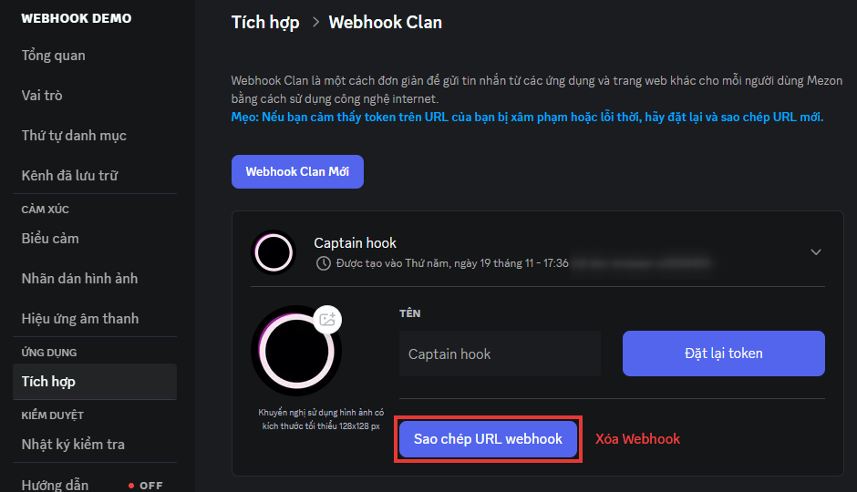

import Tabs from "@theme/Tabs";
import TabItem from "@theme/TabItem";

# Clan webhook

Clan webhook gửi thông báo lưu bền vững trực tiếp vào mục **Inbox → Messages** của một thành viên trong clan, kèm tên clan cùng tên và ảnh đại diện của webhook. Bạn chỉ định người nhận động ngay ở phần cuối URL.

<ApiBadge method="POST" path="https://webhook.mezon.ai/clanwebhooks/YOUR_WEBHOOK_TOKEN/USERNAME_OR_USER_ID" />

## Quyền hạn

| Thao tác | Quyền clan bắt buộc (`api_clan_webhook.go`) |
|---|---|
| Tạo clan webhook (`GenerateClanWebhook`) | **Manage Channel** |
| Sửa, đặt lại token hoặc xóa (`UpdateClanWebhookById`, `DeleteClanWebhookById`) | **Manage Clan** |

## Tạo Clan Webhook

1. Bấm vào tên clan ở đầu danh sách kênh và chọn **Clan Settings**.

   

2. Mở mục **Integrations** và bấm **Create Clan Webhook** (hoặc **View Clan Webhook** nếu đã có clan webhook).

   

3. Bấm **New Clan Webhook**, mở mục vừa tạo rồi bấm **Copy Webhook URL**.

   

Bảo mật URL này cẩn thận. Nếu bị lộ, bấm **Reset Token** (cần quyền **Manage Clan**) để vô hiệu hóa ngay token cũ.

## Gửi tin nhắn

Nối **username** hoặc **user ID** (snowflake) của thành viên nhận vào cuối URL đã sao chép, rồi gửi `HTTP POST` với header `Content-Type: application/json`:

```text
https://webhook.mezon.ai/clanwebhooks/YOUR_WEBHOOK_TOKEN/USERNAME_OR_USER_ID
```

Người nhận bắt buộc phải đang là thành viên của clan (`CheckUserInClan`).

### Cấu trúc body

```json
{
  "content": "{\"t\":\"Báo cáo tuần của bạn đã sẵn sàng.\",\"mk\":[{\"type\":\"b\",\"s\":0,\"e\":12}]}",
  "attachments": [
    { "url": "https://example.com/report.png", "filetype": "image/png" }
  ]
}
```

| Trường | Kiểu | Bắt buộc | Mô tả |
|---|---|---|---|
| `content` | string | Có | **Chuỗi JSON đã tuần tự hóa** (không phải object JSON) có dạng `{ "t": "...", "mk": [...] }`. Dùng `JSON.stringify` / `json.dumps` / `json.Marshal` / `JsonSerializer.Serialize`. |
| `attachments` | array | Không | Mảng `{ "url", "filetype" }`. Mọi `url` đều được kiểm tra (`ValidateURL` yêu cầu đủ scheme và host). Mezon hiển thị tệp **đầu tiên** (`AttachmentLink` / `AttachmentType`) và đặt cờ `HasMoreAttachment = true` khi có nhiều hơn một tệp (`api_clan_webhook.go`). |

### Ví dụ mã nguồn

Đặt `CLAN_WEBHOOK_URL="https://webhook.mezon.ai/clanwebhooks/YOUR_WEBHOOK_TOKEN/USERNAME_OR_USER_ID"` trong biến môi trường.

<Tabs groupId="code">
<TabItem value="bash" label="curl" default>

```bash
curl -X POST "$CLAN_WEBHOOK_URL" \
  -H "Content-Type: application/json" \
  -d '{"content":"{\"t\":\"Báo cáo tuần của bạn đã sẵn sàng.\"}","attachments":[{"url":"https://example.com/report.png","filetype":"image/png"}]}'
```

</TabItem>
<TabItem value="js" label="JavaScript">

```js
const body = {
  content: JSON.stringify({ t: "Báo cáo tuần của bạn đã sẵn sàng." }),
  attachments: [{ url: "https://example.com/report.png", filetype: "image/png" }],
};

const res = await fetch(process.env.CLAN_WEBHOOK_URL, {
  method: "POST",
  headers: { "Content-Type": "application/json" },
  body: JSON.stringify(body),
});
console.log(res.status, await res.text());
```

</TabItem>
<TabItem value="python" label="Python">

```python
import json
import os
import urllib.request

body = {
    "content": json.dumps({"t": "Báo cáo tuần của bạn đã sẵn sàng."}),
    "attachments": [{"url": "https://example.com/report.png", "filetype": "image/png"}],
}

req = urllib.request.Request(
    os.environ["CLAN_WEBHOOK_URL"],
    data=json.dumps(body).encode("utf-8"),
    headers={"Content-Type": "application/json"},
    method="POST",
)
with urllib.request.urlopen(req) as res:
    print(res.status, res.read().decode())
```

</TabItem>
<TabItem value="go" label="Go">

```go
package main

import (
	"bytes"
	"encoding/json"
	"fmt"
	"io"
	"net/http"
	"os"
)

func main() {
	inner, _ := json.Marshal(map[string]any{"t": "Báo cáo tuần của bạn đã sẵn sàng."})
	body, _ := json.Marshal(map[string]any{
		"content": string(inner),
		"attachments": []map[string]string{
			{"url": "https://example.com/report.png", "filetype": "image/png"},
		},
	})

	resp, err := http.Post(os.Getenv("CLAN_WEBHOOK_URL"), "application/json", bytes.NewReader(body))
	if err != nil {
		panic(err)
	}
	defer resp.Body.Close()
	text, _ := io.ReadAll(resp.Body)
	fmt.Println(resp.StatusCode, string(text))
}
```

</TabItem>
<TabItem value="csharp" label="C#">

```csharp
using System.Net.Http.Json;
using System.Text.Json;

var body = new
{
    content = JsonSerializer.Serialize(new { t = "Báo cáo tuần của bạn đã sẵn sàng." }),
    attachments = new[] { new { url = "https://example.com/report.png", filetype = "image/png" } },
};

using var http = new HttpClient();
var response = await http.PostAsJsonAsync(Environment.GetEnvironmentVariable("CLAN_WEBHOOK_URL"), body);
Console.WriteLine($"{(int)response.StatusCode} {await response.Content.ReadAsStringAsync()}");
```

</TabItem>
</Tabs>

Thành viên nhận sẽ thấy tin nhắn trong **Inbox → Messages**:


## Mã phản hồi lỗi

| Mã HTTP | Nội dung trả về | Nguyên nhân |
|---|---|---|
| `200` | *(rỗng)* | Đã gửi thông báo và cập nhật số đếm chưa đọc. |
| `400` | `Invalid JSON` | Body không phải JSON hợp lệ. |
| `400` | `invalid token` | Token sai, đã xóa hoặc đã bấm Reset Token. |
| `400` | `User not in clan` | User ID / username không tồn tại hoặc không thuộc clan. |
| `400` | `Invalid attachment URL` | Một `url` trong `attachments` thiếu scheme hoặc host hợp lệ. |
| `404` | `Not Found` | URL thiếu phần `/{username_or_user_id}` ở cuối. |

## Liên quan

- [Tổng quan Webhooks](./overview.mdx)
- [Channel webhook](./channel-webhook.mdx)
