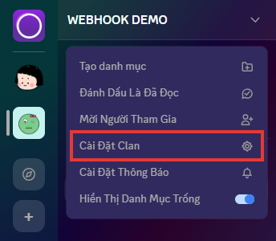
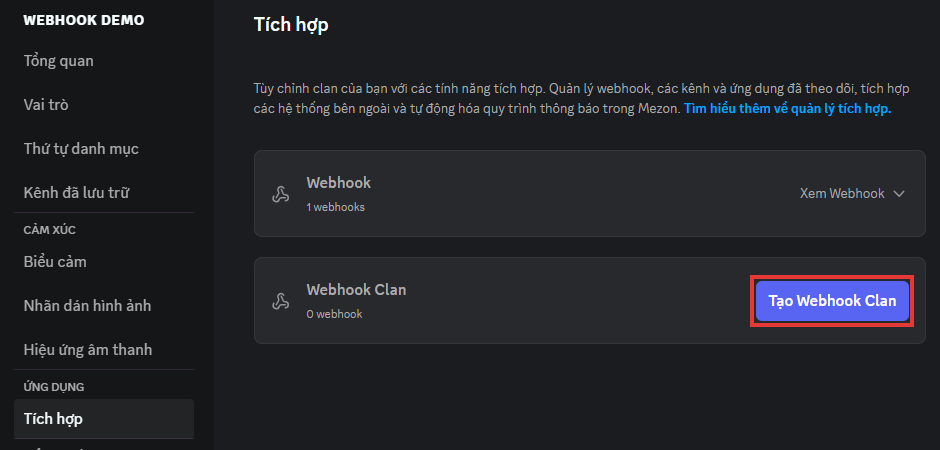
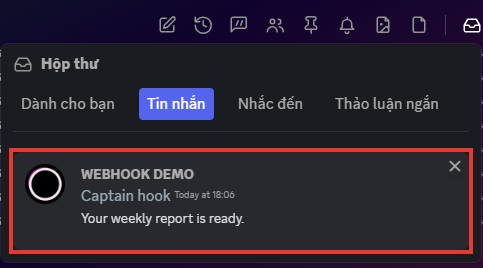

import Tabs from "@theme/Tabs";
import TabItem from "@theme/TabItem";

# Webhook clan

Webhook clan gửi tin nhắn tới một thành viên của clan. Bạn chọn thành viên trong URL. Tin nhắn đến **Hộp thư** của thành viên, ở thẻ **Tin nhắn**, kèm tên clan cùng tên và ảnh đại diện của webhook.

## Tạo webhook clan {#create-a-clan-webhook}

Bạn cần quyền **Quản lý kênh** để tạo webhook clan, và quyền **Quản lý Clan** để sửa hoặc xóa webhook clan. Các bước dưới đây dùng ứng dụng web Mezon trên máy tính.

1. Nhấn vào tên clan ở đầu danh sách kênh.
2. Nhấn **Cài Đặt Clan**.

   

3. Nhấn **Tích hợp** trong menu cài đặt.
4. Cạnh **Webhook Clan**, nhấn **Tạo Webhook Clan**. Nếu clan đã có webhook clan, hãy nhấn **Xem Webhook Clan**.

   

5. Nhấn **Webhook Clan Mới**. Mezon tạo một webhook với tên và ảnh đại diện ngẫu nhiên.
6. Nhấn vào webhook để mở, rồi nhấn **Sao chép URL webhook**.

   

Hãy giữ bí mật URL này. Nếu URL bị lộ, hãy nhấn **Đặt lại token**: URL cũ sẽ ngừng hoạt động.

## Gửi tin nhắn {#send-a-message}

Thêm thành viên vào cuối URL đã sao chép, rồi gửi `POST` với header `Content-Type: application/json`:

```text
https://webhook.mezon.ai/clanwebhooks/TOKEN/USERNAME_OR_USER_ID
```

Phần cuối là tên người dùng hoặc ID người dùng của thành viên. Thành viên phải ở trong clan.

### Nội dung {#body}

```json
{
  "content": "{\"t\":\"Your weekly report is ready.\"}",
  "attachments": [{ "url": "https://example.com/report.png", "filetype": "image/png" }]
}
```

| Trường | Kiểu | Bắt buộc | Ý nghĩa |
|---|---|---|---|
| `content` | string | Có | Tin nhắn, dạng chuỗi JSON: `{"t": "text", "mk": [...]}`. `t` là văn bản; `mk` thêm định dạng, như trong [webhook kênh](./channel-webhook.mdx#body). |
| `attachments` | array | Không | Tệp cần hiện: `{ "url", "filetype" }`. Mezon chỉ hiện tệp đầu tiên. |

`content` là một chuỗi chứa JSON, không phải đối tượng JSON. Hãy tạo nó bằng `JSON.stringify` (hoặc hàm tương đương trong ngôn ngữ của bạn), như trong các ví dụ.

Mỗi `url` đính kèm phải là URL đầy đủ, có scheme và tên máy chủ.

### Ví dụ {#examples}

Đặt biến `CLAN_WEBHOOK_URL` bằng URL webhook clan của bạn, có tên người dùng hoặc ID người dùng của thành viên ở cuối.

<Tabs groupId="code">
<TabItem value="bash" label="curl" default>

```bash
curl -X POST "$CLAN_WEBHOOK_URL" \
  -H "Content-Type: application/json" \
  -d '{"content":"{\"t\":\"Your weekly report is ready.\"}"}'
```

</TabItem>
<TabItem value="js" label="JavaScript">

```js
const body = {
  content: JSON.stringify({ t: "Your weekly report is ready." }),
  attachments: [{ url: "https://example.com/report.png", filetype: "image/png" }],
};

fetch(process.env.CLAN_WEBHOOK_URL, {
  method: "POST",
  headers: { "Content-Type": "application/json" },
  body: JSON.stringify(body),
}).then(async (response) => console.log(response.status, await response.text()));
```

</TabItem>
<TabItem value="python" label="Python">

```python
import json
import os
import urllib.request

body = {
    "content": json.dumps({"t": "Your weekly report is ready."}),
    "attachments": [{"url": "https://example.com/report.png", "filetype": "image/png"}],
}

request = urllib.request.Request(
    os.environ["CLAN_WEBHOOK_URL"],
    data=json.dumps(body).encode(),
    headers={"Content-Type": "application/json"},
    method="POST",
)
with urllib.request.urlopen(request) as response:
    print(response.status, response.read().decode())
```

</TabItem>
</Tabs>

Thành viên thấy tin nhắn trong **Hộp thư** → **Tin nhắn**:



## Phản hồi {#responses}

| Mã | Nội dung | Nguyên nhân |
|---|---|---|
| `200` | (trống) | Đã gửi tin nhắn. |
| `400` | `Invalid JSON` | Nội dung không phải JSON. |
| `400` | `invalid token` | Token trong URL sai hoặc đã bị đặt lại. |
| `400` | `User not in clan` | Thành viên không ở trong clan, hoặc tên người dùng không tồn tại. |
| `400` | `Invalid attachment URL` | `url` đính kèm không phải URL đầy đủ. |
| `404` | `Not Found` | URL không có tên người dùng hay ID người dùng ở cuối. |

## Liên quan {#related}

- [Tổng quan về webhook](./overview.mdx)
- [Webhook kênh](./channel-webhook.mdx)
