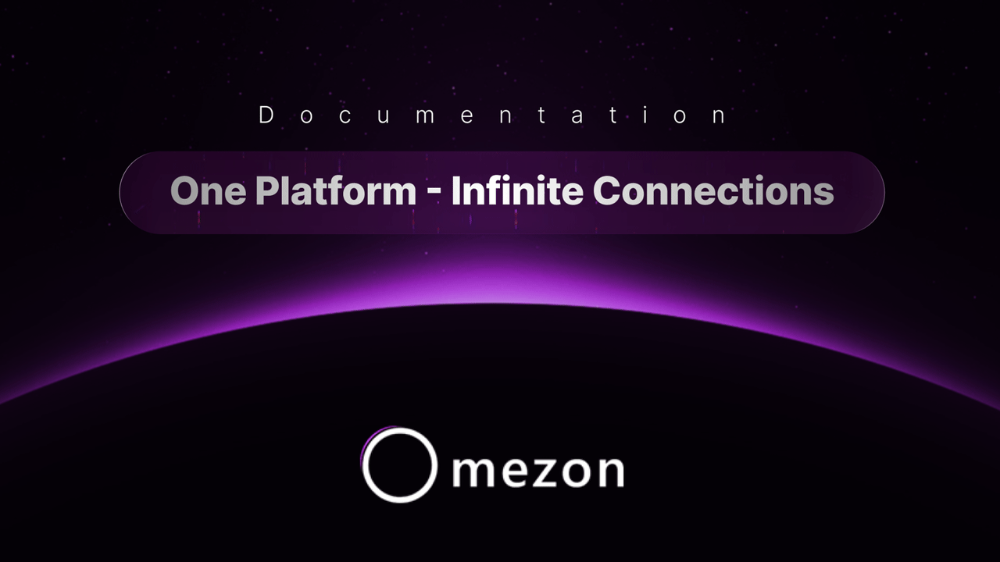

# Chào mừng đến với Mezon

**Mezon** là nền tảng kết nối, làm việc và giải trí. Bạn nhắn tin với từng người hoặc cả nhóm, họp trong kênh thoại, phát và xem trực tiếp trong kênh phát trực tiếp, và tổ chức đội nhóm hay cộng đồng trong các clan. Mezon chạy trên Android, iPhone, Windows, macOS, Linux và trình duyệt web.

## Mới dùng Mezon? Bắt đầu từ đây

<FeatureGrid columns={2}>
  <FeatureCard
    title="Bắt đầu nhanh"
    badge="Nên đọc trước"
    description="Cài Mezon trên điện thoại và máy tính, vào clan của nhóm bằng liên kết hoặc mã QR, nhắn tin, gọi thoại và mời người khác."
    to="/user/quick-start"
  />
  <FeatureCard
    title="Tính năng chính"
    badge="Tra cứu nhanh"
    description="Tổng hợp toàn bộ tính năng có trên Mezon theo từng chủ đề, nền tảng và gói Pro."
    to="/user/features-at-a-glance"
  />
</FeatureGrid>

## Hướng dẫn

<FeatureGrid columns={2}>
  <FeatureCard
    title="Tài khoản và cá nhân hóa"
    description="Tải Mezon, đăng nhập, làm quen giao diện, tùy chỉnh cài đặt và tìm hiểu gói User Pro, Clan Pro."
    to="/user/account-and-personalization"
  />
  <FeatureCard
    title="Bạn bè và nhắn tin"
    description="Kết bạn, nhắn tin trực tiếp, tạo nhóm chat, gọi thoại/video 1-1 và dùng chủ đề, thảo luận ngắn."
    to="/user/friends-and-messaging"
  />
  <FeatureCard
    title="Clan, kênh và Go Live"
    description="Tham gia hoặc tạo clan, quản lý vai trò và sự kiện, họp trong kênh thoại và phát hoặc xem trực tiếp."
    to="/user/clan"
  />
  <FeatureCard
    title="Bot và ứng dụng"
    description="Tìm và cài bot, ứng dụng trong kênh, thêm AI agent vào cuộc gọi thoại và bảo vệ an toàn cho clan."
    to="/user/bots-and-apps"
  />
  <FeatureCard
    title="Mezon Đồng"
    description="Chuyển Mezon Đồng, tặng cà phê, mở khóa vật phẩm, nâng cấp gói Pro và tra cứu giao dịch công khai."
    to="/user/mezon-dong"
  />
  <FeatureCard
    title="Tài nguyên và FAQ"
    description="Câu trả lời nhanh cho các thắc mắc thường gặp và danh sách các trang web chính thức của Mezon."
    to="/user/resources"
  />
</FeatureGrid>

## Dành cho nhà phát triển

Xây dựng bot, ứng dụng trong kênh, widget chat nhúng, client thoại SFU và tích hợp Webhook hoặc OAuth2.

Xem [Tài liệu dành cho nhà phát triển](../developer/intro.mdx).
